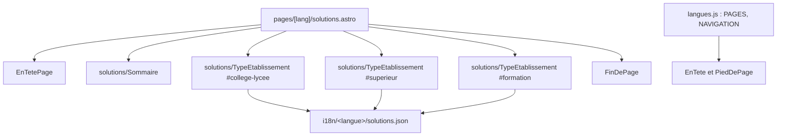

# VIT-05 (préparation) · Page « Solutions » du site vitrine · plan court

| | |
|---|---|
| Module | [VIT](../../plan/modules/VIT-site-vitrine.md) · préparation de VIT-05, dégelée sans tarifs par le chef le 18 nov. |
| Mission | `docs/plan/missions/vit-solutions.md` (branche `doc/coordination-equipe`) |
| Plan du site | `docs/conception/vitrine/vit-vitrine.md`, § 3 et § 3 bis (branche `doc/coordination-equipe`) |
| Branche | `feat/vit-05-solutions`, depuis `origin/main` (`f28eff4e`) |
| Rédigé par | Claude Code (Opus 5.5), le 18 novembre 2026 |
| **Validé** | **Validé par Claude20022002 le 18 novembre 2026** (« Validé », titres et points du § 4 compris) |

## 1. Objet et critère de « terminé »

Une page « Solutions » qui présente Planner par type d'établissement, et son lien dans l'en-tête. La page est terminée quand :

- elle existe en français et en anglais ; l'arabe est construit et affiche le français, comme les autres pages, en attendant UIX-04 ;
- le lien « Solutions » est dans l'en-tête et le pied de page, sur toutes les pages, dans les trois langues ;
- elle ne dit que ce qui existe ; le prévu est marqué « Bientôt », sans date, et vient du plan de parité (#193) ; aucun prix, aucun lien « Tarifs » ; rien n'est mis en ligne ;
- les contrôles du site passent : build, tests unitaires (traductions comprises), `node scripts/verifier-neutre.mjs`, Lighthouse au-dessus de 90 et axe-core sans violation sur la page, à 390, 768 et 1440 px, mouvement réduit respecté.

## 2. Ce qui existe

- Site Astro `vitrine/` (#195) : composants du socle (`Section`, `Titre`, `Accroche`, `Apparition`, `Gabarit`…) et des pages de fonctions (`EnTetePage`, `GrilleCartes`, `FinDePage`), textes dans `src/i18n/{fr,en,ar}/<page>.json`.
- L'en-tête et le pied de page lisent la liste `NAVIGATION` de `src/i18n/langues.js` ; l'adresse d'une page vient de `PAGES` dans le même fichier.
- Ce qui tourne aujourd'hui sert surtout le **supérieur** : le calcul d'un collège ou d'un lycée (MOT-06, MOT-07), l'affectation aux groupes de langue (VSC-07) et le vocabulaire « classe, matière » (UIX-02) sont à faire. La page le dit sans détour : pour le collège et le lycée, le calcul de l'emploi du temps est « Bientôt ».
- Le LMD n'existe pas encore : il n'apparaît que dans « Bientôt » (VSC-10).

## 3. Questions et réponses (chef, 18 nov.)

| N° | Question | Réponse du chef |
|---|---|---|
| 1 | Quels types d'établissement ? | **Trois** : collège et lycée ; enseignement supérieur (université, grande école, BTS) ; centre de formation professionnelle. Ni primaire ni maternelle (Q-07, Q-08 ouvertes), ni école de langues |
| 2 | Une page avec une section par type, ou une page par type ? | **Une page, trois sections**, une ancre par type et un sommaire en tête |
| 3 | Ce que la page met en avant pour chaque type | **La proposition telle quelle** (§ 4) |
| 4 | Le lien vient de `NAVIGATION` dans `langues.js`, hors du périmètre de la fiche : l'y ajouter ? | **Oui, en premier** : « Solutions » avant « Emploi du temps », dans l'en-tête et le pied de page. Périmètre étendu à `vitrine/src/i18n/langues.js` (clé `solutions` dans `PAGES` et `NAVIGATION`) |

## 4. Solution

Adresse : `/fr/solutions/`, `/en/solutions/`, `/ar/solutions/`. La page assemble :

1. **En-tête de page** (`EnTetePage`, réutilisé) : surtitre « Solutions », titre « Une école, ses règles. », accroche « Collège et lycée, enseignement supérieur, formation professionnelle : voici ce que Planner fait déjà pour chacun, et ce qui arrive. »
2. **Sommaire** : trois liens vers les ancres `#college-lycee`, `#superieur`, `#formation`.
3. **Une section par type**, dans l'ordre de la cible du plan (écoles privées d'abord), tons clair, gris, clair. Chaque section a un titre, un court texte, une liste **« Aujourd'hui »** (chaque point renvoie à la page de fonction qui le détaille) et une liste **« Bientôt »** dont chaque point porte le badge.
4. **Fin de page** (`FinDePage`, réutilisé) : l'invitation à voir Planner sur une école fictive.

Textes en français (l'anglais suit le même sens) :

| Section | Aujourd'hui | Bientôt (plan de parité, sans date) |
|---|---|---|
| **Collège et lycée** · « Toute la classe, en un geste. » | appel par QR code, rattaché à la séance (En classe) ; quiz en direct et jeux (En classe) ; salles, examens et surveillances, statistiques (Pour l'établissement) ; reports de séance suivis, les élèves prévenus (Emploi du temps) | emploi du temps calculé avec les groupes de langue et d'option ; un compte pour les familles ; absences, notes et bulletins ; export Massar ; Planner en arabe |
| **Enseignement supérieur** (université, grande école, BTS) · « Filières, groupes et campus, calculés ensemble. » | emploi du temps calculé : filières, cours, TD et TP qui suivent leurs groupes et sous-groupes, chaque refus expliqué (Emploi du temps) ; plusieurs campus, trajet compté dans le calcul (Pour l'établissement) ; examens : sessions, salles, surveillances (Pour l'établissement) ; appel par QR code, quiz en direct, jeux (En classe) | notes et bulletins avec les crédits du LMD ; stages et anciens élèves |
| **Formation professionnelle** · « Des sessions qui changent, un planning qui suit. » | emploi du temps calculé, gardé en versions, publié quand vous le décidez (Emploi du temps) ; reports suivis, export PDF et abonnement d'agenda (Emploi du temps) ; import des données depuis un fichier CSV (Pour l'établissement) | admissions ; documents vérifiables ; stages |

Rien n'y nomme une école, un client, un prix, la loi 09-08 ou une certification. Aucun visuel nouveau : les captures viendront avec les vidéos (§ 3 bis du plan du site).

## 5. Fichiers créés ou modifiés

| Fichier | Créé / modifié | Rôle | Taille visée |
|---|---|---|---|
| `vitrine/src/pages/[lang]/solutions.astro` | créé | assemble la page | 50 lignes |
| `vitrine/src/components/solutions/Sommaire.astro` | créé | liens vers les trois sections | 60 |
| `vitrine/src/components/solutions/TypeEtablissement.astro` | créé | une section : titre, texte, « Aujourd'hui » avec liens, « Bientôt » avec badge | 150 |
| `vitrine/src/i18n/{fr,en,ar}/solutions.json` | créés | textes ; l'arabe a les mêmes clés, vides | 80 chacun |
| `vitrine/src/i18n/{fr,en,ar}/commun.json` | modifiés | clé `navigation.solutions` | + 1 ligne |
| `vitrine/src/i18n/langues.js` | modifié (accordé, Q4) | `solutions` dans `PAGES` et en tête de `NAVIGATION` | + 2 lignes |
| `vitrine/src/components/solutions/types.js` | créé (ajouté au codage) | ordre des types, ancres, tons, page liée à chaque point « Aujourd'hui » | 10 |
| `vitrine/src/components/socle/EnTete.astro` | **non modifié** (chef, 18 nov.) : la barre demande 1 209 px en français pour tenir sur une ligne ; resserrer l'espacement ne gagnait que 70 px. Les libellés restent sur deux lignes entre 1024 et 1209 px, comme avant le lien | — | — |
| `vitrine/tests/solutions.test.js` | créé | voir § 8 | 60 |
| `docs/plan/modules/VIT-site-vitrine.md` | modifié | « Ce qui existe » | |

Les composants `EnTetePage`, `FinDePage` et ceux du socle sont réutilisés sans changement.

## 6. Données et migration

Aucune : site statique, aucune donnée d'utilisateur, aucun cookie.

## 7. Sécurité et exigences

EP-2 (sobre), EP-11 (contraste AA ; l'arabe en droite à gauche par les propriétés logiques), EP-13 (rien chargé d'un autre site), EP-16 (aucun texte en dur : tout passe par `solutions.json`).

## 8. Tests

- `tests/traductions.test.js` couvre déjà `solutions.json` : mêmes clés dans les trois langues.
- `tests/solutions.test.js` :
  - `chemin('fr', 'solutions')` vaut `/fr/solutions/`, et « solutions » est le premier lien de `NAVIGATION` ;
  - chacun des trois types a au moins un point « Aujourd'hui » et un point « Bientôt », dans chaque langue publiée ;
  - chaque lien « Aujourd'hui » vise une page qui existe dans `PAGES` ;
  - aucun texte de la page ne contient de montant ni de mot de prix (`MAD`, `DH`, `€`, `prix`, `price`, `tarif`).
- Puis build, `node scripts/verifier-neutre.mjs`, Lighthouse et axe-core sur `/fr/solutions/` et `/en/solutions/` à 390, 768 et 1440 px, et mouvement réduit.

## 9. Étapes

1. Ce plan, commité seul, validé par le chef.
2. Textes (`solutions.json` en trois langues, `commun.json`), `langues.js`, tests.
3. Composants et page ; en-tête vérifié à 1024 px.
4. Vérifications du § 8, fichier du module, fiche de session ; tout commité, rien poussé.
