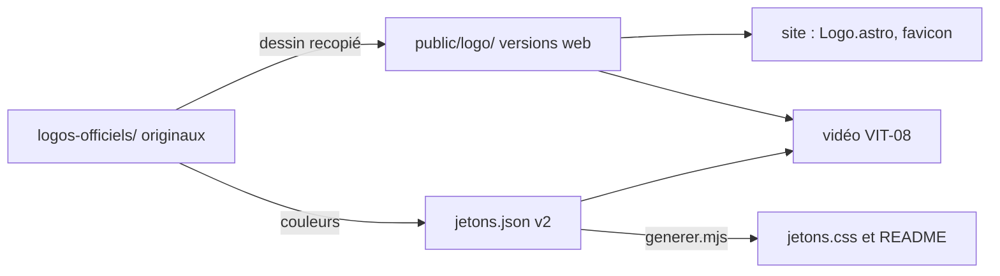

# VIT-06 · condition 3 : logos officiels et charte (plan court)

| | |
|---|---|
| Module | [VIT](../../plan/modules/VIT-site-vitrine.md) · condition 3 de la mise en ligne (VIT-06) |
| Branche | `chore/vit-06-logos-officiels`, depuis `origin/main` (`48d65fd8`), dossier `..\travaux-planner\vit-06-logos` |
| Rédigé par | Claude Code (Opus 5.5), le 2026-11-18, pendant la reprise de VIT-08 |
| **Validé** | par Claude20022002 le 2026-11-18 (réponses aux questions 1 à 4, ci-dessous) |

## 1. Objet et critère de « terminé »

Le chef a donné les SVG officiels le 18 nov. : `planner-variante-1-horloge.svg` et `planner-variante-4-icone-app.svg`. Ils remplacent les logos redessinés d'après photos (VIT-01), et leurs couleurs remplacent les valeurs provisoires de la charte (`shared/charte/jetons.json`, version 1).

Terminé quand :
- les originaux sont dans le dépôt, octet pour octet ;
- le site affiche les versions web, dont les aiguilles tournent comme avant ;
- la charte est en version 2, ses contrastes sont vérifiés et ses sorties sont régénérées ;
- plus aucune trace de l'ancien bleu n'est écrite en dur dans le site ;
- tests du site et de la charte, construction et `verifier-neutre` passent.

VIT-08 (rendu final de la vidéo) se fait ensuite, sur sa propre branche, après fusion locale de celle-ci.

## 2. Ce qui existe

- `vitrine/public/logo/planner-horloge.svg` et `planner-icone.svg` : dessins provisoires. `socle/Logo.astro` les insère dans la page ; `socle/animations.js` et la vidéo font tourner `.aiguille-minutes` et `.aiguille-heures` autour du centre de leur boîte (`transform-box: fill-box`). Un cercle invisible centré sur l'horloge règle ce centre.
- `vitrine/public/favicon.svg` : redessiné d'après photos.
- Les SVG officiels ne sont pas prêts pour le web :
  - pas de classes sur les aiguilles ;
  - l'icône n'occupe que 47 % de son cadre (tuile de 676 dans 1440) ;
  - mêmes identifiants dans les deux fichiers, insérés dans la même page ;
  - en-tête, commentaire et styles d'Illustrator ;
  - un `<title>`, qui afficherait une infobulle.
- L'ancien bleu écrit en dur : `Contact.astro`, `IllustrationAppel.astro`, `EnTete.astro`, les ombres de `jetons.json`. Le texte « valeurs provisoires » de `generer.mjs`. L'ancien `#1F65B3` dans `charte.test.js`.

## 3. Questions et réponses

| N° | Question | Réponse du chef (18 nov.) |
|---|---|---|
| 1 | Comment préparer les fichiers ? | **Version web, dessin intact** : mêmes tracés et mêmes couleurs ; cadrage resserré sur le dessin (icône carrée) ; classes des aiguilles ajoutées (heures : l'aiguille verticale, la plus courte) ; en-tête d'Illustrator, styles et identifiants retirés ou convertis ; originaux gardés tels quels à côté |
| 2 | Quelles couleurs pour la charte ? | **Les trois du logo et le survol** : `bleu-nuit` #17395C, `bleu` #2A679F, `bleu-clair` #A6CAEE, `bleu-profond` #21507C. #8FB4DE reste propre à l'icône. Les autres jetons ne changent pas. Version 2 |
| 3 | Où faire le changement ? | **Branche à part**, `chore/vit-06-logos-officiels`, fusionnée en local dans VIT-08 pour le rendu |
| 4 | Le favicon ? | **Refait depuis l'icône officielle**, dans le même changement |

## 4. Solution

- **Originaux** dans `shared/charte/logos-officiels/`, sous leurs noms, sans aucune retouche.
- **Versions web**, mêmes noms qu'aujourd'hui dans `vitrine/public/logo/` :
  - tracés, couleurs et opacités recopiés à l'identique ; attributs au lieu des classes `st0` à `st3` ;
  - `viewBox` resserré sur le dessin : l'horloge sans la marge vide ; l'icône en carré autour de sa tuile ;
  - chaque aiguille dans `<g class="aiguille aiguille-heures">` ou `aiguille-minutes`, avec un cercle invisible centré sur l'axe de l'horloge, comme avant ;
  - sans identifiants, `<title>`, `role` ni `aria-label` : `Logo.astro` marque déjà le logo comme décoratif ;
  - un commentaire de rôle en tête, que `Logo.astro` et la vidéo retirent.
- **Favicon** : le dessin de l'icône web, au même cadrage.
- **Charte** : les quatre valeurs ci-dessus, `version: 2`, note et texte du générateur mis à jour. Les ombres passent de `rgb(11 59 111)` à `rgb(23 57 92)`, le nouveau bleu nuit. Puis `node shared/charte/generer.mjs`, qui refuse toute paire sous son seuil.
- **Valeurs en dur du site** : remplacées par les nouvelles. `#0B3B6F` devient #17395C ; `rgb(11 59 111)` devient `rgb(23 57 92)` ; `rgb(168 200 234)` devient `rgb(166 202 238)`.

## 5. Fichiers créés ou modifiés

| Fichier | Action |
|---|---|
| `shared/charte/logos-officiels/planner-variante-1-horloge.svg`, `planner-variante-4-icone-app.svg` | créés (originaux) |
| `vitrine/public/logo/planner-horloge.svg`, `planner-icone.svg`, `vitrine/public/favicon.svg` | remplacés |
| `shared/charte/jetons.json`, `generer.mjs`, `charte.test.js` ; `shared/charte/README.md`, `vitrine/src/styles/jetons.css` (générés) | modifiés |
| `vitrine/src/components/accueil/Contact.astro`, `IllustrationAppel.astro`, `socle/EnTete.astro` | valeurs en dur |
| `docs/plan/modules/VIT-site-vitrine.md`, fiche de session | modifiés, créée |

## 6. Vérifications

- `node --test shared/charte/` et `generer.mjs --verifier` ;
- tests du site, construction, `verifier-neutre` ;
- dans un navigateur : centre de chaque aiguille sur l'axe de l'horloge, mesuré ; captures de l'en-tête, du Contact et du favicon.
