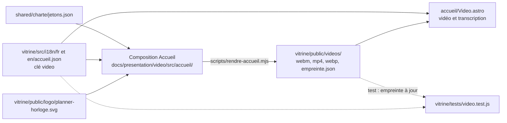

# VIT-08 · Vidéo de présentation globale de Planner, sur l'accueil du site · plan court

| | |
|---|---|
| Module | [VIT](../../plan/modules/VIT-site-vitrine.md) et [MKT](../../plan/modules/MKT-marketing.md) · préparation de VIT-05 ; **condition 6** de la mise en ligne (VIT-06) |
| Mission | `docs/plan/missions/vit-08-video-presentation.md` (branche `doc/coordination-equipe`) |
| Décision d'origine | chef, 18 nov. : motion design aux couleurs du site, sans captures, sous-titres en français et en anglais, sans voix ni musique |
| Branche | `feat/vit-08-video-presentation`, depuis `origin/main` (`5f053ebf`, UIX-10a fusionnée) |
| Rédigé par | Claude Code (Opus 5.5), le 18 novembre 2026 |
| **Validé** | en attente (le chef : le message et l'ordre des scènes sont un choix de produit) |

## 1. Objet et critère de « terminé »

Une vidéo d'environ 86 secondes qui présente **tout Planner** : l'emploi du temps calculé, l'appel, le Studio quiz et les jeux, l'espace de cours, les annonces et la bibliothèque, l'établissement, la sécurité, l'application mobile. Elle est placée sur l'accueil du site. C'est la vidéo d'ensemble ; les vidéos par module, avec des captures, viendront après UIX-10b.

La fonction est terminée quand :

- la composition `Accueil` existe dans `docs/presentation/video/`, sans rien changer aux 27 scènes ni aux six compositions existantes ;
- ses textes sont **ceux de `accueil.json`**, en français et en anglais : la vidéo et sa transcription ne peuvent pas diverger ;
- chaque affirmation cite sa source dans le code (§ 4) ; rien de « Bientôt » n'apparaît dans la vidéo ;
- les fichiers rendus respectent les poids du § 5 ;
- l'accueil respecte les règles d'intégration du § 6 dans les trois langues ; l'arabe montre la vidéo française, comme les textes, en attendant UIX-04 ;
- les contrôles du site passent :
  - build, tests unitaires (traductions comprises), `node scripts/verifier-neutre.mjs` ;
  - Lighthouse au-dessus de 90 sur l'accueil, à 390 et à 1440 px ;
  - axe-core sans violation ;
  - mouvement réduit respecté ;
  - aucune requête vers un autre site.

## 2. Ce qui existe

- **Le projet Remotion** `docs/presentation/video/` (Remotion 4.0.533, React 19) contient six compositions et 27 scènes : `HestimPlanner`, `Matinee`, `Direction`, `Keynote`, les versions verticales et le carrousel. Elles sont faites pour la présentation d'octobre, et ne conviennent pas ici :
  - les écrans sont de **vraies captures** (`../captures/`), alors que le chef n'en veut pas ;
  - l'ancienne charte : fond noir, Barlow (`src/theme.ts`) ;
  - de la musique ;
  - un nom d'école dans les compositions.

  On garde le projet, ses outils (`Sequence`, ressorts, `components/Camera.tsx`) et sa configuration de rendu. On ne reprend aucune scène telle quelle.
- **La charte** (UIX-10a, #207) : `shared/charte/jetons.json`, version 1. Les couleurs sont **provisoires** : elles seront remplacées par celles des SVG officiels du chef (condition 3 de VIT-06).
- **Le style des illustrations du site**, que la vidéo reprend :
  - `vitrine/src/components/socle/CadreAppareil.astro` : des cadres d'ordinateur et de téléphone propres à Planner ;
  - `accueil/IllustrationSemaine.astro`, `IllustrationAppel.astro`, `IllustrationQuiz.astro` : des écrans dessinés en HTML ;
  - le logo à l'horloge, dont les aiguilles tournent (`socle/Logo.astro`, `public/logo/planner-horloge.svg`) ;
  - l'apparition au défilement (`socle/animations.js`, courbe `cubic-bezier(0.22, 1, 0.36, 1)`).
- **L'accueil** (`vitrine/src/pages/[lang]/index.astro`) assemble huit sections. VIT-07 (agent de Cursor) ne touche ni à `index.astro` ni à `accueil.json` (sa fiche, « Périmètre d'écriture »).
- **Le dépôt suit déjà des fichiers lourds** : des captures vidéo dans `docs/presentation/captures/video/` et la musique dans `docs/presentation/video/public/audio/`. Le `.git` local pèse 155 Mo.

## 3. Questions et réponses

| N° | Question | Proposition | Réponse du chef | Bloque |
|---|---|---|---|---|
| 1 | Le message et l'ordre des neuf scènes du § 4, avec leurs textes | **Tels quels** | | oui |
| 2 | Où placer la vidéo sur l'accueil ? | **Juste après l'ouverture** (section 2), avec le surtitre « Présentation » et le titre « Tout Planner, en une minute et demie. » / « All of Planner, in ninety seconds. » | | oui |
| 3 | Comment se lance la lecture ? | **Seule, sans le son, une fois**, quand la moitié de la vidéo est visible. Elle se met en pause hors de l'écran. Un bouton Pause et Lecture reste visible. Avec le mouvement réduit ou l'économie de données : l'image fixe et un bouton « Lire la vidéo », rien ne part seul | | oui |
| 4 | Les fichiers rendus (environ 25 Mo pour deux langues) vont-ils dans le dépôt ? | **Oui, dans `vitrine/public/videos/`, rendus une seule fois**, après l'arrivée des SVG officiels (condition 3). D'ici là, des aperçus rendus en local, hors du dépôt, pour la relecture (§ 5) | | oui, pour l'étape 5 |
| 5 | Que dit la dernière image ? | **Le logo, « Planner » et « Parlons de votre établissement. »**, le titre de la section Contact. Ni adresse ni magasin d'applications : le domaine n'est pas choisi (Q-11) et l'application n'est pas sur les magasins | | non |
| 6 | Sur la page arabe, quelle vidéo ? | **La française**, comme les textes, jusqu'à UIX-04 ; la version arabe se rendra alors avec la même composition | | non |

Les quatre options de la question 4, pour que le chef tranche :

| Option | Pour | Contre |
|---|---|---|
| **A. Dans le dépôt** (proposée) | rien à changer à la CI ni au déploiement ; le site se construit seul ; il y a déjà un précédent | environ 25 Mo par rendu, ajoutés pour toujours à l'historique d'un dépôt public ; on rend donc une seule fois |
| B. Git LFS | l'historique reste léger | le quota gratuit de GitHub est de 1 Go de stockage et 1 Go de téléchargement par mois ; chaque construction de la CI télécharge les vidéos ; un outil de plus pour chaque agent |
| C. Une release GitHub, téléchargée au déploiement | dépôt léger | une étape de plus dans VIT-06 ; la CI construit un accueil sans sa vidéo ; il faut prouver que les fichiers téléchargés sont bien les bons |
| D. Rendu par la CI | aucun fichier rendu dans le dépôt | Chrome et Remotion dans la CI, plusieurs minutes de rendu par construction ; le site dépend alors du projet vidéo |

## 4. Les scènes

**Le style.**

- **Fonds** : blanc et `gris-fond`, comme le site ; les scènes de l'appel et de la sécurité sont sur `bleu-nuit`, comme la section sombre de l'accueil.
- **Écrans** : dessinés dans les cadres d'appareils du site, avec `ecran`, `ombre-appareil`, `rayon-grand`.
- **Accent** : `jeu` (#FFC83D), pour le quiz et les jeux seulement, comme le veut la charte.
- **Police** : Inter, seule famille. On utilise `@remotion/google-fonts/Inter`, un module du paquet déjà installé. La police est chargée au rendu seulement ; le site, lui, ne charge rien d'ailleurs.
- **Mouvement** : chaque entrée suit la courbe du site, avec une durée lente. Ni rebond, ni flou, ni rotation de caméra.

**Les textes.**

- Pas de voix : un titre et au plus deux lignes par scène. Chaque ligne fait 12 mots au plus et reste 3 secondes à l'écran.
- Les noms des illustrations sont fictifs, comme sur le site (Amphi A, Salle B12, TD Physique).

| # | Temps | Image | Français | Anglais | Source dans le code |
|---|---|---|---|---|---|
| 1 | 0:00 – 0:06 | Fond blanc. Le logo à l'horloge, ses aiguilles tournent puis s'arrêtent ; le nom apparaît dessous | **Planner** · Sept applications pour votre école. Un seul compte. | **Planner** · Seven apps for your school. One account. | `frontend/src/i18n/applications.fr.js` (sept applications : Emploi du temps, Enseignements, Personnes, Établissement, Annonces, Quiz et jeux, Bibliothèque) ; `shared/contrat-jeton-sso.json` (le même compte ouvre la bibliothèque) |
| 2 | 0:06 – 0:18 | Cadre d'ordinateur. La semaine se remplit case par case ; puis l'avis « Séance non placée » glisse en bas à droite, comme dans `IllustrationSemaine` | **Votre semestre, calculé.** · Salles, enseignants, groupes, campus : vos règles, tenues ensemble. · Une séance ne trouve pas sa place ? Planner dit quelle règle la bloque. | **Your semester, worked out.** · Rooms, teachers, groups, campuses: all your rules, held together. · A session can't be placed? Planner tells you which rule is in the way. | `solver/…/ContraintesEmploiDuTemps.java` (règles strictes), `PreferencesEmploiDuTemps.java` (règles souples), `TrajetEntreCampusTest.java` ; `solver/…/rest/AnalyseDesRegles.java` (la règle qui bloque) |
| 3 | 0:18 – 0:27 | Cadre de téléphone. Une séance glisse du mardi au jeudi ; une notification descend ; quatre étapes s'allument : Demande, Validation, Prévenus, Publié | **Un cours déplacé ? Les étudiants sont prévenus.** · L'enseignant demande, la scolarité valide, l'emploi du temps se met à jour. | **A class moved? Students are notified.** · The teacher asks, the school office approves, the timetable updates. | `backend/controllers/demandeReportController.js` ; `backend/services/planning/reportDecision.js` ; `backend/services/planning/seances.js`, l. 195 (`notifierChangementSeance`) |
| 4 | 0:27 – 0:36 | Fond bleu nuit. Un écran projeté montre un QR code qui se redessine ; un téléphone le scanne ; le compteur passe à « 28 présents sur 32 » | **L'appel en un geste.** · Le QR code change toutes les 30 secondes. | **Attendance in one gesture.** · The QR code changes every 30 seconds. | `backend/services/presences/appel.js`, l. 10 à 13 |
| 5 | 0:36 – 0:46 | Accent `jeu`. Dix pastilles, une par type de question, s'alignent ; puis un téléphone montre une question, son minuteur et quatre réponses ; un podium monte | **Des quiz en direct, ou à son rythme.** · Dix types de questions. En direct, les points comptent la justesse et la rapidité. | **Live quizzes, or at your own pace.** · Ten question types. Live, points reward accuracy and speed. | `shared/quiz/studio/types.js`, l. 31 à 42 (dix types) ; `shared/quiz/studio/direct.js`, l. 11 à 13 (les points) ; `backend/models/studio.js`, l. 76 à 83 (passation ouverte par code) |
| 6 | 0:46 – 0:56 | Accent `jeu`. Des cartes de jeux se rangent ; puis le terminal au tableau, et un téléphone qui répond | **Réviser en jouant.** · Dix simulations et un terminal Linux. · Le terminal se joue aussi au tableau, avec toute la classe. | **Learn by playing.** · Ten simulations and a Linux terminal. · The terminal can also be played on the board, with the whole class. | `shared/simulations/catalogue.js`, l. 17 (dix simulations) ; `shared/jeux/catalogue.js`, l. 12 à 24 (terminal, modes individuel et collectif) ; `mobile/src/app/jeu-direct/[id].jsx` |
| 7 | 0:56 – 1:06 | Cadre d'ordinateur. L'espace d'une classe, avec ses sections « Général », « Semaine 1 » et « TP » ; un sondage et ses barres ; une annonce ; puis la bibliothèque qui s'ouvre | **Chaque classe a son espace.** · Supports par section, sondages, annonces de l'école. · La bibliothèque s'ouvre avec le même compte. | **Every class has its own space.** · Materials by section, polls, school announcements. · The library opens with the same account. | `backend/models/SectionCours.js`, `SupportCours.js`, `Sondage.js`, `Annonce.js` ; `shared/sondages.js` ; `shared/contrat-jeton-sso.json` |
| 8 | 1:06 – 1:17 | Deux campus reliés par un trajet, des salles et une session d'examen ; puis, sur bleu nuit, un bouclier et un code à six chiffres | **Toute l'école, d'un seul regard.** · Salles, examens et surveillances, sur plusieurs campus. · Double authentification, accès par rôle. Quand l'école active l'IA, celle-ci ne reçoit aucune donnée d'élève. | **The whole school at a glance.** · Rooms, exams and invigilation, across several campuses. · Two-step sign-in, role-based access. When the school turns on AI, it never receives student data. | `backend/models/Salle.js`, `SessionExamen.js`, `Surveillance.js`, `Campus.js`, `TrajetCampus.js` ; `backend/services/mfa.js` ; `backend/middleware/roleMiddleware.js` ; `backend/services/ia/consigne.js`, l. 1 à 8 (seuls le support ou le sujet partent vers le modèle) |
| 9 | 1:17 – 1:26 | Cadre de téléphone. Les onglets Semaine, Scan, Jeux et Bibliothèque défilent ; puis fond blanc, le logo, le nom et la phrase de fin | **Aussi sur le téléphone.** · La semaine, le scanner de l'appel, les jeux, la bibliothèque. · **Planner** · Parlons de votre établissement. | **On the phone, too.** · The week, the attendance scanner, games, the library. · **Planner** · Let's talk about your school. | `mobile/src/app/(onglets)/semaine.jsx`, `scan.jsx`, `jeux.jsx`, `bibliotheque.jsx` |

Les textes 2, 4, 8 et 9 reprennent ceux du site, déjà relus : `accueil.json`, `emploi.titre`, `appel.titre`, `donnees`, `contact.titre`.

On ne montre ni chiffre de performance ni « Bientôt ». La vidéo sera rendue rarement : un « Bientôt » y resterait après sa sortie.

## 5. Outil, rendu et poids

**La composition.**

- Elle s'appelle `Accueil` et vit dans le projet existant, dans un dossier à part : `docs/presentation/video/src/accueil/`.
- Elle prend la langue en paramètre (`fr`, `en`, et plus tard `ar`).
- Elle n'importe ni `theme.ts` ni les scènes existantes.
- Elle lit :
  - les jetons dans `shared/charte/jetons.json` ;
  - les textes dans `vitrine/src/i18n/<langue>/accueil.json`, sous la clé `video` ;
  - le logo dans `vitrine/public/logo/planner-horloge.svg`, copié par le script de rendu.

**Le rendu.** Un script, `scripts/rendre-accueil.mjs`, produit pour chaque langue :

| Fichier | Format | Poids visé |
|---|---|---|
| `planner-<langue>-720.webm` | 1280 × 720, VP9, 30 i/s | **≤ 4 Mo** (le fichier lu par défaut) |
| `planner-<langue>-1080.webm` | 1920 × 1080, VP9 | ≤ 8 Mo (seulement sur un écran de 1280 px ou plus) |
| `planner-<langue>-720.mp4` | 1280 × 720, H.264 | ≤ 6 Mo (pour un navigateur sans VP9) |
| `planner-<langue>.webp` | image fixe d'attente, 1280 × 720 | ≤ 60 Ko |

Il écrit aussi `vitrine/public/videos/empreinte.json` : l'empreinte des textes `video`, la version des jetons et l'empreinte du logo. Un test du site échoue si les textes, la charte ou le logo ont changé depuis le dernier rendu. Ainsi, une vidéo périmée ne part pas en ligne.

**Les poids.**

- Ce sont des estimations. Les aplats de couleur se compressent bien, et le rendu de l'étape 3 donnera les vrais poids.
- Pas de MP4 en 1080p : seul un navigateur sans VP9 le lirait, et le 720p lui suffit.
- Total pour deux langues : environ 25 Mo.
- La page ne charge **qu'un fichier**, et seulement quand on arrive à la section.

**L'image fixe** est une image de la scène 2, la semaine remplie avec l'avis. Le chef peut en choisir une autre à la relecture de l'aperçu.

## 6. Intégration sur l'accueil

Un composant `vitrine/src/components/accueil/Video.astro` et son petit script : une `<section>` avec un titre, la vidéo et sa transcription.

- **Rien n'est chargé avant que la section approche** : pas de `src`, `preload="none"`. L'image fixe est une ``. Un `IntersectionObserver` pose la source quand la section approche, en choisissant le fichier :
  - 1080p ou 720p, d'après la largeur de l'écran ;
  - WebM ou MP4, d'après `canPlayType`.
- **Sans le son** : `muted` et `playsinline`. La vidéo n'a pas de piste audio, puisqu'elle n'a ni voix ni musique.
- **Mouvement réduit**, économie de données (`navigator.connection.saveData`) ou JavaScript absent : seule l'image fixe s'affiche ; rien ne part seul.
- **Commandes** : un vrai `<button>` Pause / Lecture, visible, au clavier, avec son nom accessible et le contour du focus de la charte. À la fin, il devient « Revoir ». La règle WCAG 2.2.2 est tenue : ce qui bouge plus de 5 secondes peut s'arrêter.
- **Transcription** (WCAG 1.2.1) : sous la vidéo, une liste repliable « Lire le texte de la vidéo ». Elle reprend les mêmes textes `video` de `accueil.json`, scène par scène, avec une ligne qui décrit chaque image. Comme la vidéo n'a pas de son, la transcription tient lieu d'audiodescription.
- **La vidéo est cachée aux lecteurs d'écran** (`aria-hidden`), puisque la transcription dit tout. La section garde son titre.
- **Mise en page** : une place réservée en 16:9 (`aspect-ratio`), donc aucun décalage de mise en page. La vidéo prend toute la largeur du contenu, dans un cadre aux coins `rayon-grand`.
- **Rien ne vient d'ailleurs** : tout est servi depuis `vitrine/public/videos/`.
- **Lighthouse** : la section est sous l'ouverture. Elle n'entre donc ni dans le premier affichage (LCP) ni dans le temps de blocage. On le vérifie à 390 et 1440 px.

## 7. Fichiers créés ou modifiés

| Fichier | Créé / modifié | Rôle | Taille visée |
|---|---|---|---|
| `docs/presentation/video/src/accueil/Accueil.tsx` | créé | la composition : enchaîne les neuf scènes, lit la langue | 120 lignes |
| `docs/presentation/video/src/accueil/charte.ts` | créé | jetons de `jetons.json`, Inter, courbe et durées du site | 60 |
| `docs/presentation/video/src/accueil/elements/` | créé | cadres d'appareils, logo animé, texte animé, pastille | 80 à 150 chacun |
| `docs/presentation/video/src/accueil/scenes/A1…A9*.tsx` | créé | une scène par fichier | 200 au plus chacune |
| `docs/presentation/video/src/Root.tsx` | modifié | une ligne : la composition `Accueil` | + 3 |
| `docs/presentation/video/scripts/rendre-accueil.mjs` | créé | rendu des fichiers du § 5 et de l'empreinte | 120 |
| `docs/presentation/video/package.json`, `README.md` | modifiés | commande `render:accueil` ; une section « Accueil » | — |
| `docs/presentation/video/tsconfig.json` | modifié | `resolveJsonModule`, pour lire les jetons et les textes | + 1 |
| `vitrine/src/i18n/{fr,en,ar}/accueil.json` | modifiés | clé `video` : titre de section, scènes, descriptions, boutons | — |
| `vitrine/src/components/accueil/Video.astro` | créé | section, vidéo, bouton, transcription | 120 |
| `vitrine/src/components/accueil/video.js` | créé | chargement à l'approche, choix du fichier, pause hors écran, mouvement réduit | 80 |
| `vitrine/src/pages/[lang]/index.astro` | modifié | une ligne : la section après l'ouverture | + 2 |
| `vitrine/public/videos/*` | créés | les fichiers rendus et `empreinte.json` (si l'option A est retenue) | ≈ 25 Mo |
| `vitrine/tests/video.test.js` | créé | textes dans les deux langues, empreinte à jour, fichiers présents et sous leur poids | 80 |
| `docs/plan/modules/VIT-site-vitrine.md` | modifié | « Ce qui existe » : la vidéo de l'accueil | — |

Hors du périmètre : `docs/plan/suivi.md`, les pages de VIT-07, `vitrine/src/styles/`, le socle.

## 8. Données, sécurité et exigences

- **Aucune donnée réelle** : les noms sont fictifs, et aucun nom d'école n'apparaît. Les textes passent par `verifier-neutre.mjs`, puisqu'ils sont dans `vitrine/src`.
- **Aucune requête vers un autre site** : la police n'est chargée qu'au rendu, sur le poste.
- Ni migration, ni API, ni donnée de mineur.

## 9. Étapes de livraison

1. Ce plan, validé par le chef, commité seul.
2. La charte de la composition et les éléments : cadres, logo animé, texte animé. Un aperçu dans Remotion Studio.
3. Les neuf scènes. **Un aperçu rendu en 720p en français, hors du dépôt**, que le chef relit : rythme, textes, image fixe. On note les poids mesurés.
4. Les textes anglais, le script de rendu, l'empreinte.
5. L'intégration sur l'accueil, le test, les contrôles du site (§ 1).
6. Le rendu final, après les SVG officiels (question 4), commité seul ; puis le fichier du module et la fiche de session.

Les étapes 2 à 5 n'attendent pas les SVG : la composition lit les jetons, et un nouveau rendu suffira quand ils changeront.

## 10. Risques et retour arrière

- **Couleurs et logo provisoires** : un rendu fait trop tôt serait faux. L'empreinte le détecte, et la question 4 place le rendu final après les SVG.
- **Le poids dépasse la cible** : on augmente le CRF, et on raccourcit les mouvements de fond qui compressent mal (dégradés, grands fondus).
- **Un texte devient faux** quand une fonction change : on modifie `accueil.json`, l'empreinte fait échouer le test, et on refait le rendu.
- **Retour arrière** : la section se retire de `index.astro` en une ligne ; la composition n'a d'effet sur rien d'autre.

## 11. Hors périmètre

- Les vidéos par module, avec des captures, après UIX-10b.
- La version arabe, après UIX-04.
- La voix, la musique, les sous-titres en piste séparée (WebVTT) : les textes sont dans l'image.
- Les versions pour les réseaux sociaux (formats verticaux) : MKT, plus tard.
- La mise à jour des anciennes compositions.
