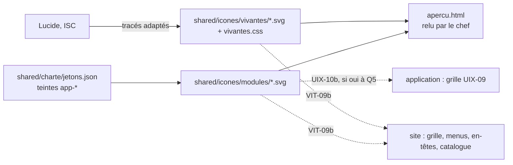

# VIT-09a · logos des modules et icônes vivantes (plan court)

| | |
|---|---|
| Module | [VIT](../../plan/modules/VIT-site-vitrine.md) · préparation de VIT-05 · condition 7 de VIT-06 (avec VIT-09b) |
| Mission | `docs/plan/missions/vit-09-illustrations.md` (branche `doc/coordination-equipe`), ligne du 18 nov. 21 h 20 |
| Branche | `feat/vit-09a-logos-icones`, depuis `origin/main` (`0c79c00d`), dossier `..\travaux-planner\vit-09a-logos` |
| Rédigé par | Claude Code (Opus 5.5), le 2026-11-18 |
| **Validé** | **par Claude20022002 le 2026-11-18** : propositions retenues aux questions 1, 2, 3 et 5 (outil de questions) ; question 4 : la proposition s'applique |

## 1. Objet et critère de « terminé »

Décision du chef (18 nov., 21 h 20, relayée par le coordinateur) : VIT-09 est découpée.
- **VIT-09a** fait la **bibliothèque** :
  - de vrais logos illustrés, un par module : multicolores, en léger volume, charte v2, SVG, lisibles de 24 à 96 px, en clair et en sombre ;
  - des **icônes vivantes** pour les boutons et les liens : animées au survol et au focus, immobiles si le visiteur demande moins de mouvement.
  - Inspiration : la grille « Nos modules » d'OpenEduCat et les icônes d'Apple. Rien n'est copié : aucun tracé, aucune forme reconnaissable.
- **VIT-09b**, en dernier sur le site, les pose sur les pages.

Terminé quand :
- les logos et les icônes sont dans une **source unique**, `shared/icones/`, sans qu'aucune page du site ni de l'application ne change ;
- une **planche d'aperçu** (`shared/icones/apercu.html`, ouverte en local) montre chaque logo à 24, 32, 48 et 96 px, sur fond clair et sur fond sombre, et chaque icône vivante au survol et au focus, avec et sans mouvement réduit. **Le chef la voit avant le commit des dessins** ;
- des tests vérifient chaque fichier : couleurs de la charte seulement, identifiants uniques, pas de script, contraste du tracé sur sa tuile, mouvement coupé sous `prefers-reduced-motion`.

## 2. Ce qui existe

- **Les sept applications** (`frontend/src/i18n/applications.fr.js`) : Emploi du temps (`planning`), Enseignements (`pedagogie`), Personnes, Établissement, Annonces, Quiz et jeux (`activites`), Bibliothèque.
- **La grille d'UIX-09** (`feat/uix-09-grille-applications`, PR #213) : une tuile par application avec un dégradé (`teintes.js`, sept teintes en `oklch`, **hors charte**) et une icône animée en React. Ces icônes sont adaptées de `lucide-animated` (licence MIT, fichier `LICENSE`) et animées par `motion`.
- **Le site** : icônes Lucide fixes (`lucide-react` 1.67.0). Celles des commandes :
  - le chevron des liens (`BoutonPrincipal`) ;
  - le menu (`EnTete`) ;
  - la flèche des ancres (`Sommaire`) ;
  - la flèche des points des Solutions ;
  - lecture, pause et revoir (`Video`).
- **Les modules annoncés « Bientôt »** (`bientot.json`, huit cartes) : notes et bulletins, vie scolaire, familles, admissions, frais et paiements, communication, transport et internat, stages et anciens.
- **La charte v2** (`shared/charte/jetons.json`) : bleu nuit, bleu, bleu profond, bleu clair, jaune `jeu`, bleu vif, gris, et les tons du sombre. Pas de teinte par application.

## 3. Questions au chef

| N° | Question | Proposition | Réponse | Bloque |
|---|---|---|---|---|
| 1 | Quels modules reçoivent un logo maintenant ? | **Les sept applications de la grille.** Les modules « Bientôt » auront le leur, sur le même gabarit, quand ils existeront : un logo ne précède pas sa fonction | **les sept applications**. Le chef ajoute : des pages qui détaillent ce que Planner apporte à chaque rôle, comme « For teachers » d'OpenEduCat (openeducat.org/for/teachers). C'est l'objet de VIT-10 (PR #219, agent de Cursor) : la demande remonte au coordinateur, et VIT-09b illustrera ces pages (18 nov.) | oui |
| 2 | Quelles couleurs, pour des logos « multicolores » dans la charte v2 ? | **Une teinte par application**, inscrite dans la charte, et dérivée des sept teintes d'UIX-09 pour que la grille de l'application garde ses repères. Chaque teinte a deux tons (clair et foncé, pour le volume), sous la forme de jetons `app-<id>` et `app-<id>-fonce` dans `jetons.json` (version 3). Les détails reprennent les couleurs de la charte (blanc, bleu clair, jaune `jeu`). Le générateur vérifie le contraste du tracé blanc sur chaque tuile (3:1 au moins) | **une teinte par application, dans la charte** (version 3) (18 nov.) | oui (touche la charte) |
| 3 | Quel « léger volume » ? | Une tuile carrée aux coins arrondis, avec un dégradé du ton clair au ton foncé. Dessus, un objet dessiné en deux ou trois plans superposés (par exemple un calendrier dont la page du jour se soulève), avec une ombre douce et un reflet. Pas de 3D réaliste ni de relief imité d'Apple. **Deux dessins par logo** : un détaillé (40 à 96 px) et un simplifié (24 à 32 px), car les détails se perdent sous 32 px | **tuile et objet en plans**, deux dessins par logo, un seul logo d'abord (18 nov.) | non |
| 4 | Quelles icônes vivantes ? | **Celles des commandes du site** : flèche droite, flèche bas, chevron droit et bas, menu, lien externe, envoyer, télécharger, lecture, pause, revoir, langue. Environ douze. Tracés adaptés de Lucide (licence ISC, mention jointe). Animation **en CSS seulement** (pas de JavaScript sur le site), au survol et au focus, et coupée sous `prefers-reduced-motion` | | non |
| 5 | **L'application les prend-elle aussi, avec UIX-10b ?** | **Oui** : une seule famille de logos et d'icônes pour le site et l'application. Avec UIX-10b, la grille d'UIX-09 remplace ses dégradés et ses icônes par ceux de `shared/icones/`. D'ici là, rien ne change dans l'application | **oui, une seule famille**, avec UIX-10b (18 nov.) | non pour VIT-09a |

## 4. Solution

- **Source unique `shared/icones/`** :
  - `modules/<id>.svg` et `modules/<id>-petit.svg` : les logos, en fichiers SVG autonomes (`viewBox` 0 0 96 96). Leurs dégradés ont des identifiants préfixés par le logo (`vit-<id>-…`), uniques même si plusieurs logos sont sur une page.
  - `modules/index.js` : la liste des logos (`id`, fichiers, jetons de couleur). Les noms affichés restent ceux des traductions de chaque site.
  - `vivantes/<nom>.svg` : les icônes (grille de 24, trait de 2, `currentColor`), avec une classe par partie animée.
  - `vivantes/vivantes.css` : une animation par icône, déclenchée par `:hover` et `:focus-visible` sur le bouton ou le lien parent (classe `icone-vivante`). Elle est coupée sous `@media (prefers-reduced-motion: reduce)`.
  - `LICENSE-lucide` (ISC) ; `README.md` : comment poser un logo et une icône, sur le site (Astro) et dans l'application (React).
- **Usage prévu (VIT-09b et UIX-10b, pas ici)** :
  - les logos en `` : aucun identifiant en double, mis en cache, sans animation ;
  - les icônes vivantes insérées dans le bouton ou le lien, avec la feuille de style.
- **Couleurs** : seulement des jetons de la charte. Si la question 2 est acceptée, sept paires de jetons s'ajoutent dans `jetons.json`, puis `generer.mjs` régénère les sorties et vérifie les contrastes.
- **Planche d'aperçu** : `shared/icones/generer-apercu.mjs` écrit `apercu.html`, qui n'est ni publié ni commité. On y voit les quatre tailles, les deux fonds, le survol, le focus et le mouvement réduit.

## 5. Fichiers créés ou modifiés

| Fichier | Action |
|---|---|
| `shared/icones/modules/` (14 SVG), `modules/index.js` | créés |
| `shared/icones/vivantes/` (environ 12 SVG), `vivantes.css` | créés |
| `shared/icones/LICENSE-lucide`, `README.md`, `generer-apercu.mjs`, `icones.test.js` | créés |
| `shared/charte/jetons.json` (version 3) et ses sorties générées | modifiés, **si oui à la question 2** |
| `.gitignore` (`shared/icones/apercu.html`) | modifié |
| `docs/plan/modules/VIT-site-vitrine.md`, fiche de session | modifié, créée |

Aucune page, aucun composant du site, rien dans `frontend/`.

## 6. Étapes

1. Plan validé, commité seul.
2. Les teintes dans la charte (si oui à la question 2), avec leurs contrastes.
3. Le gabarit des logos et un premier logo (Emploi du temps), en deux tailles. **Planche montrée au chef** : il valide le style avant les six autres.
4. Les six autres logos ; planche complète, montrée au chef.
5. Les icônes vivantes et leur feuille de style ; planche, montrée au chef.
6. Tests, README, fichier du module, fiche de session.

## 7. Risques

- **Le style ne plaît pas** : l'étape 3 ne dessine qu'un logo avant l'accord du chef.
- **Une ressemblance avec une marque** : chaque logo part d'un objet simple de l'école (calendrier, livre, cloche…). La planche est relue aussi pour cela.
- **Le poids** : un logo détaillé reste sous 3 Ko, une icône sous 1 Ko. Le test le vérifie.

## 8. Hors périmètre

- La pose sur les pages, les illustrations, les captures et la première section : VIT-09b.
- La grille de l'application : UIX-10b (question 5).
- Les logos des modules « Bientôt » (question 1).
