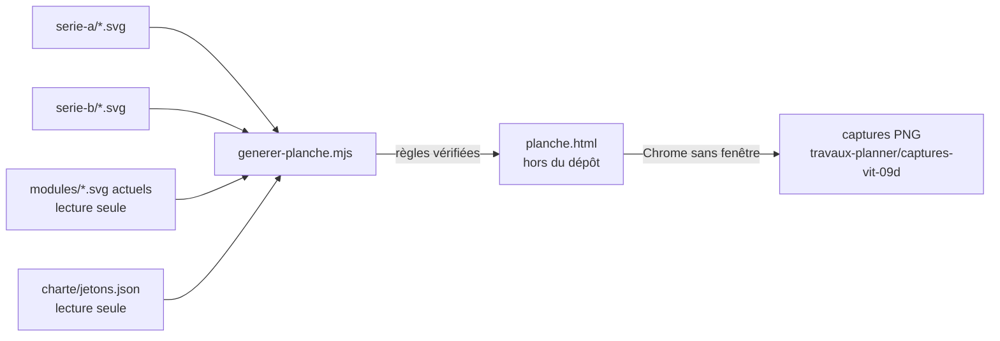

# VIT-09d · Les 20 logos dans le style du logo Planner, deux séries (plan court)

| | |
|---|---|
| Module | [VIT](../../plan/modules/VIT-site-vitrine.md) · suite de VIT-09a et VIT-09c, hors chantier (demande du chef, 26 nov.) ; sert aussi UIX (grille des applications) |
| Mission | `docs/plan/missions/vit-09d-logos-style-planner.md` (branche `doc/coordination-2026-11-26-suite`) |
| Branche | `feat/vit-09d-logos-style-planner`, depuis `origin/main` (`ebbe1548`), dossier `..\travaux-planner\vit-09d-logos-style-planner` |
| Rédigé par | Claude Code (Opus 5.5), le 2026-11-26 |
| **Validé** | **par le coordinateur le 2026-11-26** (fonction M, sans migration, sans sécurité ni donnée de mineur) ; le choix du rendu reste au chef, sur la planche. Points d'attention : la manette d'`activites` reste générique (ni croix directionnelle ni disposition de boutons d'une console connue, le point d'interrogation porte le sens) ; en série A, vérifier à 24 px que `planning`, `pilotage` et `vacataires` (trois signes ronds) se distinguent |

## 1. Objet et critère de « terminé »

Le chef aime les logos de VIT-09a et VIT-09c. Il veut d'autres propositions **dans le style du logo Planner**, pour comparer et garder les meilleures, logo par logo s'il le souhaite. Deux séries :

- **Série A, tuile commune** : tuile bleu nuit de l'icône Planner, couleurs du logo seulement. Seul l'objet distingue l'application.
- **Série B, teinte de l'application** : tuile en `app-<id>`, dessin dans le style du logo.

Terminé (étape 1, celle de ce plan) quand :

- les 40 SVG détaillés (20 × 2) sont dans `shared/icones/essais/style-planner/serie-a/<id>.svg` et `serie-b/<id>.svg`, aux 20 identifiants de `shared/icones/index.js` ;
- `generer-planche.mjs` vérifie chaque SVG (§ 4, règles), puis écrit une planche HTML **hors du dépôt** : par application, sur une ligne, le logo actuel, la série A et la série B, à 24, 48 et 96 px, sur fond clair et sur fond sombre ;
- les captures PNG de la planche sont dans `C:\Users\clusa\Desktop\Github Project\travaux-planner\captures-vit-09d\` (hors du dépôt, comme `captures-vit-20\`) ;
- la fiche de session liste, logo par logo, l'objet dessiné.

Les versions `-petit` et le remplacement des logos viennent à l'étape 2, après le choix du chef, avec un nouveau plan court.

## 2. Ce qui existe

- **Le style à suivre** : `shared/charte/logos-officiels/planner-variante-4-icone-app.svg` (icône) et `planner-variante-1-horloge.svg` (logo seul).
  - Tuile carrée à coins arrondis, `#17395C` ; rayon de 150 pour un côté de 676 (rapport 0,22).
  - Formes plates, symétriques, sans dégradé ni ombre portée. Une seule ombre, **en aplat** : la bande sous le plateau de la toque, dans la couleur de la tuile.
  - Blanc (corps et plateau), un bleu clair (`#8FB4DE` sur l'icône, `#A6CAEE` dans la charte) pour le plan arrière (pages du livre).
  - Traits fins à bouts ronds pour les détails (aiguilles).
  - **Deux objets fondus en un signe** : livre ouvert et toque ; plateau de la toque et horloge.
- **Les logos actuels** (`shared/icones/modules/`, à ne pas toucher) : tuile en dégradé `app-<id>` → `app-<id>-fonce`, reflet, filet clair, objet en plans avec ombre douce, accent jaune `jeu`. Rendus regardés le 26 nov. : nets à 24 px grâce au dessin `-petit`. Deux paires se confondent à 24 px : **pedagogie et formation** (deux chevalets), **evaluations et documents** (deux feuilles marquées).
- **Le test** `shared/icones/icones.test.js` ne lit que les fichiers de `LOGOS` et le dossier `images/` : le dossier `essais/` ne le touche pas.

## 3. Questions et réponses

| N° | Question | Proposition | Réponse | Qui |
|---|---|---|---|---|
| 1 | Série A : la tuile garde-t-elle la forme et le rayon de l'icône Planner ? | oui : `viewBox` 96, tuile de 88 à 4 px du bord, rayon 19,5 (rapport 0,22 de l'icône) ; même tuile en série B | **oui**, coordinateur, 26 nov. | coordinateur |
| 2 | Série B : tuile en aplat de `app-<id>`, ou en dégradé ? | aplat ; `app-<id>-fonce` sert aux ombres en aplat | **oui**, coordinateur, 26 nov. (aussi pour les traits fins sur le blanc) | coordinateur |
| 3 | Un motif peut-il changer d'objet ? | oui, si le plan dit pourquoi (§ 4, tableau) ; la planche montre l'actuel à côté | au chef, sur la planche ; les changements motivés se dessinent tels quels (coordinateur, 26 nov.) | chef, sur la planche |
| 4 | Le même dessin dans les deux séries ? | oui, seules les couleurs changent | **oui** (chef, 26 nov.) | chef |
| 5 | Le jaune `jeu` des logos actuels ? | exclu, comme dans le logo Planner | **exclu partout** (chef, 26 nov.) | chef |
| 6 | Un filet clair autour des tuiles, pour le fond sombre ? | oui, blanc à 15 % d'opacité, dans les deux séries | **oui** (chef, 26 nov.) | chef |
| 7 | Série B : couleur des traits fins et des ombres sur le blanc ? | `app-<id>-fonce` | **ton foncé de l'application** (chef, 26 nov.) | chef |

## 4. Solution

### Gabarit commun

- `viewBox="0 0 96 96"`, tuile `rect` 4,4 → 92,92, `rx` 19,5 ; filet blanc à 15 % d'opacité, 1 px, en retrait d'un demi-pixel.
- L'objet tient dans un carré central d'environ 58 px (l'objet de l'icône occupe 61 % de la tuile), centré optiquement.
- Construction en trois tons : **corps en blanc**, **plan arrière en bleu clair**, **une ombre en aplat** (bande sous un bord, comme sous le plateau de la toque). Détails fins en trait à bouts ronds, de 3,5 px au moins (environ 1 px à 24 px). Aucun détail sous 4 px.
- Symétrie quand l'objet le permet. Pas de texte : le point d'interrogation et le signe plus sont des tracés.

### Couleurs par série

| Rôle | Série A | Série B |
|---|---|---|
| Tuile | `#17395C` | `app-<id>` en aplat |
| Corps de l'objet | blanc | blanc |
| Plan arrière | `#8FB4DE` (comme l'icône) | `#A6CAEE` (bleu clair de la charte) |
| Second plan ou reflet | `#A6CAEE`, `#2A679F` | `#A6CAEE` |
| Ombre en aplat, traits fins sur blanc | `#17395C`, `#21507C` | `app-<id>-fonce` |
| Filet | blanc à 15 % | blanc à 15 % |

`#8FB4DE` n'est pas un jeton de la charte : si la série A est choisie, son inscription dans la charte revient au chef, à l'étape 2 (comme la décision sur les teintes `app-<id>`).

### Le signe de chaque application (le même dans les deux séries)

| id | Application | Logo actuel | Signe proposé : deux objets fondus | Pourquoi |
|---|---|---|---|---|
| `planning` | Emploi du temps | calendrier, séance placée | **calendrier à anneaux dont la page est un cadran** : deux aiguilles à bouts ronds sur la grille | le temps et la semaine en un signe ; reprend l'horloge du logo Planner |
| `pedagogie` | Enseignements | tableau sur chevalet | **tableau sur chevalet**, une courbe et un point tracés en traits ronds | même objet, dessin du style |
| `personnes` | Personnes | deux personnes, badge | **badge à cordon portant une silhouette** | un seul objet, symétrique ; ne se confond plus avec `familles` (deux silhouettes) |
| `etablissement` | Établissement | école et drapeau, second bâtiment | **école à toit à deux pentes, porte en arche, drapeau au faîte** | même objet, symétrique, sans le second bâtiment |
| `annonces` | Annonces | mégaphone et ondes | **mégaphone et trois ondes en traits ronds** | même objet |
| `activites` | Quiz et jeux | manette, bulle de question | **manette dont les boutons de droite sont remplacés par un point d'interrogation** | le jeu et la question fondus en un objet, au lieu de deux posés côte à côte |
| `bibliotheque` | Bibliothèque | livres sur une étagère | **trois livres debout et un penché, sur une planche** à ombre en aplat | même objet |
| `presences` | Présences | feuille d'appel cochée | **planchette à pince et grande coche** | même objet ; une coche au lieu de deux lignes cochées, pour rester net à 24 px |
| `cours` | Espace de cours | cahier ouvert à onglet | **cahier à spirale et marque-page** | **change** : le livre ouvert est le motif du logo Planner ; un cahier ouvert dans la même famille se confondrait avec lui |
| `vacataires` | Vacataires et heures | feuille d'heures et horloge | **chronomètre devant une feuille d'heures** | même idée ; la silhouette ronde du chronomètre le sépare du calendrier de `planning` |
| `evaluations` | Évaluations, crédits et jurys | copie avec sceau | **copie lignée et rosette à rubans** | même objet |
| `inscriptions` | Inscriptions | dossier et signe plus | **chemise à onglet, signe plus en médaillon** | même objet |
| `documents` | Documents vérifiables | attestation à coin plié | **feuille à coin plié et bouclier coché** | **change en partie** : le bouclier dit « vérifiable » et sépare le logo d'`evaluations` |
| `stages` | Stages | mallette à poignée | **mallette à poignée**, rabat en ombre d'aplat | même objet |
| `frais` | Frais et caisse | tiroir de caisse | **caisse d'où sort un reçu à bord dentelé** | **change en partie** : le reçu est l'objet que voient les familles ; le tiroir seul se lit mal à 24 px |
| `formation` | Formation et financeurs | chevalet et jalons | **escalier de trois marches et drapeau au sommet** | **change** : le chevalet actuel se confond avec celui de `pedagogie` ; l'escalier dit le parcours et ses jalons |
| `familles` | Vie scolaire et familles | maison et deux silhouettes | **toit de maison abritant un adulte et un enfant** | même objet |
| `etat` | Échanges avec l'État | fronton sur colonnes | **fronton sur colonnes et deux flèches d'échange** | **change en partie** : les flèches disent l'échange, le fronton seul dit seulement « État » |
| `paiements` | Paiements en ligne | carte et flèche | **carte et flèche** | même objet ; aucun symbole de devise |
| `pilotage` | Pilotage | cadran à aiguille | **cadran en demi-cercle, aiguille à bout rond** | même objet ; l'aiguille reprend celles du logo Planner |

Pendant le dessin, si un signe ne tient pas à 24 px, je le simplifie et le note dans la fiche ; si l'objet doit changer, je m'arrête et le redemande.

### La planche

- `node shared/icones/essais/style-planner/generer-planche.mjs [chemin de sortie]` : sans dépendance (modules de Node seulement). Sortie par défaut : `planche-vit-09d.html` dans le dossier temporaire du système, pour ne rien laisser dans le dépôt sans toucher au `.gitignore`.
- **Il vérifie chaque SVG avant d'écrire**, et s'arrête sur la première faute : `viewBox` carré ; ni `<text>`, ni police, ni `<image>`, ni `<script>` ; identifiants préfixés `vit09d-a-<id>-` ou `vit09d-b-<id>-` ; 4 Ko au plus ; couleurs de la liste de sa série seulement (les tons `app-<id>` lus dans `jetons.json`).
- La planche : en tête, l'icône Planner pour référence ; puis une ligne par application, dans l'ordre de `index.js` : actuel (24 px en `-petit`, 48 et 96 en détaillé, comme `fichierLogo`), série A, série B, à 24, 48 et 96 px ; sur fond `blanc` puis `ecran` de la charte. Les SVG sont incorporés en `data:` dans des `` : la page tient seule, sans identifiant en double.
- Les captures : Chrome sans fenêtre, en PNG, une par groupe de lignes lisible ; je les regarde moi-même, avec un agrandissement des rendus à 24 px, avant de les montrer.

## 5. Fichiers créés ou modifiés

| Fichier | Créé / modifié | Rôle | Taille visée |
|---|---|---|---|
| `docs/conception/vitrine/vit-09d-logos-style-planner.md` | créé | ce plan | — |
| `shared/icones/essais/style-planner/serie-a/<id>.svg` (20) | créés | série A | 4 Ko au plus chacun |
| `shared/icones/essais/style-planner/serie-b/<id>.svg` (20) | créés | série B | 4 Ko au plus chacun |
| `shared/icones/essais/style-planner/generer-planche.mjs` | créé | vérification et planche | moins de 200 lignes |
| `docs/plan/modules/VIT-site-vitrine.md` | modifié | une ligne VIT-09d | — |
| `docs/sessions/2026-11-26-feat-vit-09d-logos-style-planner.md` | créé | fiche de session | — |

Rien d'autre : ni `shared/icones/modules/`, `images/`, `index.js`, le test, le guide, l'aperçu ; ni `shared/charte/` ; ni `vitrine/`, `frontend/`, `mobile/` ; ni `docs/plan/suivi.md`.

## 6. Données et migration

Aucune donnée, aucune migration.

## 7. Sécurité, isolation et exigences produit

Aucun canal d'isolation touché, aucun droit. EP-19 : chaque SVG pèse 4 Ko au plus, vérifié par le script. Rien n'est posé sur une page à l'étape 1.

## 7 bis. Ce que disent les études

| Ligne | Étude | Appliquée ou écartée | Comment, ou pourquoi |
|---|---|---|---|
| § 1 (reprendre en créant) | 14-reprendre-et-depasser | appliquée | dessins originaux, à partir d'objets simples de l'école ; aucun tracé ni forme reconnaissable d'une marque (la manette surtout) |
| § 7 (réseau faible) | 13 | appliquée | 4 Ko au plus par logo, aucune image incorporée |
| Condition 7 (illustrations) | expertise du site | appliquée en partie | VIT-09d propose ; la pose sur les pages reste à VIT-09b et VIT-20f, après le choix |

Public : tous. Les logos ne disent rien d'un pays ni d'un niveau d'enseignement.

## 7 ter. EP-18 : tous les contextes

| Contexte | Ce que fait la fonction | Preuve ou test |
|---|---|---|
| **A. Élève sans appareil** | sans objet : un logo n'est pas une fonction ; le nom de l'application est écrit à côté | — |
| **B. Connexion lente ou coupée** | 4 Ko au plus par logo, mis en cache en `` à la pose | vérifié par `generer-planche.mjs` |
| **C. Équipement de la salle** | lisible projeté (contraste blanc sur tuile foncée) et imprimé en niveaux de gris (le blanc et le bleu clair restent distincts de la tuile) | relu sur les captures |

## 8. Tests

- `generer-planche.mjs` vérifie les règles de chaque SVG et sort en erreur sur une faute.
- `node --test shared/icones/icones.test.js` reste vert (il ne lit pas `essais/`).
- Relecture visuelle à 24 et à 96 px, sur fond clair et sombre, avant de montrer : lisibilité, différences entre logos voisins, cohérence de la famille.

## 9. Étapes de livraison

1. Ce plan, commité seul ; validation par le coordinateur (le chef transmet).
2. **Essai sur trois logos** (`planning`, `presences`, `activites`), dans les deux séries, avec le script et la planche ; captures relues à 24 et 96 px ; **le chef valide la direction**.
3. Les dix-sept autres, dans les deux séries ; planche complète et captures, relues, puis montrées au chef.
4. Ligne VIT-09d du fichier du module, fiche de session (objet de chaque logo), commandes pour le chef.

## 10. Risques et retour arrière

- **Le style ne plaît pas** : l'étape 2 ne dessine que trois logos avant l'accord du chef.
- **Illisible à 24 px** : le gabarit fixe une épaisseur et un détail minimaux ; la planche montre les 24 px agrandis.
- **Les séries A se ressemblent toutes** (une seule couleur) : c'est le choix à comparer ; les silhouettes doivent suffire, et la planche le montre.
- Retour arrière : retirer `shared/icones/essais/style-planner/`. Rien d'autre ne dépend de ces fichiers.

## 11. Hors périmètre

- Les versions `-petit`, le remplacement des logos, `index.js`, le test, le guide, l'aperçu : étape 2, nouveau plan.
- Les jetons de la charte (`#8FB4DE`, sort des teintes `app-<id>` si la série A est choisie) : décision du chef, étape 2.
- La pose sur les pages (VIT-09b, VIT-20f) et les illustrations WebP de VIT-09c.

## 12. Étape 2 : la série B remplace les logos (plan court)

| | |
|---|---|
| Décision | le chef retient **la série B pour les 20 logos** (26 nov., vers 10 h 10, relayé par le coordinateur). Les teintes `app-<id>` de la charte ne changent pas ; `#8FB4DE` n'entre pas dans la charte (vérifié : aucun des 20 SVG de la série B ne l'emploie) |
| Branche | la même, `feat/vit-09d-logos-style-planner` (PR #277, ouverte par le chef) |
| **Validé** | en attente (coordinateur) |

### 12.1 Qui lit les logos aujourd'hui (relevé par grep sur la branche)

| Lecteur | Ce qu'il lit | Ce que je vérifie | Touché ? |
|---|---|---|---|
| `vitrine/src/components/applications/logos.js` | `shared/icones/modules/<id>.svg` (dessin détaillé seulement), **incorporé dans la page** à la construction ; utilisé par `TuileModule.astro` (catalogue) et `EnTeteModule.astro` | construction du site (`npm run build`), tests unitaires (`npm run test:unit`), poids des pages (`npm run test:poids`), capture d'une page du catalogue avant et après | **non** (VIT-20f, VIT-23) |
| `vitrine/tests/modules.test.js` | l'existence de `modules/<logo>.svg` | dans `test:unit` | non |
| `shared/charte/charte.test.js` | `LOGOS` (`teinte`, `fonce`) de `index.js` | `node --test shared/charte/charte.test.js` | non |
| `shared/icones/icones.test.js`, `generer-apercu.mjs`, `README.md`, `index.js` | tout `modules/` | voir 12.3 | oui |
| `frontend/`, `mobile/` | **rien** : la grille d'UIX-09 a ses propres icônes animées (`frontend/src/components/applications/icones/`) | aucun build nécessaire ; le grep le prouve dans la fiche | non |

Les logos sont incorporés dans la page : deux fois le même logo dans une page donnerait des identifiants en double. Les nouveaux dessins **n'ont plus aucun identifiant interne** (aucun dégradé, aucun `url(#…)`). Le test le vérifie (12.3).

### 12.2 Les fichiers de `shared/icones/modules/`

- **`<id>.svg`** (20) : le dessin de la série B, aux mêmes noms. Les pages qui les lisent suivent sans changement.
  - Pas d'identifiant interne.
  - Le commentaire de rôle en tête est repris : application, style du logo Planner, objet, jetons employés.
- **`<id>-petit.svg`** (20), pour 24 à 32 px : un dessin à part, sur la même tuile et dans les mêmes couleurs.
  - L'objet est agrandi d'environ 10 %.
  - Les traits font au moins 6 unités (1,5 px à 24 px).
  - Les détails de moins de 6 unités disparaissent.
  - 1,5 Ko au plus, comme aujourd'hui.

| id | Le dessin `-petit` garde | Il retire ou renforce |
|---|---|---|
| `planning` | calendrier, anneaux, grand cadran | bande d'ombre retirée |
| `pedagogie` | tableau, deux pieds, courbe épaissie | point d'arrivée et pied du milieu retirés |
| `personnes` | badge, cordon, silhouette | fente retirée |
| `etablissement` | toit, mur, porte, drapeau agrandi | fenêtres et bande d'ombre retirées |
| `annonces` | mégaphone, **deux** ondes épaisses | troisième onde et bande d'ombre retirées |
| `activites` | manette, point d'interrogation | point d'interrogation un peu plus épais |
| `bibliotheque` | trois livres debout et un penché, planche | bandes d'ombre retirées |
| `presences` | planchette, pince, coche | trou de la pince retiré |
| `cours` | cahier, trois anneaux, marque-page | étiquette et ombre retirées |
| `vacataires` | chronomètre agrandi, coin de la feuille | lignes de la feuille retirées |
| `evaluations` | **renforcé** : rosette agrandie (rayon 16) devant une copie à deux lignes | troisième ligne retirée |
| `inscriptions` | **renforcé** : chemise, signe plus agrandi en médaillon (rayon 15, trait de 6) | ombre du pli retirée |
| `documents` | feuille à coin plié, bouclier agrandi | lignes retirées |
| `stages` | mallette, poignée, rabat | fermoir agrandi |
| `frais` | caisse, reçu | touches, lignes du reçu et du tiroir retirées |
| `formation` | trois marches, drapeau | bandes d'ombre retirées |
| `familles` | toit, adulte, enfant | rien |
| `etat` | **renforcé** : fronton, socle, deux colonnes ; deux flèches d'échange de trait 6, plus courtes et plus écartées | entablement réduit |
| `paiements` | carte, bande, pastille à flèche agrandie | puce retirée |
| `pilotage` | cadran, aiguille épaissie, socle | arc bleu clair retiré |

Je regarde chaque dessin `-petit` à 24 et 32 px, au pixel près, avant de le montrer. S'il faut changer un objet, je m'arrête et je le demande.

### 12.3 Ce qui suit les dessins

- **`icones.test.js`** :
  - le test des couleurs ne cherche plus de dégradé (`stop-color`). Il vérifie :
    - une tuile **en aplat** `app-<id>` au gabarit commun (`x="4" y="4" width="88" height="88" rx="19.5"`) ;
    - le ton `app-<id>-fonce` présent ;
    - **ni dégradé, ni jaune `jeu`** ;
    - **seulement les couleurs de son application**, plus le blanc et `bleu-clair` (pas la teinte d'une autre application) ;
  - le test des identifiants reste (préfixe `vit-<id>-` et unicité s'il y en a un). Il vérifie en plus qu'aucun logo ne renvoie à un `url(#…)`, ce qui rend le double sans danger ;
  - les autres tests restent : poids, `viewBox`, pas de script ni de texte.
- **`README.md`** :
  - le style est décrit (logo Planner, tuile en aplat, blanc, bleu clair et ton foncé, sans jaune) ;
  - le tableau des objets est mis à jour ; six objets changent ou s'enrichissent : `personnes`, `cours`, `documents`, `frais`, `formation`, `etat` ;
  - la phrase sur les identifiants des dégradés est retirée.
- **`index.js`** : aucun changement de code ; le commentaire d'en-tête cite VIT-09d.
- **`generer-apercu.mjs`** : aucun changement de code (il ne lit ni dégradé ni couleur de logo) ; le commentaire d'en-tête cite VIT-09d.
- **`shared/icones/essais/style-planner/`** : **retiré** à la fin. La PR ne garde que le remplacement, le plan et la fiche.
- **Avant tout code**, `git merge origin/main` dans la branche (12 commits de retard, dont des fichiers du site), pour construire le site d'aujourd'hui.

### 12.4 Vérifications et planche finale

- `node --test shared/icones/icones.test.js` et `node --test shared/charte/charte.test.js`.
- Dans `vitrine/` : `npm run test:unit`, `npm run build`, `npm run test:poids`. Le poids d'une page du catalogue est relevé avant et après (EP-19).
- `node scripts/verifier-neutre.mjs`.
- Le frontend n'est pas construit : il ne lit pas ces fichiers (12.1).
- **Planche finale**, hors du dépôt, dans `..\travaux-planner\captures-vit-09d\final\` :
  - pour chaque application, avant et après, à 24 et 32 px (dessins `-petit`) puis 48 et 96 px (dessins détaillés), sur fond clair et sur fond sombre ;
  - une capture d'une page du catalogue du site construit, avant et après.

### 12.5 Fichiers

| Fichier | Action |
|---|---|
| `shared/icones/modules/<id>.svg` et `<id>-petit.svg` (40) | remplacés |
| `shared/icones/icones.test.js`, `README.md`, `index.js` (commentaire), `generer-apercu.mjs` (commentaire) | modifiés |
| `shared/icones/essais/style-planner/` | retiré |
| ce plan, le fichier du module VIT, la fiche de session | modifiés |

Rien dans `vitrine/`, `frontend/`, `mobile/`, `shared/charte/`, ni `docs/plan/suivi.md`.

### 12.6 Risque et retour arrière

- **Un logo se lit moins bien dans la page qu'en planche** : la capture du catalogue le montre avant la relecture.
- **La place réservée** de `logos.js` garde un rayon de 22, contre 19,5 pour les logos. Elle ne sert qu'aux modules sans logo, et VIT-20f les remplit. Je ne la modifie pas : c'est signalé au coordinateur.
- **Retour arrière** : `git revert` du commit de remplacement. Les anciens logos reviennent tels quels.
