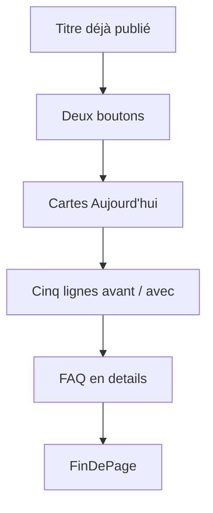

# VIT-10b · « avant → avec Planner » et FAQ des pages par rôle — plan court

| | |
|---|---|
| Module | [VIT](../../plan/modules/VIT-site-vitrine.md) · fiche [vit-10b-avant-avec-faq](../../plan/missions/vit-10b-avant-avec-faq.md) (branche `doc/coordination-equipe`, jusqu'à sa fusion) |
| Branche | `feat/vit-10b-avant-avec-faq`, depuis `origin/main` (`427afdea`, fusion de #219) |
| Rédigé par | agent de Cursor (Grok 4.7), le 18 novembre 2026 |
| **Validé** | en attente |

Aucun code avant que la ligne « Validé » soit remplie, et avant la réponse aux questions. Les phrases « avant » sont nouvelles : le chef les valide une à une. Les phrases « avec » et les réponses de FAQ déjà visées ne se réécrivent pas.

## 1. Objet

Sur les quatre pages par rôle déjà en ligne, après les cartes, deux blocs :

1. **Avant → avec Planner** : cinq lignes. « Avant » décrit la tâche sans outil (papier, tableur, messages), sans dénigrer personne et sans nommer de concurrent. « Avec » recopie une phrase déjà publiée, ou une réponse de FAQ déjà validée dans [VIT-11](vit-11-catalogue-faq.md).
2. **FAQ** : trois ou quatre questions. D'abord les réponses validées de VIT-11, recopiées. Une question nouvelle n'a pour réponse qu'une phrase déjà publiée.

Accordéon `details`, lisible sans JavaScript. JSON-LD `FAQPage` local : le texte du script est celui qui s'affiche, après le repli vers le français. VIT-11 n'a pas encore posé de composant sur `main` : le bloc reste dans la page par rôle. S'il en pose un avant le code, on le réutilise.

EP-18 : aucun téléphone ni QR code comme seul chemin. La ligne d'appel des enseignants est la saisie à la main. La ligne des étudiants sur la semaine reprend la réponse 7 de VIT-11, qui dit le navigateur. EP-5 : aucun pays, aucune monnaie. Aucun chiffre inventé, aucun prix, aucun nom d'école. L'arabe garde des chaînes vides (UIX-04). Pas d'illustration, pas de colonne visuelle : VIT-09 reste après. Pas de lien vers le catalogue ni vers `/faq/` tant que ces pages ne sont pas en ligne. `suivi.md` n'est pas modifié.

## 2. Ce qui existe

`PageRole.astro` enchaîne le titre, deux boutons, la grille « Aujourd'hui », puis `FinDePage`. Les deux blocs se placent entre la grille et `FinDePage`.

## 3. Phrases proposées

Chaque « avec » est recopié. La source de code est celle qui rend la phrase vraie. L'anglais « avec » est celui déjà publié dans le fichier cité. L'anglais « avant » est proposé ici.

### Direction

| | Avant, proposé | Avec, recopié | Source |
|---|---|---|---|
| 1 | L'occupation des salles se suit dans un tableur. | Planner montre l'occupation de chaque salle et la charge de chaque enseignant. | `etablissement.json` `statistiques.texte`. `frontend/src/pages/dashboard/AdminDashboard.jsx`, bande `IndicatorsStrip`. |
| 2 | Les sessions d'examen et les surveillances se tiennent sur une liste à part. | Les sessions d'examen, leurs salles et leurs surveillances. | `etablissement.json`, carte Examens. `frontend/src/pages/gestion/Examens.jsx`. |
| 3 | Une séance qui ne tient pas se voit en relisant la grille. | Quand une séance ne trouve pas sa place, Planner nomme la règle qui la bloque. | `emploi-du-temps.json` `refus.texte`. `frontend/src/components/planning/ViolationsDialog.jsx` ; `backend/services/generation/timefold/deploiement.js` (`sautées`, `raisons`). |
| 4 | Une salle demandée en dehors des cours se note dans un message. | Les salles, leur capacité, et leurs réservations en dehors des cours. | `etablissement.json`, carte Salles. `frontend/src/pages/Reservations.jsx`. |
| 5 | Revenir à une grille précédente, c'est retrouver le fichier d'avant. | Chaque calcul est gardé. Vous revenez à une version précédente quand vous le voulez. | `emploi-du-temps.json`, carte Des versions. `deploiement.js` (`id_snapshot`). |

Anglais proposé des « avant » : Room use is tracked in a spreadsheet. Exam sessions and invigilation are kept on a separate list. A session that does not fit shows up when the grid is read again. A room requested outside class is noted in a message. Going back to an earlier grid means finding the previous file.

FAQ, réponses recopiées de VIT-11 : « Où sont stockées les données ? », « Dans quelles langues puis-je consulter le site ? », « Peut-on importer des listes ? », « Combien cela coûte-t-il ? ».

### Scolarité

| | Avant, proposé | Avec, recopié | Source |
|---|---|---|---|
| 1 | Les salles, les enseignants et les groupes sont répartis à la main. | Vous décrivez vos salles, vos enseignants, vos groupes et vos règles. Planner place les séances, et vous dit pourquoi quand il ne le peut pas. | `emploi-du-temps.json`, accroche. `ViolationsDialog.jsx`, `deploiement.js`. |
| 2 | Les listes de comptes circulent dans des fichiers qu'on ressaisit. | Enseignants, étudiants, filières, groupes et cours s'importent depuis un fichier CSV. | `etablissement.json`, carte Import. `frontend/src/utils/fileImport.js` ; routes citées par VIT-11, réponse 6. |
| 3 | Un report se confirme par des messages. | L'enseignant demande, la scolarité valide, les étudiants concernés sont prévenus. | `emploi-du-temps.json`, carte Des reports suivis. `frontend/src/pages/gestion/DemandesReportAdmin.jsx`. |
| 4 | La grille part aux enseignants en pièce jointe. | L'emploi du temps s'exporte en PDF, sur la grille des créneaux de l'école. | `emploi-du-temps.json`, carte En PDF. `frontend/src/utils/exportEmploiDuTemps.js`, `exportToPDF`. |
| 5 | Chaque version de la grille est un fichier de plus. | Chaque calcul est gardé. Vous revenez à une version précédente quand vous le voulez. | même source que Direction, ligne 5. |

Anglais proposé des « avant » : Rooms, teachers and groups are assigned by hand. Account lists move around in files that get typed in again. A postponement is confirmed through messages. The grid goes to teachers as an attachment. Each version of the grid is another file.

FAQ : « Peut-on importer des listes ? » (VIT-11, réponse 6). Deux questions nouvelles, réponses déjà publiées : « Comment une séance refusée s'explique-t-elle ? » (`refus.texte`) ; « Qui prévient les étudiants d'un report ? » (carte Des reports suivis).

### Enseignants

| | Avant, proposé | Avec, recopié | Source |
|---|---|---|---|
| 1 | L'appel se fait sur une feuille. | L'enseignant note aussi à la main : présent, en retard, absent. Un étudiant sans téléphone est noté ainsi. | `en-classe.json`, second point de l'appel. `frontend/src/components/appel/LigneAppel.jsx` ; `frontend/src/pages/Appel.jsx`. |
| 2 | Le quiz se prépare à part, puis se projette depuis un autre outil. | L'enseignant prépare ses quiz dans le studio, puis les lance en classe ou les laisse à faire à chacun à son rythme. | `en-classe.json` `quiz.texte`. |
| 3 | Un document de cours s'envoie aux étudiants. | L'enseignant dépose un document ou un lien dans une section. | `cours-et-annonces.json`, accroche. `frontend/src/services/espaceCours.js`, `deposerFichier`. |
| 4 | Un sondage se fait à main levée ou sur un papier. | Les sondages de la classe s'ouvrent quand l'établissement les active. Une question, de deux à six choix. | `cours-et-annonces.json`, carte Sondages. `frontend/src/components/espaceCours/NouveauSondageDialog.jsx` ; `shared/sondages.js`. |
| 5 | Une question proposée se relit sur le document d'origine. | Quand l'école active l'IA dans le Studio quiz, elle peut proposer des questions que l'enseignant relit avant de les partager. | VIT-11, réponse 8. `frontend/src/services/studioApi.js`, `marquerRelue`. |

Anglais proposé des « avant » : Attendance is taken on a sheet. The quiz is prepared separately, then shown from another tool. A course document is sent to the students. A poll is done by a show of hands or on paper. A suggested question is reread on the original document.

FAQ : « Comment l'IA intervient-elle ? » (VIT-11, réponse 8). Deux questions nouvelles : « Comment se fait l'appel sans le téléphone de l'étudiant ? » (le point de la ligne 1) ; « Le quiz demande-t-il une application ? » (« Le lien s'ouvre dans un navigateur, sur un ordinateur de l'école ou ailleurs. Un code ou un QR code mène au même lien. », `quiz-et-jeux.json`).

### Étudiants

| | Avant, proposé | Avec, recopié | Source |
|---|---|---|---|
| 1 | Les supports du cours arrivent par message ou sur papier. | L'étudiant voit les supports publiés de ses cours. | `cours-et-annonces.json` `supports.texte`. `frontend/src/pages/MesCours.jsx`. |
| 2 | Les documents de l'école sont dans des dossiers partagés. | Les documents sont rangés par filière et par module. | `bibliotheque.json`, accroche. |
| 3 | La semaine se consulte sur une feuille affichée. | L'application des étudiants montre leur semaine, scanne le QR code de l'appel et ouvre la Bibliothèque. Sans téléphone, l'emploi du temps et les ressources s'ouvrent dans un navigateur, et l'enseignant fait l'appel à la main. | VIT-11, réponse 7, preuves dans ce plan. |
| 4 | Participer au quiz demande d'installer une application. | Le lien s'ouvre dans un navigateur, sur un ordinateur de l'école ou ailleurs. Un code ou un QR code mène au même lien. | `quiz-et-jeux.json`, accroche. |
| 5 | Les nouvelles d'une classe passent par une affiche ou un message. | Une annonce s'adresse à une classe, un groupe ou une filière. L'e-mail est facultatif. | `cours-et-annonces.json`, carte Une annonce. `frontend/src/pages/Annonces.jsx`. |

Anglais proposé des « avant » : Course materials arrive by message or on paper. The school's documents sit in shared folders. The week is read from a posted sheet. Taking the quiz means installing an application. News for a class goes out on a notice or in a message.

FAQ : « Que propose l'application mobile ? » (VIT-11, réponse 7). Deux questions nouvelles : « Où sont les supports de mes cours ? » (ligne 1) ; « Où sont les documents de l'école ? » (ligne 2).

### Titres proposés

| Clé | Français | Anglais |
|---|---|---|
| `passage.titre` | Avant, avec Planner. | Before, with Planner. |
| `passage.avant` | Avant | Before |
| `passage.avec` | Avec Planner | With Planner |
| `faq.titre` | Questions fréquentes. | Common questions. |

## 4. Questions

| N° | Question | Proposition | Réponse du chef | Bloque |
|---|---|---|---|---|
| 1 | Les vingt phrases « avant », et leur anglais, sont-ils ceux du § 3 ? Une phrase refusée est retirée. Elle n'est pas réécrite sans un nouveau visa. | **oui pour toutes** | | oui |
| 2 | Les phrases « avec » et les réponses de FAQ déjà visées restent recopiées, sans reformulation ? | **oui** | | oui |
| 3 | Les titres du § 3, et la place des deux blocs entre les cartes et le bandeau de contact ? | **oui** | | oui |

## 5. Fichiers, au moment du code

| Fichier | Rôle |
|---|---|
| `vitrine/src/components/fonctions/PageRole.astro` | appelle les deux blocs |
| `vitrine/src/components/fonctions/Passage.astro` | les cinq lignes |
| `vitrine/src/components/fonctions/FaqRole.astro` | `details` et le JSON-LD |
| `vitrine/src/i18n/{fr,en,ar}/{direction,scolarite,enseignants,etudiants}.json` | les textes. L'arabe : clés présentes, chaînes vides |
| `vitrine/tests/roles.test.js` | chaque « avec » égale sa source ; la FAQ visible égale le JSON-LD ; pas de prix |
| fiche de session, ligne du module VIT | `suivi.md` n'est pas modifié |

## 6. Contrôles, au moment du code

Build, tests unitaires de `vitrine`, `node scripts/verifier-neutre.mjs`, pas de défilement horizontal en 390 et 1440 px, axe-core sur une page par rôle, accordéon utilisable sans JavaScript.
