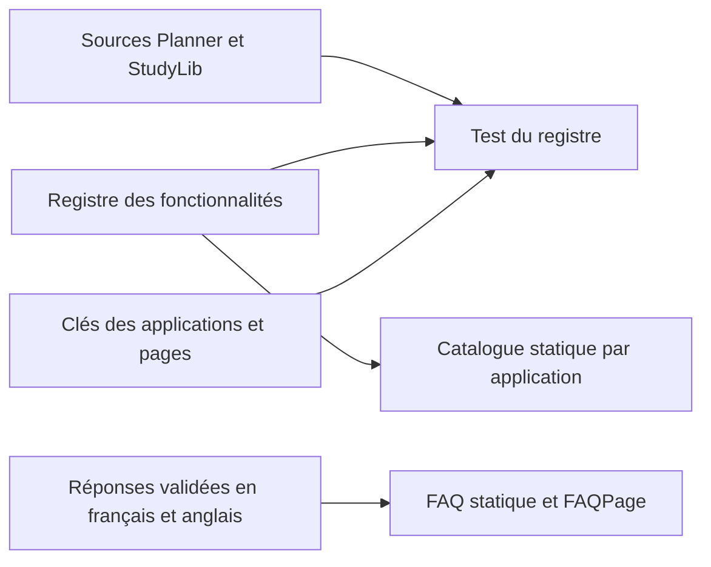

# VIT-11 · Catalogue des fonctionnalités et FAQ

| | |
|---|---|
| Module | [VIT](../../plan/modules/VIT-site-vitrine.md) · condition 9 de la mise en ligne |
| Branche | `feat/vit-11-catalogue-faq`, depuis `origin/main` à `48d65fd8` |
| Rédigé par | Codex, le 18 novembre 2026 |
| **Validé** | En attente de Claude20022002, y compris pour chaque réponse de la FAQ |

## 1. Objet

Livrer deux pages statiques, « Toutes les fonctionnalités » et « Questions fréquentes ». Le catalogue
part d’un registre vérifiable et regroupe les fonctionnalités par application. Le site publie le français
et l’anglais et construit l’arabe avec le repli français du socle.

## 2. Catalogue

- `vitrine/src/donnees/fonctionnalites.json` fait foi. Une entrée représente un parcours identifiable.
  Champs proposés : `id` stable, `application` (clé), `categorie` (clé), `titre` et `description`
  (`fr`, `en`), `page` (clé de la page de détail), `sources` (dépôt et chemins), `etat`
  (`existe` ou `bientot`). Pour les usages sur téléphone, prévoir `alternative` (`fr`, `en`)
  et sa source lorsqu’un autre chemin existe.
- Applications : `planning`, `pedagogie`, `personnes`, `etablissement`, `annonces`, `activites`
  et `bibliotheque`, issues de `frontend/src/i18n/applications.fr.js`. Catégories proposées sous
  leurs applications : organisation et présence, cours et supports, comptes et rôles, configuration,
  communication, quiz et jeux, ressources pédagogiques, stages, projets et événements.
- Le site assemble les sections par application, chacune avec son titre, son nombre d’entrées et ses
  catégories. VIT-09 posera les icônes. Le filtre par texte porte sur les titres et descriptions dans
  la langue affichée et annonce le nombre de résultats. La page présente toutes les entrées sans
  JavaScript. Les entrées « Bientôt » portent ce libellé sans date et renvoient à leur plan.
- Adresses proposées : `/<langue>/fonctionnalites/` et `/<langue>/faq/`. Le coordinateur transmet à
  VIT-10 l’ajout des liens catalogue et FAQ et des clés de routes dans le socle de navigation.
  Les preuves de Planner partent des plans [VIT-05](vit-05-solutions.md), [VIT-07](vit-07-contenu-complet.md) et de parité.

## 3. StudyLib dans l’application Bibliothèque

Sources lues dans [StudyLib à a834980](https://github.com/Claude20022002/StudyLib/tree/a8349801f351e884cc9e2877a649b51825f7ff50).
Le terme « module » désigne aussi la matière à laquelle StudyLib rattache un document. Les familles
ci-dessous permettent de présenter les capacités du produit et de discuter de leurs offres commerciales.

| Famille | Capacités observées | Preuves dans StudyLib |
|---|---|---|
| Ressources pédagogiques | Parcours par filière et matière, recherche, dépôt de cours, examens, TD, TP, exercices et articles, consultation, téléchargement et notation. Les dépôts étudiants passent par la modération. Les enseignants et l’administration publient directement selon leur rôle. | `routes/web.php`, `app/Enums/DocumentType.php`, `app/Services/DocumentService.php`, `app/Livewire/Ui/SearchBar.php`, contrôleurs de téléchargement, notation et modération |
| Accompagnement des cours | Supports liés aux séances, documents de classe publiés depuis Planner, vidéos recommandées par matière. | `routes/api.php`, `app/Http/Controllers/ModuleSupportsController.php`, `app/Http/Controllers/YoutubeRecommendationController.php` |
| Stages | Consulter et partager des retours d’expérience, avec photos selon le parcours disponible. L’API mobile liste les retours avec filtres et les retours de la personne connectée. | `app/Http/Controllers/InternshipReviewController.php`, `tests/Feature/Internship/InternshipReviewPhotoTest.php`, `tests/Feature/Planner/InternshipReviewMobileTest.php` |
| Projets | Consulter et proposer des idées de projet, suggestions IA selon disponibilité et droits. | `app/Http/Controllers/ProjectIdeaController.php`, `app/Http/Controllers/AiRecommendationController.php` |
| Événements | Consulter les événements et les administrer selon le rôle. | `app/Http/Controllers/EventController.php`, `app/Http/Controllers/Admin/EventController.php` |
| Parcours transversaux | Profil, tableau de bord, notifications et API mobile couvrant notamment documents, stages, projets et événements. | `routes/web.php`, `routes/api.php`, `tests/Feature/Planner/MobileApiTest.php` |

Le catalogue public présente ces capacités sous « Bibliothèque · StudyLib ». L’offre peut regrouper
StudyLib avec Planner, proposer une sélection de familles ou vendre StudyLib séparément. Le périmètre
exact des offres reste à valider. La connexion web actuelle redirige vers Planner, l’API mobile
utilise son jeton et le référentiel peut être synchronisé depuis Planner (`routes/auth.php`,
`routes/api.php`, `app/Console/Commands/SyncPlannerReferential.php`). L’offre autonome demande
donc de trancher la dépendance d’identité, le référentiel, l’isolation par établissement (BIB-02)
et les intégrations de cours. La disponibilité commerciale et l’activation à la carte demandent
un arbitrage distinct de l’existence d’une fonction dans le code.

## 4. Questions à valider par le chef

| N° | Question | Proposition de réponse ou de décision |
|---|---|---|
| 1 | Valider le regroupement du catalogue et les deux adresses ? | Les clés des applications Planner pilotent les sections. Les familles de StudyLib restent sous Bibliothèque. VIT-09 fournit les icônes. |
| 2 | Quel périmètre StudyLib présenter dans VIT-11 ? | Présenter les fonctions vérifiées. Préparer une offre par familles et une offre StudyLib séparée. Afficher le contact pour discuter de l’offre, après validation de la réponse 9. |
| 3 | Comment vérifier les sources StudyLib ? | Épingler un commit public. Le test de revue lit les chemins avec `git cat-file -e <commit>:<chemin>` dans un clone local de StudyLib. Tester aussi les chemins Planner à chaque exécution. La vérification complète exige le clone épinglé et échoue si une source manque. Le build reste autonome. |
| 4 | Où sont stockées les données ? | « Demandez-nous où seront hébergées les données de votre établissement. Nous vous préciserons les conditions de l’offre. » Lien vers Sécurité et données, pays d’hébergement à confirmer pour chaque offre. |
| 5 | Dans quelles langues puis-je consulter le site ? | « Le site est disponible en français et en anglais. Contactez-nous pour connaître les langues disponibles dans les applications qui vous intéressent. » |
| 6 | Peut-on importer des listes ? | « L’administration peut importer des listes de comptes, d’étudiants et d’enseignants à partir de fichiers CSV compatibles. » Sources : `backend/routes/{userRoutes,etudiantRoutes,enseignantRoutes}.js` et `frontend/src/utils/fileImport.js`. |
| 7 | Que propose l’application mobile ? | « Les étudiants peuvent retrouver leur emploi du temps et les ressources de la Bibliothèque. Les ressources sont aussi accessibles depuis un navigateur. » Voir la page Application. |
| 8 | Comment l’IA intervient-elle ? | « Quand l’école active l’IA dans le Studio quiz, elle peut proposer des questions que l’enseignant relit avant de les partager. » |
| 9 | Peut-on choisir StudyLib séparément ? | « Contactez-nous pour discuter de StudyLib et des fonctionnalités qui répondent aux besoins de votre établissement. » Publier cette réponse après validation de son libellé commercial. |
| 10 | Combien cela coûte-t-il ? | « Contactez-nous pour parler des besoins de votre établissement. » Réutiliser le contact existant du site. |

La FAQ intègre `FAQPage` en JSON-LD local. Ses questions et réponses reprennent exactement le texte
visible dans la langue affichée, après validation individuelle. Les décisions 1 à 3 et les réponses
4 à 10 sont soumises au chef avant le code.

## 5. EP-18 et EP-5

Le catalogue et la FAQ sont consultables sur le poste de l’école, avec un HTML statique et sans
JavaScript obligatoire. Pour les fonctions d’élève, indiquer le parcours vérifié avec l’équipement
de l’école, par exemple l’appel à la main depuis le poste enseignant, le jeu collectif au tableau
et les ressources StudyLib depuis un navigateur. Une ressource déjà téléchargée peut être remise
par l’école sur papier lorsque le support s’y prête. Garder explicite le besoin de connexion pour
consulter ou télécharger une ressource en ligne. Toute référence à un échange avec l’État précise
le pays et le service pertinent.

## 6. Livraison et vérifications

1. Commettre le plan seul et faire valider les décisions. Attendre la fusion de VIT-10 avant le code.
2. Créer le registre, les deux pages et leurs composants et textes dans les répertoires de VIT-11.
   Le site reste statique et les pages chargent leurs ressources depuis la vitrine.
3. Ajouter `vitrine/tests/fonctionnalites.test.js`. Vérifier l’unicité des identifiants, les états,
   les langues, les applications connues, les routes existantes et les chemins de source. Vérifier aussi
   la correspondance entre FAQ visible et JSON-LD, le repli et le filtre clavier.
4. Lancer les tests, le build de la vitrine, la neutralité, axe-core et Lighthouse. Recetter les deux
   pages sur mobile et bureau, avec et sans JavaScript. Documenter les résultats pour le chef.
