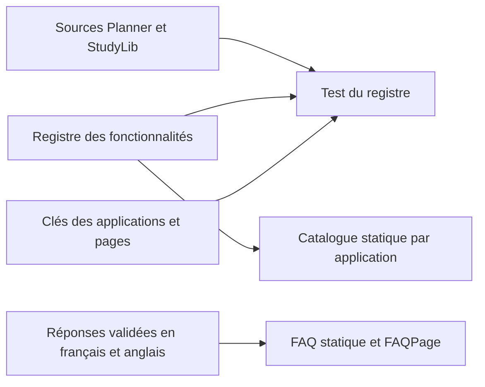

# VIT-11 · Catalogue des fonctionnalités et FAQ

| | |
|---|---|
| Module | [VIT](../../plan/modules/VIT-site-vitrine.md) · condition 9 de la mise en ligne |
| Branche | `feat/vit-11-catalogue-faq`, depuis `origin/main` à `48d65fd8` |
| Rédigé par | Codex, le 18 novembre 2026 |
| **Validé** | Validé par Claude20022002 le 18 novembre 2026 (questions 1, 2, 4 à 10 ; 3 par le coordinateur) |

## 1. Objet

Livrer deux pages statiques, « Toutes les fonctionnalités » et « Questions fréquentes ». Le catalogue
part d’un registre vérifiable et regroupe les fonctionnalités par application. Le site publie le français
et l’anglais et construit l’arabe avec le repli français du socle.

## 2. Catalogue

- `vitrine/src/donnees/fonctionnalites.json` fait foi. Une entrée représente un parcours identifiable.
  Champs proposés : `id` stable, `application` (clé), `categorie` (clé), `titre` et `description`
  (`fr`, `en`), `page` (clé de la page de détail), `sources` (dépôt et chemins), `etat`
  (`existe` ou `bientot`). Pour les usages sur téléphone, prévoir `alternative` (`fr`, `en`)
  et sa source lorsqu’un autre chemin existe.
- Applications : `planning`, `pedagogie`, `personnes`, `etablissement`, `annonces`, `activites`
  et `bibliotheque`, issues de `frontend/src/i18n/applications.fr.js`. Catégories proposées sous
  leurs applications : organisation et présence, cours et supports, comptes et rôles, configuration,
  communication, quiz et jeux, ressources pédagogiques, stages, projets et événements.
- Le site assemble les sections par application, chacune avec son titre, son nombre d’entrées et ses
  catégories. VIT-09 posera les icônes. Le filtre par texte porte sur les titres et descriptions dans
  la langue affichée et annonce le nombre de résultats. La page présente toutes les entrées sans
  JavaScript. Les entrées « Bientôt » portent ce libellé sans date et renvoient à leur plan.
- Adresses validées : `/<langue>/fonctionnalites/` et `/<langue>/faq/`. Après la fusion de VIT-10,
  VIT-11 ajoute les clés de route dans `langues.js` et les liens dans `EnTete.astro` et
  `PiedDePage.astro`. Le coordinateur ouvre ces trois fichiers pour cet ajout uniquement.
  Les preuves de Planner partent des plans [VIT-05](vit-05-solutions.md), [VIT-07](vit-07-contenu-complet.md) et de parité.

## 3. StudyLib dans l’application Bibliothèque

Sources lues dans [StudyLib à a834980](https://github.com/Claude20022002/StudyLib/tree/a8349801f351e884cc9e2877a649b51825f7ff50).
Le terme « module » désigne aussi la matière à laquelle StudyLib rattache un document. Les familles
ci-dessous permettent de présenter les capacités du produit et de discuter de leurs offres commerciales.

| Famille | Capacités observées | Preuves dans StudyLib |
|---|---|---|
| Ressources pédagogiques | Parcours par filière et matière, recherche, dépôt de cours, examens, TD, TP, exercices et articles, consultation, téléchargement et notation. Les dépôts étudiants passent par la modération. Les enseignants et l’administration publient directement selon leur rôle. | `routes/web.php`, `app/Enums/DocumentType.php`, `app/Services/DocumentService.php`, `app/Livewire/Ui/SearchBar.php`, contrôleurs de téléchargement, notation et modération |
| Accompagnement des cours | Supports liés aux séances, documents de classe publiés depuis Planner, vidéos recommandées par matière. | `routes/api.php`, `app/Http/Controllers/ModuleSupportsController.php`, `app/Http/Controllers/YoutubeRecommendationController.php` |
| Stages | Consulter et partager des retours d’expérience, avec photos selon le parcours disponible. L’API mobile liste les retours avec filtres et les retours de la personne connectée. | `app/Http/Controllers/InternshipReviewController.php`, `tests/Feature/Internship/InternshipReviewPhotoTest.php`, `tests/Feature/Planner/InternshipReviewMobileTest.php` |
| Projets | Consulter et proposer des idées de projet, suggestions IA selon disponibilité et droits. | `app/Http/Controllers/ProjectIdeaController.php`, `app/Http/Controllers/AiRecommendationController.php` |
| Événements | Consulter les événements et les administrer selon le rôle. | `app/Http/Controllers/EventController.php`, `app/Http/Controllers/Admin/EventController.php` |
| Parcours transversaux | Profil, tableau de bord, notifications et API mobile couvrant notamment documents, stages, projets et événements. | `routes/web.php`, `routes/api.php`, `tests/Feature/Planner/MobileApiTest.php` |

Le catalogue public présente les fonctions vérifiées sous « Bibliothèque · StudyLib ». Les demandes
commerciales passent par le contact. Le site ne décrit aucune offre ni aucun prix.

## 4. Décisions et réponses de FAQ validées

Visas relayés par le coordinateur dans la boîte Codex le 18 novembre 2026 à 20 h.

| N° | Sujet | Décision ou texte validé | Visa |
|---|---|---|---|
| 1 | Regroupement et adresses | Regroupement par application avec les clés de `frontend/src/i18n/applications.fr.js`. StudyLib reste sous « Bibliothèque ». Les adresses sont `/<langue>/fonctionnalites/` et `/<langue>/faq/`. VIT-09 pose les icônes. Après la fusion de VIT-10, VIT-11 ajoute les clés et les liens du catalogue et de la FAQ au menu et au pied de page, dans le périmètre ouvert par le coordinateur. | Chef pour le catalogue et les adresses. Coordinateur pour le périmètre des liens. |
| 2 | Périmètre StudyLib | Présenter les fonctions vérifiées et renvoyer vers le contact. Aucune offre ni aucun prix décrits. | Chef |
| 3 | Vérification des sources | Épingler le commit de StudyLib et contrôler les chemins avec `git cat-file -e <commit>:<chemin>` dans un clone local, hors CI. La vérification complète échoue si une source manque. Vérifier les chemins Planner à chaque exécution. Le build reste autonome. | Coordinateur |
| 4 | Où sont stockées les données ? | « Demandez-nous où seront hébergées les données de votre établissement. Nous vous préciserons les conditions de l’offre. » Lien vers Sécurité et données, pays d’hébergement à confirmer pour chaque offre. | Chef |
| 5 | Dans quelles langues puis-je consulter le site ? | « Le site est disponible en français et en anglais. Contactez-nous pour connaître les langues disponibles dans les applications qui vous intéressent. » | Chef |
| 6 | Peut-on importer des listes ? | « L’administration peut importer des listes de comptes, d’étudiants et d’enseignants à partir de fichiers CSV compatibles. » Sources : `backend/routes/{userRoutes,etudiantRoutes,enseignantRoutes}.js` et `frontend/src/utils/fileImport.js`. | Chef |
| 7 | Que propose l’application mobile ? | « L'application des étudiants montre leur semaine, scanne le QR code de l'appel et ouvre la Bibliothèque. Sans téléphone, l'emploi du temps et les ressources s'ouvrent dans un navigateur, et l'enseignant fait l'appel à la main. » Voir la page Application et les preuves ci-dessous. | Chef, sur la formulation du coordinateur |
| 8 | Comment l’IA intervient-elle ? | « Quand l’école active l’IA dans le Studio quiz, elle peut proposer des questions que l’enseignant relit avant de les partager. » | Chef |
| 9 | Peut-on choisir StudyLib séparément ? | « Contactez-nous pour discuter de StudyLib et des fonctionnalités qui répondent aux besoins de votre établissement. » | Chef |
| 10 | Combien cela coûte-t-il ? | « Contactez-nous pour parler des besoins de votre établissement. » Réutiliser le contact existant du site. | Chef |

Preuves de la réponse 7, vérifiées sur `main` à `631975af`.

- L’écran `mobile/src/app/(onglets)/semaine.jsx` affiche la liste et la grille des séances de la semaine.
- `mobile/src/app/scanner.jsx` lit le QR code avec `CameraView` et l’envoie à `/presences/scanner`.
- `mobile/src/app/(onglets)/_layout.jsx` expose l’onglet Bibliothèque. `mobile/src/app/(onglets)/bibliotheque.jsx` y affiche les cours et les ressources StudyLib.
- Dans le navigateur, `frontend/src/App.jsx` ouvre l’emploi du temps étudiant à `/emploi-du-temps/etudiant`. `frontend/src/components/layouts/navigation.jsx` propose la Bibliothèque à `/biblio/documents` et `frontend/src/components/layouts/DashboardLayout.jsx` ouvre cette adresse par navigation web.
- `frontend/src/pages/Appel.jsx` affiche les lignes d’appel et enregistre le statut choisi par l’enseignant via `presenceAPI.marquer`. `frontend/src/components/appel/LigneAppel.jsx` fournit les commandes pour chaque étudiant.

La FAQ intègre `FAQPage` en JSON-LD local. Ses questions et réponses reprennent exactement le texte visible dans la langue affichée.

## 5. EP-18 et EP-5

Le catalogue et la FAQ sont consultables sur le poste de l’école, avec un HTML statique et sans
JavaScript obligatoire. Pour les fonctions d’élève, indiquer le parcours vérifié avec l’équipement
de l’école, par exemple l’appel à la main depuis le poste enseignant, le jeu collectif au tableau
et les ressources StudyLib depuis un navigateur. Une ressource déjà téléchargée peut être remise
par l’école sur papier lorsque le support s’y prête. Garder explicite le besoin de connexion pour
consulter ou télécharger une ressource en ligne. Toute référence à un échange avec l’État précise
le pays et le service pertinent.

## 6. Livraison et vérifications

1. Commettre la validation du plan seule. Attendre la fusion de VIT-10 avant le code.
2. Créer le registre, les deux pages et leurs composants et textes dans les répertoires de VIT-11.
   Le site reste statique et les pages chargent leurs ressources depuis la vitrine.
3. Ajouter `vitrine/tests/fonctionnalites.test.js`. Vérifier l’unicité des identifiants, les états,
   les langues, les applications connues, les routes existantes et les chemins de source. Vérifier aussi
   la correspondance entre FAQ visible et JSON-LD, le repli et le filtre clavier.
4. Lancer les tests, le build de la vitrine, la neutralité, axe-core et Lighthouse. Recetter les deux
   pages sur mobile et bureau, avec et sans JavaScript. Documenter les résultats pour le chef.
