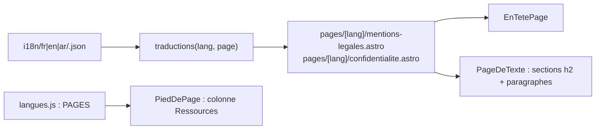

# VIT-12 · Mentions légales et confidentialité du site vitrine

| | |
|---|---|
| Module | [VIT](../../plan/modules/VIT-site-vitrine.md) · **condition 2** de la mise en ligne ([VIT-06](../exploitation/vit-06-mise-en-ligne.md)) |
| Mission | [vit-12-pages-legales.md](../../plan/missions/vit-12-pages-legales.md) |
| Branche | `feat/vit-12-pages-legales`, depuis `origin/main` à `427afdea` (VIT-10, #219, fusionnée) |
| Rédigé par | Claude Code (Opus 5.5), le 18 novembre 2026 |
| **Validé** | en attente : le chef valide le plan **et chaque texte** (§ 4 et § 5) avant le code |

## 1. Objet et critère de « terminé »

Deux pages du seul site vitrine (pas de l'application Planner) : « Mentions légales » et « Confidentialité ».

- Adresses `/<langue>/mentions-legales/` et `/<langue>/confidentialite/`, en français et en anglais ; l'arabe est construit avec des
  textes vides, donc affiche le français (repli du socle, `vitrine/src/i18n/index.js`).
- Liens dans la colonne « Ressources » du pied de page.
- Chaque phrase vient d'une réponse du chef (§ 3) ou d'un fait du site (§ 2). **Aucun champ « à compléter » ne part en ligne** :
  un test le vérifie (§ 7).
- Build, tests du site, `scripts/verifier-neutre.mjs`, axe-core, pas de défilement horizontal en 390 et 1440 px.

## 2. Faits du site, vérifiés sur `427afdea`

| Fait | Où |
|---|---|
| Aucun formulaire ; la section Contact de l'accueil n'a ni champ ni adresse | `vitrine/src/components/accueil/Contact.astro` |
| Aucun cookie, aucun stockage sur l'appareil, aucun appel réseau : ni `document.cookie`, ni `localStorage`, ni `fetch`, ni URL externe | recherche dans `vitrine/src` |
| Polices, images, vidéos et scripts servis par le site lui-même | page Sécurité, cartes « Ce site » ; VIT-06, § « Vidéo » |
| Le serveur : image Nginx derrière Traefik ; journaux Docker `json-file`, 10 Mo × 5 fichiers par service | VIT-06 ; décision du chef du 18 nov. |
| Le site est d'abord en ligne sur un sous-domaine, non indexé (`X-Robots-Tag: noindex`) | VIT-06 |
| Le dépôt n'a pas de fichier de licence | racine du dépôt |

## 3. Réponses du chef (18 novembre 2026, par l'outil de questions)

| N° | Question | Réponse du chef | Dans le texte |
|---|---|---|---|
| 1 | Éditeur du site | **personne physique** ; **nom seul, sans adresse postale** | `[NOM]` : **à donner par le chef** |
| 2 | Directeur de la publication | **le chef de projet** | `[NOM]` |
| 3 | Hébergeur | **à compléter plus tard** (ligne présente, la mise en ligne attend) | `[HÉBERGEUR]` : nom, adresse, à donner |
| 4 | Contact sur le site et la confidentialité | **une adresse e-mail**, **à compléter plus tard** | `[E-MAIL]` : à donner |
| 5 | Journaux techniques du serveur | **dire qu'ils existent, avec une durée fixée** | `[N]` jours : à donner ; **proposition : 30** |
| 6 | Droit applicable et tribunal | **ne rien écrire** | aucune phrase |
| 7 | Relecture par un juriste | **la validation du chef suffit pour cette mise en ligne non indexée** ; le juriste relit avant VIT-02 et avant l'indexation | — |

**Ce qui reste au chef avant le code** : `[NOM]`, `[E-MAIL]`, `[HÉBERGEUR]`, `[N]`. Et, pour `[N]` : la configuration du serveur doit
effacer les journaux de la vitrine (Nginx et Traefik) en `[N]` jours au plus. Aujourd'hui la rotation se fait par taille, pas par durée :
la phrase du § 5.2 n'est vraie qu'une fois ce réglage fait ou vérifié (hors de ce périmètre : `deploy/`, chef).

Écarté faute de réponse : aucune clause de propriété du contenu (pas de licence dans le dépôt), aucun pays, aucune loi nommée (Q-23).

## 4. Texte de la page « Mentions légales »

Fichier `vitrine/src/i18n/<langue>/mentions-legales.json`. Titre de l'onglet et description pour les moteurs compris.

| Bloc | Français | English |
|---|---|---|
| Onglet | Mentions légales · Planner | Legal notice · Planner |
| Description | Qui édite ce site, qui l'héberge, et comment nous écrire. | Who publishes this site, who hosts it, and how to reach us. |
| Surtitre | Informations légales | Legal information |
| Titre | Mentions légales | Legal notice |
| Accroche | Ce site présente le logiciel Planner. Voici qui le publie et qui l'héberge. | This site presents the Planner software. Here is who publishes it and who hosts it. |
| **Éditeur** | Ce site est édité par [NOM], à titre personnel. | This site is published by [NOM], as an individual. |
| **Directeur de la publication** | [NOM]. | [NOM]. |
| **Contact** | Pour toute question sur ce site : [E-MAIL]. | For any question about this site: [E-MAIL]. |
| **Hébergement** | Ce site est hébergé par [HÉBERGEUR]. | This site is hosted by [HÉBERGEUR]. |
| **Données personnelles** | Ce que ce site recueille, et pourquoi, est expliqué sur la page Confidentialité. | What this site collects, and why, is explained on the Privacy page. |

« Confidentialité » / « Privacy » est un lien vers `/<langue>/confidentialite/`.

## 5. Texte de la page « Confidentialité »

Fichier `vitrine/src/i18n/<langue>/confidentialite.json`.

| Bloc | Français | English |
|---|---|---|
| Onglet | Confidentialité · Planner | Privacy · Planner |
| Description | Ce que ce site recueille quand vous le consultez, et pourquoi. | What this site collects when you visit it, and why. |
| Surtitre | Confidentialité | Privacy |
| Titre | Ce site recueille le moins possible. | This site collects as little as possible. |
| Accroche | Cette page dit exactement ce que ce site garde de votre visite. | This page states exactly what this site keeps from your visit. |

### 5.1 Ce que ce site ne fait pas

| Français | English |
|---|---|
| Ce site n'a pas de formulaire : il ne vous demande ni nom, ni adresse, ni message. | This site has no form: it does not ask for your name, address or message. |
| Il ne dépose aucun cookie et n'enregistre rien sur votre appareil. | It sets no cookies and stores nothing on your device. |
| Il ne mesure pas l'audience : aucun outil ne compte vos visites. | It does not measure traffic: no tool counts your visits. |
| Il ne charge rien depuis un autre site : polices, images, vidéos et scripts viennent de ce site. | It loads nothing from another site: fonts, images, videos and scripts come from this site. |

### 5.2 Le journal technique du serveur

| Français | English |
|---|---|
| Comme tout serveur web, celui de ce site note chaque demande dans un journal technique : l'adresse IP, la date et l'heure, la page demandée, la page d'où vous venez et le type de navigateur. | Like any web server, this site's server records each request in a technical log: the IP address, the date and time, the page requested, the page you came from and the type of browser. |
| Ce journal sert seulement à la sécurité et au bon fonctionnement du site : repérer une attaque, corriger une erreur. | This log is used only for the site's security and proper operation: spotting an attack, fixing an error. |
| Il n'est ni vendu, ni utilisé pour suivre vos visites. Il reste sur le serveur du site. | It is not sold, nor used to track your visits. It stays on the site's server. |
| Il est effacé automatiquement au plus tard après [N] jours. | It is deleted automatically after [N] days at most. |

« Il reste sur le serveur du site » : **fait à confirmer par le chef** (les sauvegardes hors serveur ne doivent pas emporter ces journaux ;
décision du 30 octobre : aucune erreur hors du serveur). Sans confirmation, la phrase est retirée.

### 5.3 Qui en est responsable, et vos demandes

| Français | English |
|---|---|
| Le responsable de ce journal est l'éditeur du site (voir les mentions légales). | The person responsible for this log is the site's publisher (see the legal notice). |
| Vous pouvez demander à consulter ou à effacer ce qui vous concerne en écrivant à [E-MAIL]. Pour retrouver votre visite, nous aurons besoin de votre adresse IP et de l'heure approximative. | You can ask to see or delete what concerns you by writing to [E-MAIL]. To find your visit, we will need your IP address and the approximate time. |

### 5.4 Ce que cette page ne couvre pas, et ses changements

| Français | English |
|---|---|
| Cette page ne concerne que ce site. Elle ne décrit pas l'application Planner, ni les données que les écoles y gèrent. | This page covers this site only. It does not describe the Planner application, nor the data schools manage in it. |
| Si ce site recueille un jour autre chose, par exemple avec un formulaire de contact, cette page sera mise à jour avant. | If this site ever collects anything else, for example through a contact form, this page will be updated first. |
| Dernière mise à jour : [date de la mise en ligne]. | Last updated: [date of publication]. |

« Mentions légales » / « legal notice » au § 5.3 est un lien vers `/<langue>/mentions-legales/`. La date est écrite dans le texte à la
mise en ligne, pas calculée au build (elle ne doit pas changer à chaque construction).

## 6. Solution

Deux pages statiques qui assemblent seulement : `EnTetePage` (déjà là), puis les blocs de texte, puis rien d'autre (pas de `FinDePage`,
qui invite à une démonstration). Un composant de texte simple affiche une suite de sections (titre `h2`, paragraphes, liens internes).

**Question au coordinateur (périmètre)** : la fiche n'ouvre pas `vitrine/src/components/`. Je propose un composant partagé
`vitrine/src/components/textes/PageDeTexte.astro` (styles dans le composant, aucun jeton nouveau), réutilisé par la page À propos de VIT-16.
Sans accord, le balisage et ses styles vont dans chaque page, au prix d'une répétition.

## 7. Fichiers créés ou modifiés

| Fichier | Créé / modifié | Rôle | Taille visée |
|---|---|---|---|
| `vitrine/src/pages/[lang]/mentions-legales.astro` | créé | assemble la page | 30 lignes |
| `vitrine/src/pages/[lang]/confidentialite.astro` | créé | assemble la page | 30 lignes |
| `vitrine/src/components/textes/PageDeTexte.astro` | créé, **si le coordinateur l'accepte** | sections de texte | 60 lignes |
| `vitrine/src/i18n/{fr,en,ar}/mentions-legales.json`, `confidentialite.json` | créés (ar : textes vides) | textes | — |
| `vitrine/src/i18n/{fr,en,ar}/commun.json` | modifié | deux clés de navigation : `mentionsLegales`, `confidentialite` ; l'adresse `contact.email`, écrite une seule fois et reprise par VIT-16 | +4 lignes |
| `vitrine/src/i18n/langues.js` | modifié | deux entrées de `PAGES` | +2 lignes |
| `vitrine/src/components/socle/PiedDePage.astro` | modifié | deux liens dans « Ressources » | +2 lignes |
| `vitrine/tests/pages-legales.test.js` | créé | voir § 8 | 60 lignes |
| `docs/plan/modules/VIT-site-vitrine.md` | modifié | ligne « Ce qui existe » | +1 ligne |

Aucune donnée, aucune migration. Pas de modification de `vitrine/src/styles/`, de l'accueil, de `deploy/`, des workflows, ni de `suivi.md`.

## 8. Tests et vérifications

- `vitrine/tests/pages-legales.test.js` :
  - les deux pages existent dans `PAGES` et le pied de page les lie ;
  - **aucun texte des deux pages ne contient `[` suivi d'un champ à compléter** (`[NOM]`, `[E-MAIL]`, `[HÉBERGEUR]`, `[N]`, `[date`) :
    ce test bloque une mise en ligne avec un champ vide ;
  - aucun texte ne nomme un pays ni une loi (liste : Maroc, Morocco, 09-08, CNDP, RGPD, GDPR, France) ;
  - aucun lien externe dans les deux pages (seul `mailto:` est permis).
- Les tests existants : mêmes clés dans les trois langues (`traductions.test.js`).
- `npm run build` et `npm test` dans `vitrine/`, `node scripts/verifier-neutre.mjs`, axe-core sur les deux pages en fr et en,
  largeur 390 et 1440 px sans défilement horizontal.

## 9. Étapes de livraison

1. Ce plan, commité seul.
2. Le chef valide le plan, chaque texte, et donne `[NOM]`, `[E-MAIL]`, `[HÉBERGEUR]`, `[N]` ; le coordinateur répond pour `PageDeTexte`.
3. Code et tests, en un ou deux commits ; ligne du module ; fiche de session.
4. Le chef pousse ; la condition 2 de VIT-06 est remplie quand la branche est fusionnée et que le réglage `[N]` jours du serveur est fait.
