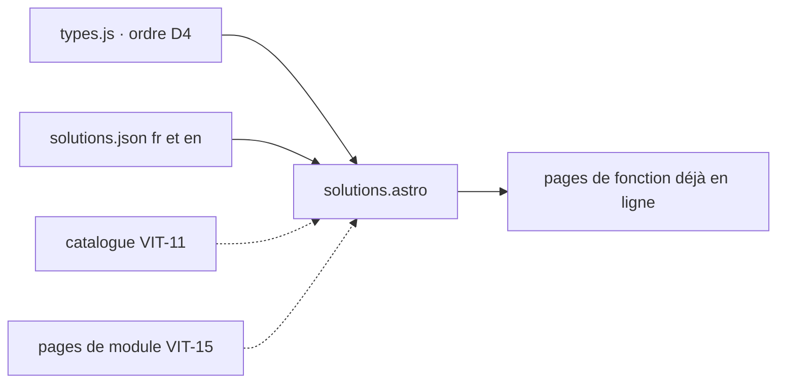

# VIT-13 · Fonctionnalités par type d'établissement — plan court

| | |
|---|---|
| Module | [VIT](../../plan/modules/VIT-site-vitrine.md) · préparation de VIT-05 |
| Mission | `docs/plan/missions/vit-13-pourquoi-et-types.md` (branche `doc/coordination-equipe`) |
| Branche | `feat/vit-13-pourquoi-et-types`, depuis `origin/main` (`b57753e9`) |
| Rédigé par | agent de Cursor (Grok 4.7), le 22 novembre 2026 |
| **Validé** | en attente du chef (ce que le site promet) |

La section « Pourquoi Planner » est à VIT-14 (`vitrine/src/pages/[lang]/comparer.astro`). VIT-13 ne la réécrit pas.

## 1. Objet et critère de « terminé »

La page `/<langue>/solutions/` dit, pour trois types et dans l'ordre de D4, ce que le code fait **aujourd'hui** et ce qui est **Bientôt**. Elle est terminée quand :

1. l'ordre reste supérieur, formation professionnelle, collège et lycée (`vitrine/src/components/solutions/types.js`) ;
2. chaque phrase d'« Aujourd'hui » cite, dans ce plan, un fichier du code qui la tient ; chaque « Bientôt » cite une fonction du plan encore à faire, ou l'absence de route ;
3. le collège et le lycée disent que le calcul de leur emploi du temps n'est pas écrit (MOT-06, MOT-07) ;
4. aucune phrase ne fait du téléphone le seul chemin, ne nomme un pays, une monnaie, une école, un chiffre ou un témoignage ;
5. français et anglais ; l'arabe garde les mêmes clés, vides, comme aujourd'hui ;
6. build, tests, `node scripts/verifier-neutre.mjs`, axe-core, 390, 768 et 1440 px ; la page reste sous le budget d'EP-19 (VIT-19, `vitrine/scripts/verifier-poids-ep19.mjs`, 204 800 octets).

Le code ne distingue pas le type d'établissement (aucune occurrence de `type_etablissement` dans `backend/`). Le même programme sert les trois textes. Le découpage par type est celui validé le 18 novembre (VIT-05) : on met en avant, on n'invente pas une fonction réservée à un type.

## 2. Ce qui existe

Déjà sur `main`, à ne pas refaire :

| Élément | Fichier | Rôle |
|---|---|---|
| Page, une section par type, sommaire | `vitrine/src/pages/[lang]/solutions.astro` | assemble ; `getStaticPaths = cheminsLangues` |
| Ordre D4, lien de chaque point « Aujourd'hui » | `vitrine/src/components/solutions/types.js` | supérieur → formation → collège et lycée |
| Textes | `vitrine/src/i18n/{fr,en,ar}/solutions.json` | arabe : clés présentes, valeurs vides |
| Catalogue et méga-menu | `vitrine/src/donnees/fonctionnalites.json`, `vitrine/src/components/catalogue/` | VIT-11 (#236). VIT-13 n'y écrit pas |
| Langues publiées | `vitrine/src/i18n/langues.js` | `cheminsLangues()` : `fr` et `en` seulement |
| Poids | `.github/workflows/vitrine.yml` | étape « EP-19 · poids transféré ≤ 200 Ko par page » |

Les pages par module (`/<langue>/modules/…`) n'existent pas : elles sont à VIT-15. VIT-13 ne les crée pas et ne pointe pas vers une adresse absente.

## 3. Questions

| N° | Question | Proposition | Réponse du chef | Bloque |
|---|---|---|---|---|
| 1 | Où montrer les trois types ? | **Rester sur la page Solutions** (choix du 18 nov. : une page, trois sections). Pas de page par type. Chaque point « Aujourd'hui » garde son lien vers la page de fonction déjà en ligne (`types.js`). Le catalogue VIT-11 reste le renvoi « toutes les fonctions ». Les URL de modules sont à VIT-15. | | oui |
| 2 | L'accroche et la description listent encore le collège en premier (`solutions.json`, `entete.accroche`, `meta.description`). | Les réordonner comme D4 : supérieur, formation professionnelle, collège et lycée. Même sens, aucun fait nouveau. L'anglais suit. | | oui |
| 3 | L'appel du collège commence par le scan. L'accueil (VIT-18) et EP-18 commencent par la main. | Aligner : « L'enseignant note chacun à la main : présent, en retard ou absent. Il peut aussi projeter un QR code. » Le hors ligne (N2) n'est pas écrit : on ne le promet pas. | | oui |
| 4 | « Des quiz et des jeux » pour le collège ne dit pas les domaines (P4). | « Des quiz en direct ou à son rythme. Les jeux portent sur l'informatique et la gestion. » Preuve : `shared/simulations/catalogue/`. | | oui |
| 5 | « Absences » est dans « Bientôt » alors que l'appel note déjà présent, retard, absent. | Garder l'appel dans « Aujourd'hui ». Dans « Bientôt », préciser : le suivi au-delà de la séance (justificatif, familles) — VSC-03, à faire. | | oui |
| 6 | Le supérieur promet « le lien avec les anciens élèves ». Aucune fonction du plan ne le porte. | Retirer ce membre de phrase. Garder « Les stages des étudiants » comme « Bientôt » (STA-02, reporté). StudyLib ne compte pas : ce sont des avis de stage, pas un suivi de stage. | | oui |
| 7 | Le collège dit « élèves », le code dit « étudiants ». | Garder « élèves » dans la section collège et lycée (textes validés le 18 nov.). Ne pas renommer le code. | | non |

Les phrases figées par VIT-18 dans `vitrine/tests/contenu.test.js` ne bougent pas : « Pour l'université, la grande école et les formations techniques supérieures » et « Un emploi du temps calculé, que vous ajustez. »

## 4. Solution

Après l'accord du chef sur les questions 1 à 6 : modifier **seulement** les chaînes acceptées, en français et en anglais, mêmes clés. Aucun composant nouveau, aucune page nouvelle, aucun logo (VIT-09).

Le lien pointillé vers VIT-15 n'est pas codé ici.

### 4.1 Supérieur — ce que le code tient

| Phrase actuelle | Preuve |
|---|---|
| Planner calcule le semestre, puis accompagne chaque séance. | `backend/routes/generationAutomatiqueRoutes.js` ; `backend/controllers/generationAutomatiqueController.js` (une version que l'on peut réactiver) |
| Cours, TD et TP, groupes et sous-groupes ; chaque refus est expliqué. | `backend/config/referentiel.js` (`TYPES_COMPOSANTE` : CM, TD, TP, Projet ; `NIVEAUX_GROUPE` : promotion, td, tp) ; `backend/services/planning/seances.js` (`ViolationsBloquantes`, HTTP 409) |
| Plusieurs campus ; le temps de trajet compte. | `backend/tests/integration/regles.test.js` (refus `trajet_campus`) ; `solver/src/test/java/ma/hestim/solver/contraintes/TrajetEntreCampusTest.java` |
| Sessions d'examen, salles, surveillances. | `backend/routes/examenRoutes.js` ; `backend/models/SessionExamen.js` (`brouillon`, `publiee`, `annulee`) |
| Appel par QR code ou à la main, quiz en direct, jeux, même compte. | `frontend/src/pages/Appel.jsx` (`presenceAPI.marquer`) ; `frontend/src/pages/AppelProjection.jsx` ; `backend/routes/quizDirectRoutes.js` ; `backend/routes/jeuxRoutes.js` |

| Bientôt | Pourquoi ce n'est pas « Aujourd'hui » |
|---|---|
| Notes et bulletins, avec les crédits. | Aucune route de notes. `docs/plan/modules/VSC-vie-scolaire.md`, VSC-04, à faire. Le mot LMD a été retiré (VIT-18, D3). |
| Stages des étudiants. | `docs/plan/modules/STA-stages-alternance.md`, STA-02, reporté. Les avis de stage de StudyLib (`InternshipReviewController`, cité par le registre VIT-11) ne sont pas ce suivi. |

### 4.2 Formation professionnelle — ce que le code tient

Même programme que le supérieur. On garde la mise en avant validée le 18 novembre.

| Phrase actuelle | Preuve |
|---|---|
| Emploi du temps calculé, gardé en version, visible une fois publié. | `backend/services/calendrier/versionPubliee.js` (les étudiants voient la publication, pas le travail en cours) ; `generationAutomatiqueController.js` |
| Reports suivis. | `backend/services/planning/reportDecision.js` ; `backend/routes/demandeReportRoutes.js` |
| Export PDF. | `frontend/src/components/emploi-du-temps/TimetableExportMenu.jsx` ; `shared/grilleEdt.js` |
| Ajout à l'agenda. | `backend/routes/agendaRoutes.js` ; `backend/services/calendrier/ics.js` |
| Import CSV des enseignants, des apprenants, des groupes et des cours. | `frontend/src/pages/gestion/Enseignants.jsx`, `Etudiants.jsx` ; `frontend/src/components/groupes/DialogsGroupes.jsx` ; `frontend/src/components/cours/DialogsModules.jsx`. Le code nomme les apprenants « étudiants ». |

| Bientôt | Pourquoi |
|---|---|
| Admissions, sans ressaisie. | `docs/plan/modules/INS-admissions.md`, INS-01, à faire |
| Attestations avec un code vérifiable. | `docs/plan/modules/DOC-documents-verifiables.md`, DOC-01, à faire |
| Stages suivis. | STA-02, reporté |

### 4.3 Collège et lycée — aujourd'hui, et ce qui est Bientôt

Le texte d'introduction reste : le calcul d'un collège ou d'un lycée est en préparation. Preuve que ce calcul n'existe pas : `docs/plan/modules/MOT-moteur.md`, MOT-06 et MOT-07, à faire. Les groupes de langue : VSC-07, à faire.

| Aujourd'hui (le code existe, il n'est pas réservé au collège) | Preuve |
|---|---|
| Appel : présent, en retard, absent, rattaché à la séance. QR projeté en plus. | `frontend/src/pages/Appel.jsx` ; `frontend/src/i18n/fr.js` (`appel.statuts`) ; `frontend/src/pages/AppelProjection.jsx`. Le QR change (`expire_le` dans `Appel.jsx`) : il demande une connexion. La saisie à la main hors ligne est N2, pas écrite. |
| Quiz en direct ou à son rythme. | `backend/routes/quizDirectRoutes.js` ; `backend/routes/quizRoutes.js` |
| Jeux. | `shared/simulations/catalogue/` : sécurité, réseaux, SQL, ordonnanceur, complexité, ERP, stocks, agile, robot. Pas un programme de collège général (P4). |
| Salles, réservations, examens, surveillances, occupation. | `backend/routes/reservationRoutes.js` ; `examenRoutes.js` ; `statistiquesRoutes.js` |
| Reports : demande, validation, personnes du groupe prévenues. | `backend/services/planning/seances.js`, `notifierChangementSeance` (notifications aux comptes du groupe) |

| Bientôt | Pourquoi |
|---|---|
| Emploi du temps calculé, groupes de langue et d'option. | MOT-06, MOT-07, VSC-07 |
| Compte famille, un ou plusieurs enfants. | VSC-02, à faire ; registre VIT-11, entrée `familles`, `etat: bientot` |
| Suivi des absences au-delà de l'appel, notes, bulletins. | VSC-03, VSC-04. L'appel de la séance, lui, est déjà là (EDT). |
| Export vers la plateforme nationale, sans nom de pays. | Phrase tenue par VIT-18 (D3). `docs/plan/modules/ETA-echanges-etat.md`, ETA-01, à faire. On ne réécrit pas Massar. |
| Arabe. | `langues.js` : `LANGUES_PUBLIEES` = `fr`, `en`. UIX-04, à faire. |

## 5. Fichiers

| Fichier | Créé / modifié | Rôle |
|---|---|---|
| `docs/conception/vitrine/vit-13-pourquoi-et-types.md` | créé | ce plan |
| `vitrine/src/i18n/fr/solutions.json` | modifié | seules les chaînes acceptées aux questions 2 à 6 |
| `vitrine/src/i18n/en/solutions.json` | modifié | le même sens |
| `vitrine/src/i18n/ar/solutions.json` | inchangé | mêmes clés, valeurs vides |
| `vitrine/src/components/solutions/types.js` | inchangé | ordre D4 et liens actuels (question 1) |
| `vitrine/src/pages/[lang]/solutions.astro` | inchangé | |
| `vitrine/src/components/catalogue/`, `langues.js` | inchangés | VIT-11 |
| `vitrine/tests/solutions.test.js` | modifié seulement si une liste change de longueur | un lien par point « Aujourd'hui » |
| `docs/plan/modules/VIT-site-vitrine.md` | modifié | ligne VIT-13, à la fin du code |
| fiche de session | créé | à la fin du code |

Pas de `docs/plan/suivi.md`.

## 6. Données et migration

Aucune. Site statique.

## 7. Sécurité et exigences produit

EP-5 : aucun pays ni aucune monnaie. Le test `contenu.test.js` refuse déjà Maroc, Morocco, Massar, BTS, LMD. La phrase « votre pays » (VIT-18) ne nomme personne : on la garde.

EP-13 : la page ne charge rien d'un autre site.

EP-16 : tout texte passe par `solutions.json`.

EP-18 : le téléphone n'est pas le seul chemin (appel à la main, `Appel.jsx` ; emploi du temps dans le navigateur, `frontend/src/App.jsx`, entrée `semaine` du registre). Pas d'écran ni de papier exigés pour l'appel à la main (`en-classe.json`, phrase VIT-18). Le PDF imprimé existe (`TimetableExportMenu.jsx`) ; le bloc « selon votre équipement » est à VIT-15, pas ici. N2 (appel hors ligne) n'est pas promis.

EP-19 : aucun média ajouté. Le contrôle VIT-19 doit rester vert. La page Solutions pesait environ 83 Ko à l'expertise du 18 nov., sous 204 800 octets.

## 7 bis. Ce que disent les études

Registre : `docs/etude-marche/14-reprendre-et-depasser.md`. Public d'abord : le **supérieur** (M18, D4). Le collège et le lycée restent nommés, avec leur calcul en « Bientôt ».

| Ligne | Étude | Appliquée ou écartée | Comment |
|---|---|---|---|
| M18 | 14, § 3 | appliquée | Le supérieur reste en tête : CM, TD, TP, groupes, campus, trajet. |
| D4 | expertise 12, § 12 | appliquée | Ordre des sections déjà celui de `types.js`. L'accroche suit si la question 2 est oui. |
| P1 | expertise 12, § 3 | appliquée avant VIT-13 | L'accueil le dit (VIT-18). VIT-13 ne rouvre pas l'accueil. Le collège le redit dans son introduction. |
| P4 | expertise 12, § 3 | appliquée si question 4 oui | La page Quiz nomme déjà les domaines. La section collège les nomme aussi. |
| M15, N4 | 14, § 3 et § 5 | appliquée | Aucun superlatif, chaque phrase a une source. |
| M17, EP-5 | 14, § 3 | appliquée | Aucun pays ni aucune monnaie nommés. |
| EP-18, § 4 point 5 | 14, § 4 | appliquée sans le bloc de VIT-15 | Main d'abord si question 3 oui. Pas de promesse hors ligne (N2 écartée d'« Aujourd'hui »). |
| N1, EP-19 | 14, § 5 | appliquée | Pas de média ; le contrôle de `vitrine.yml` reste le juge. |
| N3 | 14, § 5 | écartée | Cette page ne fait pas télécharger un support. |
| R4 | 14, § 2.1 | renvoyée à VIT-15 | VIT-13 n'écrit pas les pages de module. |
| C5 | expertise 12 | appliquée sur l'appel | Même sens que la phrase d'accueil déjà validée : la main d'abord, le QR en plus. |

## 8. Tests

- `vitrine/tests/solutions.test.js` : ordre D4, un lien par point, aucun prix.
- `vitrine/tests/contenu.test.js` : les deux phrases Solutions de VIT-18 restent ; le garde-fou pays reste.
- `npm run test:unit` dans `vitrine/`, `node scripts/verifier-neutre.mjs`, build, puis `node scripts/verifier-poids-ep19.mjs`.
- axe-core sur `/fr/solutions/` et `/en/solutions/` à 390, 768 et 1440 px.

## 9. Étapes

1. Ce plan, commité seul. Le chef valide.
2. Chaînes acceptées, tests si une longueur change.
3. Contrôles du § 8, ligne du module, fiche de session. Rien n'est poussé.

## 10. Risques et retour arrière

Le risque est une promesse plus large que le code. Le retour arrière est un commit qui rend les chaînes précédentes : aucun schéma, aucune migration.

## 11. Hors périmètre

- Section « Pourquoi Planner » et page Comparer (VIT-14).
- Catalogue, méga-menu « Fonctions », `cheminsLangues()` (VIT-11).
- Pages par module et bloc « selon votre équipement » (VIT-15).
- Logos (VIT-09). Icônes du menu (VIT-18 a déjà fixé `EnTete.astro`).
- Vidéo (VIT-08), accueil, pages par rôle.
- StudyLib comme fonction propre à un type.
- `docs/plan/suivi.md`.
