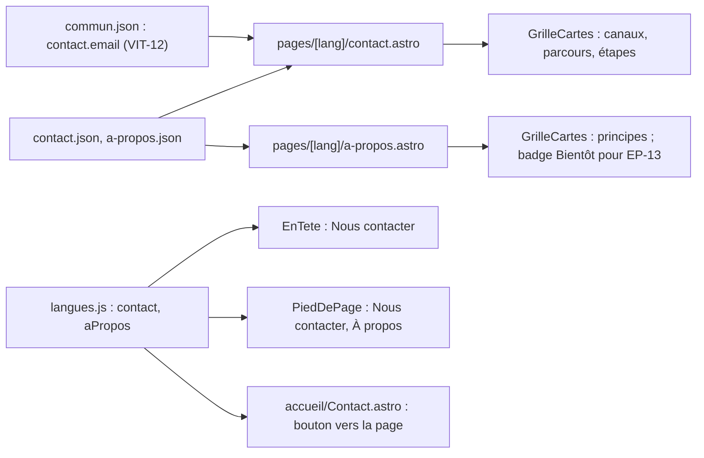

# VIT-16 · Page Contact complète et page À propos

| | |
|---|---|
| Module | [VIT](../../plan/modules/VIT-site-vitrine.md) · **condition 10** de la mise en ligne ([VIT-06](../exploitation/vit-06-mise-en-ligne.md)) |
| Mission | [vit-16-contact-a-propos.md](../../plan/missions/vit-16-contact-a-propos.md) |
| Branche | `feat/vit-16-contact-a-propos`, depuis `origin/main` à `427afdea` (VIT-10 fusionnée) ; le code se rebase après la fusion de VIT-12 |
| Rédigé par | Claude Code (Opus 5.5), le 18 novembre 2026 |
| **Validé** | « validé avec corrections » par le chef le 18 nov. ; **les corrections ne sont pas encore parvenues** : pas de code avant elles |

## 1. Objet et critère de « terminé »

- `/<langue>/contact/` : les canaux, « Comment nous pouvons vous aider », « Ce qui se passe après votre message », la démonstration.
- `/<langue>/a-propos/` : qui fait Planner, la mission, les principes. Sans témoignage ni chiffre.
- En français et en anglais ; l'arabe construit avec des textes vides (repli sur le français).
- « Nous contacter » de l'en-tête et du pied de page mène à `/contact/` ; « À propos » est dans le pied de page ; la section Contact de
  l'accueil renvoie à la page.
- **Pas de formulaire** (VIT-02 plus tard). Aucune coordonnée réelle sans l'accord du chef ; aucun champ « à compléter » ne part en ligne.
- Build, tests, `scripts/verifier-neutre.mjs`, axe-core, 390 et 1440 px.

## 2. Ce qui existe, sur `427afdea`

| Élément | Où | Ce qu'on en fait |
|---|---|---|
| Bouton « Nous contacter » de l'en-tête → `/<langue>/#contact` | `vitrine/src/components/socle/EnTete.astro`, ligne 93 | mène à `/<langue>/contact/` |
| Lien « Nous contacter » de la colonne Ressources | `vitrine/src/components/socle/PiedDePage.astro` | mène à `/<langue>/contact/` ; « À propos » ajouté |
| Section Contact de l'accueil : logo, titre, texte « Le formulaire de contact arrive bientôt sur cette page. » | `components/accueil/Contact.astro`, `i18n/*/accueil.json` → `contact` | texte corrigé, bouton vers la page |
| Fin de chaque page de fonction : bouton « Nous contacter » → `/#contact` | `components/fonctions/FinDePage.astro` | **hors périmètre** : voir § 6 |
| Grille de cartes avec un lien par carte (`href`) et un badge « Bientôt » pour toute une grille | `components/fonctions/GrilleCartes.astro` | réutilisée **sans lien** (étapes, principes) ; les liens passent par `PageDeTexte` de VIT-12 (§ 6) |
| Vidéo de l'accueil, section `#presentation` | VIT-08, PR #216, **non fusionnée** | lien seulement si elle est fusionnée au moment du code |
| Procédure de signalement des failles | QUA-08, PR #188, **non fusionnée** | rien ne renvoie encore à `SECURITY.md` |
| Adresse e-mail | posée par VIT-12 dans `commun.json` → `contact.email` | reprise ici, jamais recopiée |

## 3. Réponses du chef (18 novembre 2026, par l'outil de questions)

| Question | Réponse du chef |
|---|---|
| Canaux publiés | **e-mail** et **LinkedIn ou autre réseau** ; pas de WhatsApp. Adresse e-mail : **à compléter** (`[E-MAIL]`, la même que VIT-12) ; réseau : `[RÉSEAU]`, nom et adresse **à donner** |
| Délai de réponse | **aucun chiffre** : « nous lisons chaque message et répondons par le canal que vous avez utilisé » |
| Parcours | **démonstration**, **question sur votre école**, **partenariat**, **signaler une faille** |
| Étapes après le message | **les quatre étapes proposées** (§ 4.4) |
| Qui fait Planner | **« une petite équipe », sans nom** ; une équipe qui conçoit Planner avec des écoles ; aucun nom de personne ni d'école, aucun chiffre |
| « Aucun envoi caché » (EP-13) | **marqué « Bientôt »**, comme sur la page Sécurité, tant que #189 (QUA-09) n'est pas fusionnée |

**Ce qui reste au chef avant le code** : `[E-MAIL]` (déjà demandé pour VIT-12) et `[RÉSEAU]` (nom du réseau et adresse de la page).

## 4. Texte de la page « Contact »

Fichier `vitrine/src/i18n/<langue>/contact.json`. Les liens `mailto:` portent un objet ; il est encodé dans l'adresse.

| Bloc | Français | English |
|---|---|---|
| Onglet | Contact · Planner | Contact · Planner |
| Description | Écrivez-nous pour voir Planner, poser une question sur votre école ou proposer un partenariat. | Write to us to see Planner, ask about your school or suggest a partnership. |
| Surtitre | Contact | Contact |
| Titre | Parlons de votre école. | Let's talk about your school. |
| Accroche | Nous lisons chaque message et répondons par le canal que vous avez utilisé. | We read every message and reply through the channel you used. |

### 4.1 Nous écrire (canaux)

| Carte | Français | English | Lien |
|---|---|---|---|
| E-mail | **Par e-mail** · [E-MAIL] · Pour toute demande. | **By email** · [E-MAIL] · For any request. | `mailto:[E-MAIL]` |
| Réseau | **Sur [RÉSEAU]** · Suivez Planner et écrivez-nous. | **On [RÉSEAU]** · Follow Planner and write to us. | adresse de la page, nouvel onglet non forcé |

Le lien vers le réseau est un simple lien : la page ne charge rien de ce site (ni bouton, ni image, ni script).

### 4.2 Comment nous pouvons vous aider

| Parcours | Français | English | Lien |
|---|---|---|---|
| Démonstration | **Voir une démonstration** · Nous vous montrons Planner sur une école fictive, avec les règles de votre établissement. | **See a demo** · We show you Planner on a fictional school, with your school's own rules. | `mailto:` objet « Démonstration de Planner » / « Planner demo » |
| Votre école | **Une question sur votre école** · Dites-nous votre type d'établissement et ce que vous avez déjà ; nous vous disons ce que Planner fait aujourd'hui. | **A question about your school** · Tell us your type of school and what you already have; we tell you what Planner does today. | `mailto:` objet « Question sur mon établissement » / « Question about my school » |
| Partenariat | **Un partenariat** · Vous accompagnez des écoles ou formez des enseignants ? Parlons de ce que nous pourrions faire ensemble. | **A partnership** · Do you support schools or train teachers? Let's talk about what we could do together. | `mailto:` objet « Partenariat » / « Partnership » |
| Faille | **Signaler une faille** · Vous avez trouvé une faille de sécurité dans Planner ? Écrivez-nous en privé, sans la publier. | **Report a vulnerability** · Found a security flaw in Planner? Write to us privately, without publishing it. | `mailto:` objet « Sécurité » / « Security » |

Sous la grille, une ligne : « Avant d'écrire, vous pouvez parcourir les solutions par type d'établissement. » (lien vers `/solutions/`) ; et,
si la FAQ de VIT-11 est fusionnée au moment du code : « … ou les questions fréquentes. » Quand #188 sera fusionnée, la carte « Faille »
renverra à la procédure de `SECURITY.md` (autre fonction).

### 4.3 Voir Planner avant d'écrire

| Français | English |
|---|---|
| **Voir Planner en deux minutes** · La vidéo de l'accueil montre une semaine dans Planner. · Bouton : « Voir la vidéo » | **See Planner in two minutes** · The video on the home page shows a week in Planner. · Button: "Watch the video" |

**Seulement si VIT-08 (#216) est fusionnée** au moment du code ; la durée « deux minutes » est **remplacée par la durée réelle** de la vidéo,
ou retirée. Sinon, ce bloc n'est pas construit et revient avec VIT-08.

### 4.4 Ce qui se passe après votre message

| Étape | Français | English |
|---|---|---|
| 1 | **Nous lisons et répondons** · Nous lisons votre message et vous répondons. | **We read and reply** · We read your message and reply to you. |
| 2 | **Un court échange** · Pour comprendre votre école : son type, ses règles, ce qu'elle a déjà. | **A short conversation** · To understand your school: its type, its rules, what it already has. |
| 3 | **Une démonstration** · Planner sur une école fictive, avec vos règles. | **A demo** · Planner on a fictional school, with your rules. |
| 4 | **Vous décidez** · Vous choisissez la suite, sans engagement. | **You decide** · You choose what comes next, with no commitment. |

## 5. Texte de la page « À propos »

Fichier `vitrine/src/i18n/<langue>/a-propos.json`.

| Bloc | Français | English |
|---|---|---|
| Onglet | À propos · Planner | About · Planner |
| Description | Qui fait Planner, pourquoi, et les principes que nous tenons. | Who makes Planner, why, and the principles we hold to. |
| Surtitre | À propos | About |
| Titre | Planner, fait pour les écoles telles qu'elles sont. | Planner, made for schools as they are. |
| Accroche | L'emploi du temps et la vie de classe, simplement, avec ce que chaque école a déjà. | Timetables and classroom life, simply, with what each school already has. |
| **Qui fait Planner** | Planner est conçu par une petite équipe, avec des écoles. Nous partons de leurs règles réelles : leurs horaires, leurs salles, leurs enseignants. | Planner is designed by a small team, together with schools. We start from their real rules: their hours, their rooms, their teachers. |
| **Notre mission** | Donner à chaque établissement un outil qui organise ses cours et sa vie de classe, sans lui demander d'équipement qu'il n'a pas. | Give every school a tool that organises its lessons and classroom life, without asking for equipment it does not have. |

### 5.1 Nos principes (une grille, sans badge)

| Principe | Français | English |
|---|---|---|
| Données (EP-12) | **Les données restent à l'école** · Elles ne servent qu'à elle. Quand l'école active l'IA, celle-ci ne reçoit jamais de données d'élève. | **Data stays with the school** · It serves the school only. When the school turns on AI, it never receives student data. |
| Contextes (EP-18) | **Pour tous les contextes** · Chaque fonction est pensée pour marcher sans téléphone de l'élève, avec peu de connexion, avec un écran projeté ou du papier. | **For every context** · Each feature is designed to work without a student phone, with little connectivity, with a projected screen or paper. |
| Pays (EP-18) | **Aucun pays supposé** · Planner ne parle au nom d'aucun pays : les outils de l'État sont ceux du pays de l'école. | **No country assumed** · Planner speaks for no country: government tools are those of the school's own country. |

### 5.2 En préparation (une grille avec le badge « Bientôt »)

| Principe | Français | English |
|---|---|---|
| Envois (EP-13) | **Aucun envoi caché** · La liste publique de tout ce que Planner envoie hors de l'école. | **No hidden sending** · A public list of everything Planner sends outside the school. |

La page finit par `FinDePage` (invitation à voir Planner).

## 6. Solution

Deux pages qui assemblent des composants existants. **Correction du 18 nov.** : `vitrine/tests/roles.test.js` (VIT-10) interdit les liens
(`href`) dans `GrilleCartes` hors des pages par rôle. Les canaux et les parcours, qui portent un lien, passent donc par `PageDeTexte`
(VIT-12) : une section par canal ou parcours, et le lien nommé dans le paragraphe (`{email}`, `{demonstration}`, `{ecole}`,
`{partenariat}`, `{securite}`, chacun un `mailto:` avec son objet ; `{reseau}` ; `{solutions}`). Les étapes et les principes, sans lien,
restent des `GrilleCartes` (badge « Bientôt » pour EP-13). `FinDePage` sur À propos. « Qui fait Planner » et « Notre mission » : `PageDeTexte`.

**Périmètre, accepté par le chef le 18 novembre** :

1. `FinDePage.astro` envoie aussi vers `/#contact`, soit deux clics pour arriver à la page : il est ouvert pour ce seul lien.
2. Le texte de la section Contact de l'accueil (`accueil.json` → `contact.texte`, « Le formulaire de contact arrive bientôt sur cette page »)
   devient faux : il est ouvert pour ses clés `contact` seulement, avec ce texte : « Vous voulez voir Planner sur une école fictive,
   avec vos propres règles ? Écrivez-nous. » / "Would you like to see Planner on a fictional school, with your own rules? Write to us."
   et un bouton « Nous contacter » / "Contact us".

## 7. Fichiers créés ou modifiés

| Fichier | Créé / modifié | Rôle | Taille visée |
|---|---|---|---|
| `vitrine/src/pages/[lang]/contact.astro`, `a-propos.astro` | créés | assemblent les pages | 40 lignes chacune |
| `vitrine/src/i18n/{fr,en,ar}/contact.json`, `a-propos.json` | créés (ar : textes vides) | textes | — |
| `vitrine/src/i18n/{fr,en,ar}/commun.json` | modifié | clé `navigation.aPropos` | +1 ligne |
| `vitrine/src/i18n/langues.js` | modifié | `contact` et `aPropos` dans `PAGES` | +2 lignes |
| `vitrine/src/components/socle/EnTete.astro`, `PiedDePage.astro` | modifiés | liens vers les pages | +2 lignes |
| `vitrine/src/components/accueil/Contact.astro` (+ `accueil.json`, clés `contact`, si accepté) | modifié | bouton vers la page | +5 lignes |
| `vitrine/src/components/fonctions/FinDePage.astro` | modifié, **si accepté** | lien vers la page | 1 ligne |
| `vitrine/tests/contact-a-propos.test.js` | créé | § 8 | 70 lignes |
| `docs/plan/modules/VIT-site-vitrine.md` | modifié | ligne « Ce qui existe » | +1 ligne |

## 8. Tests et vérifications

- `vitrine/tests/contact-a-propos.test.js` :
  - aucun lien du site ne mène encore à `#contact` de l'accueil depuis l'en-tête ou le pied de page ;
  - chaque `mailto:` utilise `contact.email` de `commun.json` et a un objet ;
  - aucun texte ne contient un champ à compléter (`[E-MAIL]`, `[RÉSEAU]`) ;
  - pas de formulaire (`<form`, `<input`) dans les pages construites ;
  - aucun texte ne nomme un pays ni une loi ; aucun chiffre dans « À propos » ;
  - la carte EP-13 porte « Bientôt ».
- Build, `npm test`, `node scripts/verifier-neutre.mjs`, axe-core sur les deux pages en fr et en, 390 et 1440 px.

## 9. Étapes de livraison

1. Ce plan, commité seul.
2. Le chef valide le plan et chaque texte, et donne `[RÉSEAU]` ; le coordinateur répond aux deux questions du § 6.
3. Après la fusion de VIT-12 : rebase sur `origin/main`, code et tests, ligne du module, fiche de session.
