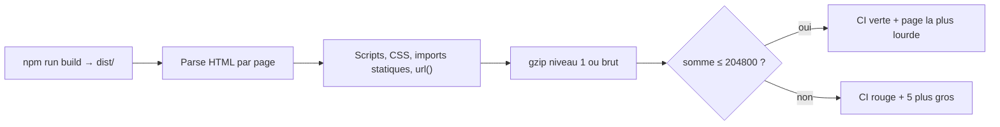

# VIT-19 · Contrôle d'EP-19 dans la CI du site (200 Ko) — plan court

| | |
|---|---|
| Module | [VIT](../../plan/modules/VIT-site-vitrine.md) · libre (N1, chef, 21 nov.) |
| Branche | `feat/vit-19-ep19-poids`, depuis `origin/main` (`84ff92a7`) |
| Rédigé par | agent de Cursor (Auto), le 21 novembre 2026 |
| **Validé** | coordinateur, 21 nov., avec les précisions 1 à 4 |

## 1. Objet et critère de « terminé »

La CI de `vitrine/` échoue dès qu'**une page construite** dépasse **200 Ko transférés**, hors média lancé à la demande (EP-19 / N1).

Terminé quand :

1. un contrôle dans la CI mesure ce poids **sans navigateur** et échoue au-delà de 200 × 1024 octets ;
2. le même contrôle **passe** sur le site actuel après `npm run build` ;
3. un **test unitaire** fabrique une page gonflée en temporaire et prouve que la mesure la refuse ;
4. le plan et la fiche de session citent N1 / EP-19 ; la section « Ce que disent les études » pointe la synthèse une fois #234 sur `main`.

## 2. Ce qui existe

| Élément | État |
|---|---|
| `vitrine/nginx/nginx.conf` | **pas de gzip** (contrairement à `frontend/nginx.conf` : `gzip on`, types texte/css/js/svg, `gzip_min_length 1024`) |
| `vitrine/nginx/verifier-image.cjs` | HTTP + Chromium sur l'image ; pas de budget de poids |
| `.github/workflows/vitrine.yml` | build, tests unitaires, image Docker, `verifier-image.cjs` |
| Accueil | vidéo en `preload="none"`, image fixe en `loading="lazy"` ; fichiers sous `/videos/` |
| Mesure manuelle | relecture #237 : Lighthouse mobile `/fr/` ≈ **132 Ko** transférés (sous le plafond) |

## 3. Questions

| N° | Question | Proposition | Réponse | Bloque |
|---|---|---|---|---|
| 1 | Activer **gzip** sur Nginx de la vitrine (aligné sur `frontend/nginx.conf`) dans cette fonction ? | Oui | **Oui, gzip** dans `vitrine/nginx/nginx.conf`, mêmes directives que `frontend/nginx.conf` (l. 51–55), **sans `gzip_comp_level`** (défaut Nginx = niveau 1) | — |
| 2 | Seuil exact | **200 × 1024 = 204 800** octets | **204 800 octets** | — |
| 3 | « Média lancé à la demande » exclus du total | Uniquement `/videos/*` ; l'image fixe lazy **compte** | **Oui** | — |
| 4 | Où vit le test | Script + étape CI après build ; preuve d'échec = test unitaire temporaire | **Oui** : `verifier-poids-ep19.mjs` + étape après build ; preuve = `tests/poids-ep19.test.js` (pas de fixture de 200 Ko commitée) | — |

## 4. Solution

### Mesure « transféré » sans navigateur

Pour chaque page HTML de `dist/{fr,en}/**/index.html` (et `dist/index.html` s'il existe) :

1. Lire le HTML.
2. Collecter les URLs **locales** du premier chargement : la page elle-même ; `link[rel=stylesheet]` ; `script[src]` ; `img[src]` / `source[srcset]` (premier candidat) ; `link[rel=preload|modulepreload]`. Ignorer les URL absolues hors origine et `/videos/*`.
3. **Suivre ce que le navigateur charge sans le HTML** (précision 2) : pour chaque script local compté, résoudre les `import` **statiques** récursivement (chaque fichier une fois) ; pour chaque feuille de style, résoudre les `url()` (polices, images), sauf `/videos/*`. Pour un `@font-face` avec `unicode-range`, ne compter que les sous-ensembles qui croisent la langue de la page (`fr`/`en` : latin ; sinon tous si pas de plage). Les `import()` **dynamiques** restent hors total.
4. Pour chaque fichier unique : taille **gzip niveau 1** (`zlib.gzipSync(..., { level: 1 })`) si le type est dans `gzip_types` **et** la taille brute ≥ 1 024 octets ; sinon taille **brute** (images, woff2, petits fichiers).
5. Sommer. Si somme > 204 800 : échec avec la page, le total et les cinq plus gros fichiers. En succès : écrire la page la plus lourde et son poids (précision 3).



### Gzip Nginx

Dans `vitrine/nginx/nginx.conf`, mêmes directives que `frontend/nginx.conf` :

```
gzip on;
gzip_types text/plain text/css application/json application/javascript
           text/xml application/xml image/svg+xml;
gzip_min_length 1024;
```

Sans `gzip_comp_level` (défaut = 1).

### Preuve d'échec (précision 4)

`vitrine/tests/poids-ep19.test.js` (via `test:unit`) : dossier temporaire, petite page qui passe, page gonflée qui échoue. Le script **exporte** sa fonction de mesure. Aucun fichier de 200 Ko dans le dépôt.

## 5. Fichiers

| Fichier | Créé / modifié | Rôle |
|---|---|---|
| `docs/conception/vitrine/vit-19-ep19-poids.md` | créé / mis à jour | ce plan |
| `vitrine/nginx/nginx.conf` | modifié | gzip |
| `vitrine/scripts/verifier-poids-ep19.mjs` | créé | mesure + seuil + export |
| `vitrine/tests/poids-ep19.test.js` | créé | preuve d'échec / succès |
| `vitrine/package.json` | modifié | script `test:poids` optionnel si utile |
| `.github/workflows/vitrine.yml` | modifié | étape après le build |
| `docs/plan/modules/VIT-site-vitrine.md` | modifié | ligne VIT-19 / critère |
| fiche de session | créé | `docs/sessions/2026-11-22-vit-19-ep19-poids.md` |

Pas de `suivi.md` dans cette livraison (consigne coordinateur).

## 6. Ce que disent les études

N1 (chef, 21 nov.) : une page du site ≤ 200 Ko transférés, hors média à la demande, vérifié en CI — décision reprise dans `docs/plan/decisions.md` et EP-19 du README du plan (branche de coordination ; sur `main` après fusion des docs concernés).

La synthèse `docs/etude-marche/14-reprendre-et-depasser.md` (branche #234) sera citée ici **dès que #234 est fusionnée** ; en attendant, la référence opérante reste N1 / EP-19 dans `decisions.md` et le README du plan.

## 7. Tests et vérification

- Script sur tout `dist/` : vert ; affiche la page la plus lourde.
- Test unitaire : petite page OK, page gonflée refusée.
- `npm run test:unit`, `node scripts/verifier-neutre.mjs`.

## 8. Étapes

1. Plan validé (ce document) — fait.
2. Gzip Nginx + script + test + workflow.
3. Fiche de session ; rapport ; le chef pousse.

## 9. Hors périmètre

- Mesure du **premier chargement de l'application web** (autre moitié d'EP-19) : hors VIT-19.
- Brotli, CDN, budget Lighthouse score.
- Textes marketing, pages nouvelles, `/ar/`.
