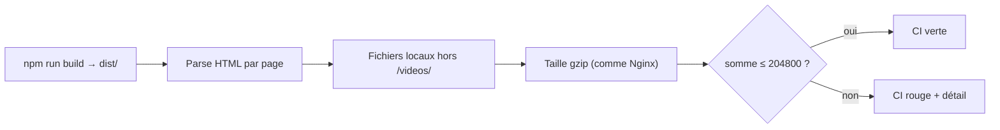

# VIT-19 · Contrôle d'EP-19 dans la CI du site (200 Ko) — plan court

| | |
|---|---|
| Module | [VIT](../../plan/modules/VIT-site-vitrine.md) · libre (N1, chef, 21 nov.) |
| Branche | `feat/vit-19-ep19-poids`, depuis `origin/main` (`84ff92a7`) |
| Rédigé par | agent de Cursor (Auto), le 21 novembre 2026 |
| **Validé** | en attente du coordinateur (S, sans texte ni donnée) |

## 1. Objet et critère de « terminé »

La CI de `vitrine/` échoue dès qu'**une page construite** dépasse **200 Ko transférés**, hors média lancé à la demande (EP-19 / N1).

Terminé quand :

1. un contrôle dans la CI mesure ce poids **sans navigateur** et échoue au-delà de 200 × 1024 octets ;
2. le même contrôle **passe** sur le site actuel après `npm run build` ;
3. un **fixture gonflé exprès** (hors `dist/` publié) fait **échouer** le contrôle, pour prouver qu'il attrape le dépassement ;
4. le plan et la fiche de session citent N1 / EP-19 ; la section « Ce que disent les études » pointe la synthèse une fois #234 sur `main`.

## 2. Ce qui existe

| Élément | État |
|---|---|
| `vitrine/nginx/nginx.conf` | **pas de gzip** (contrairement à `frontend/nginx.conf` : `gzip on`, types texte/css/js/svg, `gzip_min_length 1024`) |
| `vitrine/nginx/verifier-image.cjs` | HTTP + Chromium sur l'image ; pas de budget de poids |
| `.github/workflows/vitrine.yml` | build, tests unitaires, image Docker, `verifier-image.cjs` |
| Accueil | vidéo en `preload="none"`, image fixe en `loading="lazy"` ; fichiers sous `/videos/` |
| Mesure manuelle | relecture #237 : Lighthouse mobile `/fr/` ≈ **132 Ko** transférés (sous le plafond) |

## 3. Questions

| N° | Question | Proposition | Réponse | Bloque |
|---|---|---|---|---|
| 1 | Activer **gzip** sur Nginx de la vitrine (aligné sur `frontend/nginx.conf`) dans cette fonction ? | Oui : sans ça, « compressé comme Nginx les sert » = octets bruts, plus sévère que la prod derrière un reverse-proxy qui compresse souvent | | oui |
| 2 | Seuil exact | **200 × 1024 = 204 800** octets (Ko binaires, usage courant « 200 Ko ») | | non |
| 3 | « Média lancé à la demande » exclus du total | Uniquement `/videos/*` (mp4, webm) et toute URL absente du HTML au premier parse (pas de `<video src>`). L'image fixe (`loading="lazy"`) **compte** : elle est dans le HTML et sert de LCP | | oui |
| 4 | Où vit le test | Script `vitrine/scripts/verifier-poids-ep19.mjs` appelé après `npm run build` dans `vitrine.yml` **et** par `npm run test:unit` (ou script dédié `test:poids`) ; fixture `vitrine/tests/fixtures/page-trop-lourde.html` + faux assets, hors `public/` | | non |

## 4. Solution

### Mesure « transféré » sans navigateur

Pour chaque page HTML de `dist/{fr,en}/**/index.html` (et `dist/index.html` s'il existe) :

1. Lire le HTML.
2. Collecter les URLs **locales** du premier chargement : la page elle-même ; `link[rel=stylesheet]` ; `script[src]` ; `img[src]` / `source[srcset]` (premier candidat) ; `link[rel=preload|modulepreload]` ; polices référencées ainsi. Ignorer les URL absolues hors origine et `/videos/*` (Q3).
3. Pour chaque fichier unique sous `dist/` : taille **gzip** au niveau par défaut de Node (`zlib.gzipSync`, niveau 6), comme Nginx avec `gzip on` et sans `gzip_comp_level` explicite (défaut 1 côté Nginx — **si Q1 accepte gzip**, on aligne le script sur le `gzip_comp_level` réellement posé dans `nginx.conf`, proposition : **6** pour coller à une mesure stable et proche de Lighthouse, ou **1** pour coller au défaut Nginx ; à trancher avec Q1 : **proposition finale = niveau 1**, défaut Nginx, une fois gzip activé).
4. Sommer. Si somme > 204 800 : échec, message listant la page et les 5 plus gros contributeurs.

Pas d'appel HTTP obligatoire pour le poids : la CI reste rapide et indépendante de Docker. `verifier-image.cjs` reste pour les en-têtes ; on peut y ajouter plus tard un contrôle croisé optionnel.

### Gzip Nginx (si Q1 = oui)

Dans `vitrine/nginx/nginx.conf`, mêmes directives que `frontend/nginx.conf` (`gzip on`, types texte/css/js/json/xml/svg, `gzip_min_length 1024`). Images WebP/AVIF/PNG déjà compressées : hors `gzip_types`, comptées en taille fichier.

### Fixture qui doit échouer

Page HTML de test + un CSS ou JS factice > 200 Ko (texte répétitif), passée au même script avec un drapeau `--fixture` ; le job CI échoue si ce sous-contrôle **ne** échoue **pas**.

## 5. Fichiers

| Fichier | Créé / modifié | Rôle |
|---|---|---|
| `docs/conception/vitrine/vit-19-ep19-poids.md` | créé | ce plan |
| `vitrine/nginx/nginx.conf` | modifié | gzip (si Q1) |
| `vitrine/scripts/verifier-poids-ep19.mjs` | créé | mesure + seuil |
| `vitrine/tests/fixtures/page-trop-lourde.*` | créé | preuve d'échec |
| `vitrine/package.json` | modifié | script npm |
| `.github/workflows/vitrine.yml` | modifié | étape après le build |
| `docs/plan/modules/VIT-site-vitrine.md` | modifié | ligne VIT-19 / critère |
| fiche de session | créé | `docs/sessions/2026-11-21-vit-19-ep19-poids.md` |

Pas de `suivi.md` dans cette livraison (consigne coordinateur).

## 6. Ce que disent les études

N1 (chef, 21 nov.) : une page du site ≤ 200 Ko transférés, hors média à la demande, vérifié en CI — décision reprise dans `docs/plan/decisions.md` et EP-19 du README du plan (branche de coordination ; sur `main` après fusion des docs concernés).

La synthèse `docs/etude-marche/14-reprendre-et-depasser.md` (branche #234) sera citée ici **dès que #234 est fusionnée** ; en attendant, la référence opérante reste N1 / EP-19 dans `decisions.md` et le README du plan.

## 7. Tests et vérification

- Script sur tout `dist/` : vert.
- Fixture lourde : rouge attendu.
- `npm run test:unit`, `node scripts/verifier-neutre.mjs`.
- Si gzip ajouté : `verifier-image.cjs` inchangé sauf si un en-tête à assert ; `Content-Encoding` non exigé dans le script de poids (mesure sur fichiers).

## 8. Étapes

1. Plan validé (ce document).
2. Gzip Nginx (Q1) + script + fixture + workflow.
3. Fiche de session ; rapport ; le chef pousse.

## 9. Hors périmètre

- Mesure du **premier chargement de l'application web** (autre moitié d'EP-19) : hors VIT-19.
- Brotli, CDN, budget Lighthouse score.
- Textes marketing, pages nouvelles, `/ar/`.
- Code avant le « validé » du coordinateur.
