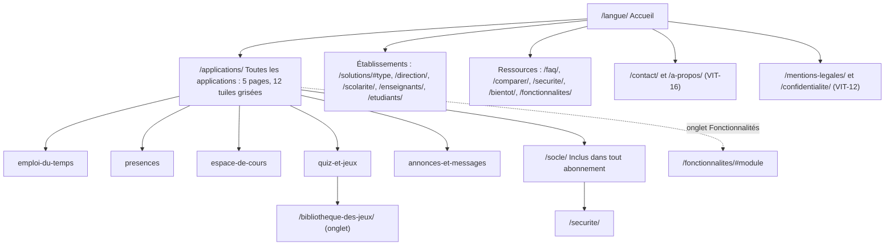

# VIT-20 · Structure du site sur le modèle d'Odoo — conception

| | |
|---|---|
| Module | [VIT](../../plan/modules/VIT-site-vitrine.md) · étape 1 de la [feuille de route](../../plan/feuille-de-route.md) (le site et la charte) |
| Branche | plan : `doc/coordination-2026-11-22` ; code : `feat/vit-20-structure-du-site` (mission d'équipe, [fiche](../../plan/missions/vit-20-equipe.md)) |
| Rédigé par | Claude Code (Opus 5.5), coordinateur, le 2026-11-22 ; **version 2** le même jour (17 modules vendables, VIT-15 fondue) |
| Taille | **L** : le plan est validé par le chef |
| **Validé** | version 1 par Claude20022002 le 2026-11-22 ; **version 2 : choix validés par le chef le 22 nov. (questions 15 à 18) ; texte de la version 2 à viser** |

## 1. Objet et critère de « terminé »

Demande du chef (22 nov.) : « que notre site soit bien structuré comme https://www.odoo.com/fr_FR ». On reprend **la structure** d'Odoo : barre à méga-menus, accueil avec la grille des applications, une page par application sur un gabarit commun, page « Toutes les applications », pied de page en colonnes. On ne reprend **ni le texte, ni le dessin, ni les prix** d'Odoo. La règle des textes reste : ne promettre que ce qui existe.

**Les applications du site sont les 17 modules vendables** validés par le chef le 21 nov. ([étude 15](../../etude-marche/15-modules-et-packs.md), branche `etude/ven-modules-packs`, #242 ; corrigée le 22 nov. : la Bibliothèque passe à l'étape 3). **VIT-15** (une page par module, bloc « selon votre équipement ») **est fondue dans VIT-20** (question 17).

Terminé quand :

1. la barre de navigation est : **Applications ▾ · Établissements ▾ · Ressources ▾ · Contact**, puis les langues, « Se connecter » (caché tant que l'adresse de l'application n'est pas fixée) et le bouton **« Demander une démonstration »** ;
2. le menu « Applications » range les 17 modules en **quatre catégories** (§ 4.2), avec la ligne « Inclus dans tout abonnement » au bas ;
3. les **5 modules disponibles** ont chacun leur page `/<langue>/applications/<module>/`, sur le même gabarit (§ 4.4), avec le bloc « selon votre équipement » ; les **12 autres** sont des **tuiles grisées « Bientôt »**, sans lien, dans le menu, sur l'accueil et sur `/<langue>/applications/` ;
4. le socle inclus a sa page `/<langue>/socle/` ;
5. l'accueil suit l'ordre du § 4.3, avec la grille des modules sous le titre et « Pourquoi Planner » animé et interactif (§ 4.8) ;
6. le pied de page a quatre colonnes (§ 4.5), puis la barre légale, les langues et les droits ;
7. les anciennes adresses des pages de fonction mènent à la nouvelle page ;
8. français et anglais ; l'arabe garde les mêmes clés, vides (repli sur le français), comme aujourd'hui ;
9. build, tests de `vitrine/tests/`, `node scripts/verifier-neutre.mjs` (superlatifs compris, VIT-18b), budget d'EP-19 (VIT-19, 200 Ko par page), axe-core, 390, 768 et 1440 px, clavier et toucher sans JavaScript pour les menus.

## 2. Ce qui existe (sur `origin/main`, `110a1d8d`)

| Élément | Fichier | Ce qu'on en fait |
|---|---|---|
| En-tête : menu « Solutions » (types et rôles), menu « Fonctions », liens Sécurité et Bientôt, langues, « Nous contacter » | `vitrine/src/components/socle/EnTete.astro` | refait selon le § 4.2 ; le mécanisme `<details>` sans JavaScript est gardé |
| Menu « Fonctions » par catégorie, tiré du registre | `vitrine/src/components/catalogue/MenuFonctions.astro` | remplacé par le menu « Applications » |
| Registre des fonctionnalités (application, catégorie, page, état) | `vitrine/src/donnees/fonctionnalites.json`, `components/catalogue/registre.js` | reste la source des listes ; chaque entrée reçoit un champ `module` (l'un des 17) ; le catalogue se range par module |
| Sept « applications » du registre | `i18n/*/fonctionnalites.json` → `applications` | remplacées par les 17 modules ; la clé `application` du registre reste pour le logo tant que VIT-09c n'a pas livré |
| Logos des sept applications | `shared/icones/modules/<clé>.svg` (VIT-09a) | posés sur les modules correspondants ; les autres modules gardent une place réservée que **VIT-09c** (Codex, plan validé) remplit |
| Constantes de navigation | `vitrine/src/i18n/langues.js` : `ROLES`, `FONCTIONS`, `BARRE`, `NAVIGATION` | remplacées (§ 5, R0) |
| Pages de fonction | `pages/[lang]/` : `emploi-du-temps`, `en-classe`, `quiz-et-jeux`, `cours-et-annonces`, `bibliotheque`, `application`, `etablissement` | leurs sections passent dans les pages de module et la page du socle (§ 4.6), puis elles deviennent des redirections |
| Accueil en dix sections | `pages/[lang]/index.astro`, `components/accueil/` | resserré (§ 4.3) |
| Pied de page en quatre colonnes (Fonctions, Solutions, Par rôle, Ressources) | `components/socle/PiedDePage.astro` | colonnes renommées et reclassées (§ 4.5) |
| Catalogue « Toutes les fonctionnalités » | `pages/[lang]/fonctionnalites.astro` | gardé ; c'est l'onglet « Fonctionnalités » de chaque page de module |
| Contenu exigé de VIT-15 | [fiche de VIT-15](../../plan/missions/vit-15-pages-modules.md) (branche `doc/coordination-equipe`) | repris au § 4.9 |
| Étude EP-18 (contextes à faible équipement) | #253 | source du bloc « selon votre équipement » (§ 4.9) |

Travaux ouverts qui touchent les mêmes fichiers : #254 (VIT-13, `solutions.json`), #223 (VIT-12, pied de page, `langues.js`, `commun.json`), VIT-16 (Contact et À propos, plan sans code : son plan touche l'en-tête, le pied de page et `Contact.astro`), #227 (VIT-09b). Voir le § 9.

## 3. Questions et réponses

Réponses du chef, 22 nov., par l'outil de questions.

| N° | Question | Réponse du chef |
|---|---|---|
| 1 | Barre de navigation | **Calque d'Odoo adapté** : Applications ▾, Établissements ▾ (types et rôles), Ressources ▾, Contact ; « Se connecter » et « Demander une démonstration ». **Pas de « Tarifs »** |
| 2 | Accueil | **Resserré** ; **pas de témoignage** tant qu'aucune école n'a donné son accord écrit |
| 3 | Pages détaillées | **Une page par application** sur un gabarit commun, plus « Toutes les applications » ; les anciennes adresses redirigent |
| 4 | Conduite | **Après la fusion des travaux ouverts du site, en équipe** |
| 5 | Regroupement du menu | trois catégories (version 1), **remplacé par la question 16** |
| 6 | Boutons de droite | **« Demander une démonstration »** vers la page Contact ; **« Se connecter » prêt mais caché** tant que l'adresse de l'application n'est pas fixée (Q-11) |
| 7 | Modules prévus | **Tuiles grisées « Bientôt »**, sans lien, dans le menu, la grille de l'accueil et « Toutes les applications » |
| 8 | Pied de page | **Quatre colonnes** : Applications · Établissements · Ressources · Planner |
| 9 | « Pourquoi Planner » | **gardé, et rendu dynamique, interactif et animé** (§ 4.8) |
| 10 | Quiz et jeux, Report et Bientôt sur l'accueil | **retirés** |
| 11 | Pages qui réunissent plusieurs applications | **réparties** (§ 4.6) |
| 12 | VIT-09b | **reprend son plan après VIT-20** |
| 13 | Libellés du § 4.7 (version 1) | **visés** |
| 14 | Comparatif : sites, usage, largeurs | **Planner face à Odoo** ; **section du site public** ; **1440 et 390 px** |
| 15 | Liste des applications | **les 17 modules vendables** de l'étude 15 : 5 pages, 12 tuiles grisées, le socle en ligne « Inclus dans tout abonnement » |
| 16 | Catégories | **quatre** : Organiser, Enseigner, Gérer, Communiquer (§ 4.2) |
| 17 | VIT-15 | **fondue dans VIT-20** ; VIT-15 est close, Codex prend un lot de VIT-20 |
| 18 | Coordination | **le coordinateur de cette session tient VIT-20 seule** ; l'autre session de coordination garde le reste |
| 19 | Qui code | **R0, B, A et C par un agent externe** (l'agent Claude d'un proche du chef), seul et sans échange ; **D par Codex**, après la fusion |
| 20 | Livraison de l'agent externe | **accès collaborateur** : il pousse sa seule branche et ouvre la PR ; le chef fusionne |

## 4. Solution

### 4.1 Arborescence



### 4.2 Barre de navigation

```
[logo] Planner   Applications ▾   Établissements ▾   Ressources ▾   Contact     FR · EN   (Se connecter)   [Demander une démonstration]

Applications ▾
  Organiser              Enseigner                 Gérer                       Communiquer
  · Emploi du temps      · Espace de cours         · Inscriptions *            · Annonces et messages
  · Présences            · Quiz et jeux            · Documents vérifiables *   · Vie scolaire et familles *
  · Vacataires et heures *  · Bibliothèque *       · Frais et caisse *
  · Pilotage *           · Évaluations, crédits et jurys *  · Paiements en ligne *
                         · Stages *                · Échanges avec l'État *
                         · Formation et financeurs *
  ─────────────────────────────────────────────────────────────────────────────────────
  Inclus dans tout abonnement : Établissement · Personnes · Web et mobile · Sécurité      Toutes les applications →
  * tuile grisée « Bientôt », sans lien
```

- Les 17 modules, leur catégorie, leur état et leur adresse tiennent dans **un seul fichier**, `vitrine/src/donnees/modules.js`, dans l'ordre de l'étude 15. Un test vérifie qu'il compte 17 modules, 5 disponibles, et qu'un module disponible a sa page.
- **Établissements ▾** : le panneau « Solutions » d'aujourd'hui, renommé : « Par type d'établissement » (les trois de `types.js`, dans l'ordre de VIT-13) et « Par rôle » (les quatre de `ROLES`).
- **Ressources ▾** : FAQ, Comparer, Sécurité et données, Bientôt, Toutes les fonctionnalités. Le centre d'aide (VIT-03) s'y ajoutera.
- **Contact** et **« Demander une démonstration »** : `/<langue>/contact/` une fois VIT-16 fusionnée ; d'ici là, `/<langue>/#contact`. Une seule constante dans `langues.js`.
- **« Se connecter »** : lien vers `ADRESSE_APPLICATION` (`vitrine/src/donnees/site.js`), vide aujourd'hui ; vide, le lien n'est pas rendu.
- **Tuiles grisées** : texte et badge « Bientôt », sans lien ni rôle de contrôle.
- **Téléphone** : le bouton de menu actuel ; chaque méga-menu devient un volet `<details>`, sans JavaScript nécessaire.

### 4.3 Accueil

| Ordre | Section | D'où elle vient |
|---|---|---|
| 1 | Titre, accroche, **« Demander une démonstration »** et **« Voir les applications »** | `Ouverture.astro` ; seuls les deux boutons changent |
| 2 | **Grille des modules** : les 5 disponibles (logo, nom, lien), les 12 grisés, puis « Voir toutes les applications » | `GrilleModules.astro`, posé par l'intégrateur à R0 |
| 3 | Vidéo de présentation | `Video.astro` (VIT-08), inchangée |
| 4 | Arguments : emploi du temps, l'appel, données | `EmploiDuTemps`, `Appel`, `Donnees` ; leur lien mène à la page du module |
| 5 | **Pourquoi Planner**, animé et interactif | § 4.8 |
| 6 | Par type d'établissement : trois cartes vers `/solutions/#<type>` | nouveau composant, textes de `solutions.json` |
| 7 | Appel final | `Contact.astro`, avec le bouton de démonstration |

Retirées de l'accueil : `QuizJeux`, `Report`, `Bientot`. Le lot de l'accueil ne supprime pas leurs fichiers : l'intégrateur le fait s'ils ne servent plus.

### 4.4 Gabarit d'une page de module

`vitrine/src/components/applications/PageModule.astro`, sur le modèle de la page « Comptabilité » d'Odoo, et avec tout ce que demandait VIT-15 :

1. **En-tête** : logo du module (VIT-09a, ou la place réservée), surtitre (la catégorie), titre, accroche, « Demander une démonstration ».
2. **Onglets** : « Aperçu », « Fonctionnalités » (`/fonctionnalites/#<module>`), et pour Quiz et jeux « Bibliothèque des jeux ».
3. **Sections** propres au module, reprises des pages actuelles (§ 4.6), par un `<slot />`.
4. **« Toutes les fonctionnalités de <module> »** : le registre filtré sur `module`, avec le badge « Bientôt » pour l'état `bientot`.
5. **« Selon votre équipement »** : § 4.9.
6. **Pour qui** : les types d'établissement (VIT-13) et les rôles (VIT-10) concernés, en liens.
7. **« Un besoin, une application. »** : les autres modules de la même catégorie (grisés s'ils sont « Bientôt »), puis « Toutes les applications ».
8. **Fin de page** : `FinDePage.astro`, inchangée.

La page **« Inclus dans tout abonnement »** (`/socle/`) suit le même gabarit, sans onglets ni bloc d'équipement : Établissement, Personnes, Web et mobile, puis un lien vers Sécurité et données.

### 4.5 Pied de page

| Applications | Établissements | Ressources | Planner |
|---|---|---|---|
| les 5 modules disponibles, « Inclus dans tout abonnement », « Toutes les applications » | les trois types, puis les quatre rôles | FAQ, Comparer, Sécurité et données, Bientôt, Toutes les fonctionnalités | À propos, Contact (VIT-16) |

Dessous : Mentions légales et Confidentialité (VIT-12), les langues, les droits.

### 4.6 Où vont les sections des pages actuelles

| Page actuelle | Section | Nouvelle page | L'ancienne adresse mène à |
|---|---|---|---|
| `emploi-du-temps` | toutes ; plus « Report » de l'accueil | Emploi du temps | Emploi du temps |
| `en-classe` | appel | Présences | Présences |
| `en-classe` | quiz | Quiz et jeux | — |
| `en-classe` | aussi (sondages) | Espace de cours | — |
| `cours-et-annonces` | supports | Espace de cours | Espace de cours |
| `cours-et-annonces` | annonces | Annonces et messages | — |
| `quiz-et-jeux` | toutes | Quiz et jeux | Quiz et jeux |
| `etablissement` | statistiques, quotidien | Socle (Établissement) | Socle |
| `application` | toutes | Socle (Web et mobile) | Socle |
| registre `comptes` | — | Socle (Personnes) | — |
| `bibliotheque` | toutes | **aucune** : la Bibliothèque est « Bientôt » (étape 3, correction du chef du 22 nov.) | Toutes les applications |

**Aucune phrase nouvelle sur le produit dans les lots A, B et C** : les sections sont déplacées telles quelles ; les titres et accroches des pages Présences, Espace de cours et Annonces et messages sont pris dans les sections déplacées. Les seuls textes nouveaux sont les libellés du § 4.7 et le bloc du § 4.9 (lot D), visés par le chef avant le code.

Les autres phrases du site qui présentent la Bibliothèque comme disponible (rôles, FAQ, solutions) sont relevées par l'intégrateur ; la correction est proposée au chef, phrase par phrase.

Les redirections passent par `redirects` de `astro.config.mjs` (une page de renvoi sans script, compatible avec la CSP de VIT-06). Le site n'est pas encore en ligne : aucune adresse indexée n'est perdue.

### 4.7 Libellés nouveaux (français · anglais)

Visés le 22 nov. (version 1) : Applications · Apps ; Établissements · Schools ; Ressources · Resources ; Demander une démonstration · Request a demo ; Se connecter · Sign in ; Toutes les applications · All apps ; Voir les applications · See the apps ; Un besoin, une application. · One need, one app. ; Toutes les fonctionnalités de {module} · Everything in {module} ; Aperçu · Overview ; Fonctionnalités · Features.

**À viser (version 2)** :

| Clé | Français | English |
|---|---|---|
| categories.organiser · enseigner · gerer · communiquer | Organiser · Enseigner · Gérer · Communiquer | Organise · Teach · Manage · Communicate |
| socle.titre | Inclus dans tout abonnement | Included in every plan |
| socle.etablissement · personnes · webMobile · securite | Établissement · Personnes · Web et mobile · Sécurité | School · People · Web and mobile · Security |
| modules (17 noms, étude 15) | Emploi du temps · Présences · Espace de cours · Quiz et jeux · Annonces et messages · Bibliothèque · Vacataires et heures · Évaluations, crédits et jurys · Inscriptions · Documents vérifiables · Stages · Frais et caisse · Formation et financeurs · Vie scolaire et familles · Échanges avec l'État · Paiements en ligne · Pilotage | Timetable · Attendance · Course space · Quizzes and games · Announcements and messages · Library · Part-time staff and hours · Grades, credits and juries · Admissions · Verifiable documents · Internships · Fees and cash desk · Training and funders · School life and families · Government exchanges · Online payments · Analytics |
| equipement.titre | Selon votre équipement | Whatever your equipment |
| pourQui.titre | Pour qui | Who it is for |

### 4.8 « Pourquoi Planner », comparatif animé et interactif (question 9)

**Captures** (22 nov.) : chaque page du site en français, pleine page, à 1440 et 390 px, prises sur `origin/main` (`110a1d8d`), dans `..\travaux-planner\captures-vit-20\planner\`, **hors du dépôt**. odoo.com répond « 403 » aux navigateurs automatisés ; ce refus n'est pas contourné : le chef prend les captures d'Odoo dans son navigateur (§ 9), dans `captures-vit-20\odoo\`. Elles servent à la recette ; **elles ne sont jamais publiées**.

**Section publique** : la règle de VIT-14 (18 nov.) tient : **aucun produit n'est nommé sur le site**, Odoo compris. La section compare Planner aux quatre approches courantes de `comparer.json`. Nommer Odoo serait une décision nouvelle du chef, avec un avis juridique.

- **Sans JavaScript** : le tableau court d'aujourd'hui (`LIGNES_ACCUEIL`).
- **Avec JavaScript** : des onglets (`role="tablist"`, flèches du clavier) pour les quatre approches ; la colonne choisie glisse à côté de celle de Planner, les cases apparaissent ligne après ligne. Un second mode montre un critère à la fois, Planner face aux quatre approches.
- **Animation** avec `motion` (déjà dans `vitrine/package.json`) : fondu et glissement de 200 à 300 ms, sans boucle ni défilement automatique. **Mouvement réduit** : sans animation.
- **Textes** : ceux de `comparer.json`. Aucun texte nouveau, sauf le libellé des onglets, tiré des noms des approches.
- **Poids** : un îlot de moins de 15 Ko, chargé quand la section devient visible (`client:visible`).
- **Accessibilité** : `aria-selected`, `aria-controls`, `aria-live="polite"` sur le titre de la colonne seulement ; axe-core sans erreur.

### 4.9 « Selon votre équipement » (repris de VIT-15)

Dans chaque page de module disponible, trois lignes : **sans wifi ou avec peu de connexion**, **sans écran projeté**, **sans téléphone de l'élève**. Chaque ligne dit ce que le code permet aujourd'hui, avec sa source dans le dépôt (gardée dans `donnees/equipement.js`, vérifiée par un test, non montrée sur le site). Ce qui manque est marqué « Bientôt ». Une ligne sans solution est écrite telle quelle.

Les phrases reprennent l'étude EP-18 (#253) et l'expertise C5 (appel à la main d'abord, QR code en option ; jeux sur téléphone ou ordinateur ; semaine lisible sans réseau ; emploi du temps imprimé en PDF), et N3 (le poids affiché avant téléchargement là où le code le fait, sinon « Bientôt »). Le supérieur d'abord (D4). **Le lot D écrit ces phrases dans un tableau (français, anglais, source), que le chef vise avant le code.**

## 5. Lots et fichiers

Un fichier n'a qu'un propriétaire : le détail, avec les agents, est dans la [fiche d'équipe](../../plan/missions/vit-20-equipe.md). En bref :

| Lot | Contenu | Fichiers |
|---|---|---|
| **R0 · intégrateur** | le contrat commun | `donnees/modules.js`, `donnees/site.js`, `i18n/langues.js`, `i18n/*/commun.json` (tous les libellés du § 4.7), `i18n/*/modules.json`, `components/applications/GrilleModules.astro` et `TuileModule.astro`, `astro.config.mjs`, fichiers de traduction vides des lots |
| **B · intégrateur** | pages de module, socle, catalogue, redirections | `components/applications/` (sauf `equipement/`), `pages/[lang]/applications/`, `pages/[lang]/socle.astro`, `donnees/fonctionnalites.json`, `components/catalogue/`, liens de `components/fonctions/` et `components/solutions/`, pages de fonction supprimées |
| **A** | navigation | `components/socle/EnTete.astro`, `components/navigation/`, `components/socle/PiedDePage.astro` |
| **C** | accueil et comparatif animé | `pages/[lang]/index.astro`, `components/accueil/`, `i18n/*/accueil.json` |
| **D** | « Selon votre équipement » | `components/applications/equipement/`, `donnees/equipement.js`, `i18n/*/equipement.json` |

## 6. Données et migration

Aucune. Site statique ; aucune base, aucune donnée d'école.

## 7. Sécurité, isolation et exigences produit

- Aucun formulaire, aucun script tiers, aucune requête vers l'extérieur. La CSP par page de VIT-06 reste calculée par le build.
- « Se connecter » ne mène nulle part tant que l'adresse n'est pas décidée.
- EP-18 : le bloc du § 4.9 ; aucun parcours ne suppose le téléphone de l'élève.
- EP-19 (200 Ko transférés par page) : le contrôle de VIT-19 tranche.
- Dépôt public : aucun nom d'école, aucune coordonnée réelle, aucun chiffre d'usage, aucun témoignage, aucun prix.

## 8. Tests

- `modules.test.js` (R0) : 17 modules, 4 catégories, 5 disponibles, chaque disponible a sa page et chaque page un module disponible ; noms présents en français et en anglais.
- `applications.test.js` (B) : 5 pages et `/socle/` construites par langue publiée ; onglets, liste des fonctionnalités, « Pour qui », « Un besoin, une application » ; chaque entrée du registre a un `module` connu ; chaque ancienne adresse redirige vers la bonne page.
- `navigation.test.js` (A) : ordre de la barre ; quatre catégories ; tuiles grisées sans `href` ; ligne « Inclus » ; « Se connecter » absent quand `ADRESSE_APPLICATION` est vide ; quatre colonnes du pied de page.
- `accueil.test.js` et `comparatif-interactif.test.js` (C) : ordre des sections ; 17 tuiles ; le tableau de repli existe sans JavaScript ; mouvement réduit respecté.
- `equipement.test.js` (D) : trois lignes par module disponible ; chaque source existe dans le dépôt ; « Bientôt » quand la ligne n'a pas de solution.
- Existants à garder verts, et le test de garde des textes (`verifier-neutre.mjs`) ; parcours des menus au clavier, au toucher et sans JavaScript ; axe-core ; 390, 768 et 1440 px.

## 9. Étapes de livraison

1. **Ce plan** (version 2), visé par le chef, commité seul.
2. **Avant R0**, le chef fusionne #254 (VIT-13) et #223 (VIT-12), et prend les captures d'Odoo dans son navigateur (huit pages : accueil, toutes les apps, Comptabilité, Planification, toutes les industries, tarifs, contact, aide ; 1440 et 390 px ; `..\travaux-planner\captures-vit-20\odoo\bureau\` et `telephone\`).
3. **R0, B, A, C** par un seul agent (l'agent externe, décision du chef du 22 nov., question 19), dans cet ordre, sur `feat/vit-20-structure-du-site`, qu'il pousse lui-même ; la place du bloc D reste vide.
4. **Relecture** par le coordinateur, captures « après » à 390 et 1440 px, comparées à celles d'avant et d'Odoo ; le chef fusionne.
5. **Lot D** ensuite, par Codex, dans une PR à part : son tableau de phrases (§ 4.9) est visé par le chef avant son code.

## 10. Risques et retour arrière

- **Conflits avec les travaux ouverts** : réglés par l'ordre du § 9 et la fiche d'équipe (VIT-16 ne touche plus l'en-tête, le pied de page ni l'accueil avant la fusion de VIT-20 ; VIT-09b refait son plan après).
- **Textes perdus en déplaçant les sections** : le test `traductions` compare les clés avant et après.
- **Retour arrière** : une seule PR ; le site n'est pas en ligne, revenir en arrière est un `git revert` de la fusion.

## 11. Hors périmètre

- Tarifs, packs, essai gratuit, témoignages.
- Centre d'aide (VIT-03), formulaire de contact (VIT-02), page d'état (VIT-04).
- Les logos et images des modules (VIT-09c) ; nouvelles illustrations (VIT-09b).
- La page « Bientôt » garde ses cartes ; son alignement sur les 17 modules est une fonction à part.
- La version arabe publiée (UIX-04).
- La grille des modules dans l'application elle-même (UIX-09).
