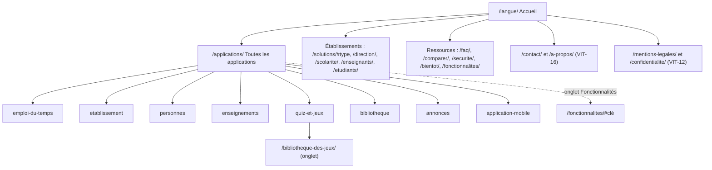

# VIT-20 · Structure du site sur le modèle d'Odoo — conception

| | |
|---|---|
| Module | [VIT](../../plan/modules/VIT-site-vitrine.md) · étape 1 de la [feuille de route](../../plan/feuille-de-route.md) (le site et la charte) |
| Branche | plan : `doc/coordination-2026-11-22` ; code : `feat/vit-20-structure-du-site` (mission d'équipe, après les fusions du § 9) |
| Rédigé par | Claude Code (Opus 5.5), coordinateur, le 2026-11-22 |
| Taille | **L** : le plan est validé par le chef |
| **Validé** | en attente |

## 1. Objet et critère de « terminé »

Demande du chef (22 nov.) : « que notre site soit bien structuré comme https://www.odoo.com/fr_FR ». On reprend **la structure** d'Odoo (barre à méga-menus, accueil avec la grille des applications, une page par application sur un gabarit commun, page « Toutes les applications », pied de page en colonnes). On ne reprend **ni le texte, ni le dessin, ni les prix** d'Odoo. La règle des textes reste : ne promettre que ce qui existe.

Terminé quand :

1. la barre de navigation est : **Applications ▾ · Établissements ▾ · Ressources ▾ · Contact**, puis les langues, « Se connecter » (caché tant que l'adresse de l'application n'est pas fixée) et le bouton **« Demander une démonstration »** ;
2. l'accueil suit l'ordre du § 4.3, avec la grille des applications sous le titre ;
3. chaque application a sa page `/<langue>/applications/<adresse>/`, toutes sur le même gabarit (§ 4.4), et `/<langue>/applications/` les montre toutes ;
4. les modules prévus apparaissent en **tuiles grisées « Bientôt »**, sans lien, dans le menu, sur l'accueil et sur la page « Toutes les applications » ;
5. le pied de page a quatre colonnes (§ 4.5), puis la barre légale, les langues et les droits ;
6. les anciennes adresses des pages de fonction mènent à la nouvelle page ;
7. français et anglais ; l'arabe garde les mêmes clés, vides (repli sur le français), comme aujourd'hui ;
8. build, tests de `vitrine/tests/`, `node scripts/verifier-neutre.mjs` (superlatifs compris, VIT-18b), budget d'EP-19 (VIT-19, 200 Ko par page), axe-core, 390, 768 et 1440 px, clavier et toucher sans JavaScript pour les menus.

## 2. Ce qui existe (sur `origin/main`, `110a1d8d`)

| Élément | Fichier | Ce qu'on en fait |
|---|---|---|
| En-tête : menu « Solutions » (types et rôles), menu « Fonctions », liens Sécurité et Bientôt, langues, « Nous contacter » | `vitrine/src/components/socle/EnTete.astro` | refait selon le § 4.2 ; le mécanisme `<details>` sans JavaScript est gardé |
| Menu « Fonctions » par catégorie, tiré du registre | `vitrine/src/components/catalogue/MenuFonctions.astro` | remplacé par le menu « Applications » |
| Registre des fonctionnalités (application, catégorie, page, état) | `vitrine/src/donnees/fonctionnalites.json`, `components/catalogue/registre.js` | reste la source des listes de fonctionnalités ; le champ `page` devient inutile (§ 4.4) |
| Sept applications et leurs noms | `vitrine/src/i18n/*/fonctionnalites.json` → `applications` | mêmes clés : `planning`, `pedagogie`, `personnes`, `etablissement`, `annonces`, `activites`, `bibliotheque` |
| Logos des sept applications | `shared/icones/modules/<clé>.svg` et `-petit.svg` (VIT-09a) | posés dans le menu, la grille, l'en-tête de chaque page d'application |
| Constantes de navigation | `vitrine/src/i18n/langues.js` : `ROLES`, `FONCTIONS`, `BARRE`, `NAVIGATION` | remplacées par `APPLICATIONS`, `RESSOURCES` (§ 5) |
| Pages de fonction | `vitrine/src/pages/[lang]/` : `emploi-du-temps`, `en-classe`, `quiz-et-jeux`, `cours-et-annonces`, `bibliotheque`, `application`, `etablissement` | leurs sections passent dans les pages d'application (§ 4.6), puis elles deviennent des redirections |
| Accueil en dix sections | `vitrine/src/pages/[lang]/index.astro`, `components/accueil/` | resserré (§ 4.3) |
| Modules en préparation | `vitrine/src/i18n/*/bientot.json` → `ecole.cartes` | source unique des tuiles grisées : rien n'est ajouté |
| Pied de page en quatre colonnes (Fonctions, Solutions, Par rôle, Ressources) | `vitrine/src/components/socle/PiedDePage.astro` | colonnes renommées et reclassées (§ 4.5) |
| Catalogue « Toutes les fonctionnalités » | `vitrine/src/pages/[lang]/fonctionnalites.astro` | gardé ; c'est l'onglet « Fonctionnalités » de chaque page d'application |

Travaux ouverts qui touchent les mêmes fichiers : #254 (VIT-13, `solutions.json`), #223 (VIT-12, pied de page, `langues.js`, `commun.json`), VIT-16 (Contact et À propos, plan sans code, en attente des corrections du chef), #227 (VIT-09b, plan des illustrations et de la première section de l'accueil).

## 3. Questions et réponses

Posées le 22 nov. par l'outil de questions ; réponses du chef.

| N° | Question | Réponse du chef |
|---|---|---|
| 1 | Barre de navigation | **Calque d'Odoo adapté** : Applications ▾, Établissements ▾ (types et rôles), Ressources ▾, Contact ; « Se connecter » et « Demander une démonstration ». **Pas de « Tarifs »** : aucun prix publié tant que la vente est mise de côté |
| 2 | Accueil | **Resserré** : titre et boutons, grille des applications, vidéo, blocs d'arguments, types d'établissement, appel final. **Pas de témoignage** tant qu'aucune école n'a donné son accord écrit |
| 3 | Pages détaillées | **Une page par application** sur un gabarit commun, plus « Toutes les applications » ; les anciennes adresses redirigent |
| 4 | Conduite | **Après la fusion des travaux ouverts du site, en équipe** (trois lots sans fichier commun) |
| 5 | Regroupement du menu « Applications » | **Trois catégories** : Organiser (Emploi du temps, Établissement, Personnes) · Enseigner (Enseignements, Quiz et jeux, Bibliothèque) · Communiquer (Annonces, Application mobile) |
| 6 | Boutons de droite | **« Demander une démonstration »** vers la page Contact ; **« Se connecter » prêt mais caché** tant que l'adresse de l'application n'est pas fixée (Q-11) |
| 7 | Modules prévus | **Tuiles grisées « Bientôt »**, sans lien, dans le menu, la grille de l'accueil et « Toutes les applications » |
| 8 | Pied de page | **Quatre colonnes** : Applications · Établissements · Ressources · Planner |

À confirmer par le chef à la validation de ce plan :

| N° | Question | Proposition du coordinateur |
|---|---|---|
| 9 | La section « Pourquoi Planner » de l'accueil (comparatif court, lignes choisies par le chef, VIT-14) | **la garder** comme dernier bloc d'arguments, à la place de « L'enfer sans Odoo » ; elle ne dit que ce qui est vérifié |
| 10 | Les sections « Quiz et jeux », « Report » et « Bientôt » de l'accueil | **les retirer de l'accueil** : « Quiz et jeux » va sur sa page, « Report » sur la page Emploi du temps, « Bientôt » est remplacée par les tuiles grisées |
| 11 | Les pages « En classe », « Cours et annonces » et « Pour l'établissement » réunissent des fonctions de plusieurs applications | **les répartir** par application (§ 4.6) ; leur ancienne adresse mène à l'application principale |
| 12 | Le plan de VIT-09b (#227, illustrations et première section de l'accueil) | **le reprendre après VIT-20**, sur le nouvel accueil ; le coordinateur le renvoie à son agent |

## 4. Solution

### 4.1 Arborescence



Les adresses des pages d'application, dans l'ordre du menu : `emploi-du-temps` (planning), `etablissement`, `personnes`, `enseignements` (pedagogie), `quiz-et-jeux` (activites), `bibliotheque`, `annonces`, `application-mobile`.

### 4.2 Barre de navigation

```
[logo] Planner   Applications ▾   Établissements ▾   Ressources ▾   Contact     FR · EN   (Se connecter)   [Demander une démonstration]

Applications ▾
  Organiser             Enseigner             Communiquer           Bientôt (grisé, sans lien)
  [logo] Emploi du temps  [logo] Enseignements  [logo] Annonces       Notes et bulletins · Vie scolaire
  [logo] Établissement    [logo] Quiz et jeux   [·] Application mobile Familles · Admissions · …
  [logo] Personnes        [logo] Bibliothèque
  ─────────────────────────────────────────────────────────────────────────────
  Toutes les applications →                     Toutes les fonctionnalités →
```

- **Établissements ▾** : le panneau « Solutions » d'aujourd'hui, renommé : « Par type d'établissement » (les trois de `types.js`, dans l'ordre de VIT-13) et « Par rôle » (les quatre de `ROLES`).
- **Ressources ▾** : FAQ, Comparer, Sécurité et données, Bientôt, Toutes les fonctionnalités. Le centre d'aide (VIT-03) s'y ajoutera.
- **Contact** et **« Demander une démonstration »** : `/<langue>/contact/` une fois VIT-16 fusionnée ; d'ici là, `/<langue>/#contact`. Une seule constante dans `langues.js`.
- **« Se connecter »** : lien vers `ADRESSE_APPLICATION` (`vitrine/src/donnees/site.js`), vide aujourd'hui ; vide, le lien n'est pas rendu. Un test le vérifie.
- **Les tuiles grisées** ne sont pas des liens : texte, badge « Bientôt », `aria-disabled` absent (ce n'est pas un contrôle). Elles reprennent les titres de `bientot.json` → `ecole.cartes`, sans en ajouter.
- **Application mobile** n'a pas de logo dans `shared/icones/modules/` : l'icône `smartphone` de lucide dans une tuile aux couleurs de la charte, en attendant un logo dessiné (hors périmètre).
- **Téléphone** : le bouton de menu actuel ; chaque méga-menu devient un volet `<details>` ; aucun JavaScript nécessaire pour l'ouvrir.

### 4.3 Accueil

| Ordre | Section | D'où elle vient |
|---|---|---|
| 1 | Titre, accroche, **« Demander une démonstration »** et **« Voir les applications »** | `Ouverture.astro` ; seuls les deux boutons changent |
| 2 | **Grille des applications** : huit tuiles (logo, nom), puis les tuiles grisées « Bientôt », puis « Voir toutes les applications » | nouveau composant `GrilleApplications.astro` (lot B), aussi utilisé par la page « Toutes les applications » |
| 3 | Vidéo de présentation | `Video.astro` (VIT-08), inchangée |
| 4 | Arguments : emploi du temps, en classe (l'appel), données | `EmploiDuTemps`, `Appel`, `Donnees`, inchangés sauf leur lien, qui mène à la page d'application |
| 5 | Pourquoi Planner | `Pourquoi.astro` (VIT-14), si la question 9 est acceptée |
| 6 | Par type d'établissement : trois cartes vers `/solutions/#<type>` | nouveau, textes de `solutions.json` (aucun texte nouveau) |
| 7 | Appel final | `Contact.astro`, avec le bouton de démonstration |

Retirées de l'accueil (question 10) : `QuizJeux`, `Report`, `Bientot`. Les fichiers restent tant qu'une page d'application les utilise ; sinon ils sont supprimés.

### 4.4 Gabarit d'une page d'application

`vitrine/src/components/applications/PageApplication.astro`, sur le modèle de la page « Comptabilité » d'Odoo :

1. **En-tête** : logo de l'application, surtitre (la catégorie), titre, accroche, bouton « Demander une démonstration ».
2. **Onglets** sous l'en-tête : « Aperçu » (la page), « Fonctionnalités » (`/fonctionnalites/#<clé>`), et pour Quiz et jeux « Bibliothèque des jeux ».
3. **Sections** propres à l'application, reprises des pages actuelles (§ 4.6), passées par un `<slot />`.
4. **« Toutes les fonctionnalités de <application> »** : la liste du registre filtrée sur la clé, avec le badge « Bientôt » pour l'état `bientot`.
5. **« Un besoin, une application. »** : les autres applications de la même catégorie, puis « Toutes les applications ».
6. **Fin de page** : `FinDePage.astro`, inchangée.

Les huit applications et leurs données d'affichage tiennent dans un seul fichier, `vitrine/src/donnees/applications.js` : clé du registre, adresse, catégorie, logo, ordre. Un test vérifie que chaque clé du registre a sa page, et l'inverse.

### 4.5 Pied de page

| Applications | Établissements | Ressources | Planner |
|---|---|---|---|
| les huit, puis « Toutes les applications » | les trois types, puis les quatre rôles | FAQ, Comparer, Sécurité et données, Bientôt, Toutes les fonctionnalités | À propos, Contact (VIT-16) |

Dessous : Mentions légales et Confidentialité (VIT-12), les langues, les droits.

### 4.6 Où vont les sections des pages actuelles

| Page actuelle | Section | Page d'application | L'ancienne adresse mène à |
|---|---|---|---|
| `emploi-du-temps` | toutes | Emploi du temps | Emploi du temps |
| `en-classe` | appel | Emploi du temps (l'appel est dans `planning`) | Emploi du temps |
| `en-classe` | quiz | Quiz et jeux | — |
| `en-classe` | aussi (sondages) | Enseignements | — |
| `cours-et-annonces` | supports | Enseignements | Enseignements |
| `cours-et-annonces` | annonces | Annonces | — |
| `etablissement` | statistiques, quotidien (salles, examens) | Établissement | Établissement |
| registre `comptes` | — | Personnes (titre et accroche tirés du registre) | — |
| `quiz-et-jeux` | toutes | Quiz et jeux | Quiz et jeux |
| `bibliotheque` | toutes | Bibliothèque | Bibliothèque |
| `application` | toutes | Application mobile | Application mobile |

**Aucune phrase nouvelle sur le produit** : les pages Enseignements, Personnes et Annonces prennent leur titre et leur accroche dans les textes existants (sections ci-dessus et descriptions du registre). Les seuls textes nouveaux sont les libellés du § 4.7.

Les redirections passent par `redirects` de `astro.config.mjs` (une page HTML de renvoi par adresse, sans script, compatible avec la CSP de VIT-06). Le site n'est pas encore en ligne : aucune adresse indexée n'est perdue.

### 4.7 Libellés nouveaux (français · anglais), à viser par le chef

| Clé | Français | English |
|---|---|---|
| navigation.applications | Applications | Apps |
| navigation.etablissements | Établissements | Schools |
| navigation.ressources | Ressources | Resources |
| navigation.demonstration | Demander une démonstration | Request a demo |
| navigation.connexion | Se connecter | Sign in |
| categories.organiser | Organiser | Organise |
| categories.enseigner | Enseigner | Teach |
| categories.communiquer | Communiquer | Communicate |
| applications.toutes | Toutes les applications | All apps |
| applications.voir | Voir les applications | See the apps |
| applications.uneParBesoin | Un besoin, une application. | One need, one app. |
| applications.fonctionnalitesDe | Toutes les fonctionnalités de {application} | Everything in {application} |
| onglets.apercu · onglets.fonctionnalites | Aperçu · Fonctionnalités | Overview · Features |
| applications.mobile | Application mobile | Mobile app |

## 5. Fichiers créés ou modifiés, par lot

Un fichier n'a qu'un lot propriétaire. `commun.json` n'est écrit que par le lot A ; les lots B et C mettent leurs textes dans leurs propres fichiers.

| Lot | Fichier | Créé / modifié | Taille visée |
|---|---|---|---|
| A · navigation | `components/socle/EnTete.astro` | modifié (style sorti dans `EnTete.css` s'il dépasse 300 lignes) | < 300 |
| A | `components/navigation/MenuApplications.astro`, `MenuEtablissements.astro`, `MenuRessources.astro` | créés ; `catalogue/MenuFonctions.astro` supprimé | < 150 chacun |
| A | `components/socle/PiedDePage.astro` | modifié | < 200 |
| A | `i18n/langues.js` (`APPLICATIONS` lu depuis `donnees/applications.js`, `RESSOURCES`, adresse du contact), `donnees/site.js` (`ADRESSE_APPLICATION`) | modifiés, créé | — |
| A | `i18n/*/commun.json` | modifiés (§ 4.7, navigation) | — |
| A | `tests/navigation.test.js` ; `menu-fonctions.parcours.cjs` → `menus.parcours.cjs` | créé, renommé | — |
| B · applications | `donnees/applications.js` | créé (le lot A le lit, il ne l'écrit pas) | < 80 |
| B | `components/applications/` : `PageApplication`, `EnTeteApplication`, `Onglets`, `ListeFonctionnalites`, `AutresApplications`, `GrilleApplications`, `TuileBientot` | créés | < 150 chacun |
| B | `pages/[lang]/applications/index.astro`, `pages/[lang]/applications/[application].astro` | créés | < 80 |
| B | `i18n/*/applications.json` ; textes des pages actuelles déplacés | créés, déplacés | — |
| B | les sept pages de fonction ; `astro.config.mjs` (`redirects`) | supprimées ; modifié | — |
| B | `tests/applications.test.js` ; `fonctionnalites.test.js`, `contenu.test.js` adaptés | créé, modifiés | — |
| C · accueil | `pages/[lang]/index.astro`, `components/accueil/Ouverture.astro`, `TypesEtablissement.astro` (créé) ; liens de `EmploiDuTemps`, `Appel`, `Donnees` | modifiés, créé | < 150 |
| C | `i18n/*/accueil.json` | modifiés | — |
| C | `tests/accueil.test.js` | créé | — |

## 6. Données et migration

Aucune. Site statique ; aucune base, aucune donnée d'école.

## 7. Sécurité, isolation et exigences produit

- Aucun formulaire, aucun script tiers, aucune requête vers l'extérieur. La CSP par page de VIT-06 reste calculée par le build.
- « Se connecter » ne mène nulle part tant que l'adresse n'est pas décidée : pas de lien vers une adresse provisoire.
- EP-19 (200 Ko transférés par page) : le méga-menu et les logos sont en SVG en ligne ou en fichiers mis en cache ; le contrôle de VIT-19 tranche.
- Dépôt public : aucun nom d'école, aucune coordonnée réelle, aucun chiffre d'usage, aucun témoignage.

## 8. Tests

- `applications.test.js` : huit pages construites par langue publiée ; chaque clé du registre a sa page et réciproquement ; chaque page contient ses onglets, sa liste de fonctionnalités et « Un besoin, une application » ; chaque ancienne adresse produit une redirection vers la bonne page.
- `navigation.test.js` : ordre de la barre ; trois catégories et leurs applications ; tuiles grisées sans `href` et identiques aux titres de `bientot.json` ; « Se connecter » absent quand `ADRESSE_APPLICATION` est vide, présent sinon ; quatre colonnes du pied de page.
- `accueil.test.js` : ordre des sections du § 4.3 ; la grille compte huit tuiles et les tuiles grisées.
- Existants à garder verts : `traductions`, `solutions`, `roles`, `comparer`, `video`, `poids-ep19`, `jetons`, `correctifs`, et le test de garde des textes (`verifier-neutre.mjs`).
- Parcours `menus.parcours.cjs` : chaque méga-menu s'ouvre au clavier et au toucher, se ferme par Échap, sans JavaScript ; axe-core sans erreur ; 390, 768 et 1440 px.

## 9. Étapes de livraison

1. **Ce plan**, validé par le chef, commité seul sur `doc/coordination-2026-11-22`.
2. **Avant le code**, le chef fusionne : #254 (VIT-13) et #223 (VIT-12). VIT-16 n'est pas attendue : le lien de contact passe par une constante.
3. **Rendez-vous 0** : branche `feat/vit-20-structure-du-site` depuis `origin/main` à jour ; le lot B commite d'abord `donnees/applications.js` et `GrilleApplications.astro` (le contrat des deux autres lots).
4. **Lots A, B, C en parallèle**, chacun sur sa sous-branche (`feat/vit-20a-navigation`, `feat/vit-20b-applications`, `feat/vit-20c-accueil`), dans son dossier de travail.
5. **Intégration** par le lot B (le plus gros) : fusion des trois sous-branches dans `feat/vit-20-structure-du-site`, tests et parcours complets, captures à 390 et 1440 px pour la recette du chef.
6. Une seule PR. Fiche d'équipe : `docs/plan/missions/vit-20-equipe.md`, écrite par le coordinateur après la validation, avec l'agent et le modèle de chaque lot.

## 10. Risques et retour arrière

- **Conflits avec les travaux ouverts** : réglés par l'ordre du § 9 ; VIT-09b reprend son plan après (question 12).
- **Textes perdus en déplaçant les sections** : le test `traductions` compare les clés avant et après ; chaque texte déplacé garde sa formulation.
- **Retour arrière** : une seule PR ; le site n'est pas en ligne, revenir en arrière est un `git revert` de la fusion.

## 11. Hors périmètre

- Tarifs et page « Tarifs » ; essai gratuit ; témoignages.
- Centre d'aide (VIT-03), formulaire de contact (VIT-02), page d'état (VIT-04).
- Logo dessiné de l'application mobile ; nouvelles illustrations (VIT-09b).
- La version arabe publiée (UIX-04).
- La structure de l'application elle-même (grille des modules : UIX-09).
