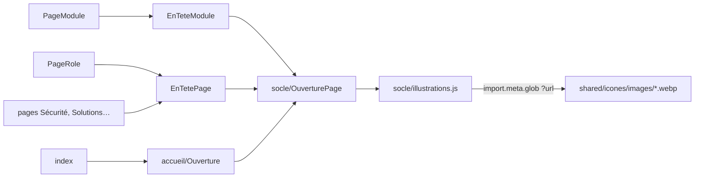

# VIT-23 · La première section de chaque page, remplie (plan court)

| | |
|---|---|
| Module | [VIT](../../plan/modules/VIT-site-vitrine.md) · hors chantier, comme la suite de VIT-20 |
| Mission | [vit-23-premieres-sections](../../plan/missions/vit-23-premieres-sections.md) (branche `doc/coordination-2026-11-26-suite`) |
| Branche | `feat/vit-23-premieres-sections`, depuis `origin/main` (`fa9df596`), dossier `..\travaux-planner\vit-23-premieres-sections` |
| Rédigé par | Claude Code (Opus 5.5), le 2026-11-26 |
| Taille | M |
| **Validé** | **par le coordinateur le 2026-11-26** (`90b9963f`, taille M, sans migration ni sécurité) ; **le rendu est validé par le chef sur captures** ; aucune phrase nouvelle n'est proposée (§ 4.5) |

## 1. Objet et critère de « terminé »

Le chef, le 26 nov., sur « Course space » à 1440 px : « Les premières sections de chaque page semblent trop vides. » Les captures « avant » (hors du dépôt, `..\travaux-planner\captures-vit-23\avant\`) le confirment :

| Ouverture | 1440 px | 390 px | Ce qui fait le vide |
|---|---|---|---|
| Accueil (`Ouverture`) | 848 px de haut, tout l'écran | tout l'écran | `Section plein` (hauteur de l'écran), une colonne centrée, aucun visuel autre que le logo |
| Module (`EnTeteModule`), ex. Espace de cours | 933 px | 605 px | marge `--espace-section` (jusqu'à 160 px) en haut et en bas, une colonne centrée de 600 px de large sur 1440 |
| Page (`EnTetePage`), ex. Sécurité, Direction | 680 à 850 px | 470 à 630 px | même marge, titre et accroche seuls |

Terminé quand (critère de la fiche, précisé) :
- sur les trois ouvertures, à 1440, 768 et 390 px, **la section est moins haute** (cible : ouverture d'une page de module ≤ 640 px à 1440, contre 933) et **un visuel accompagne le texte** sur les pages du § 4.3 ;
- **EP-19** : aucune page au-delà de 200 Ko (contrôle VIT-19) ; l'accueil monte de 20 Ko au plus (118,0 Ko aujourd'hui) ; le visuel a `width` et `height` écrits (pas de décalage) et `alt=""` (il est décoratif : le nom ou le titre est écrit à côté) ;
- axe-core sans violation ; rendu correct sans JavaScript ; l'arabe garde le sens de lecture (grille en propriétés logiques) ;
- tests du site, build, `verifier-neutre`, test des superlatifs verts ;
- les textes C2 de l'accueil, visés le 19 nov., sont repris **tels quels** ; aucune autre phrase n'est ajoutée.

## 2. Ce qui existe

- `components/applications/EnTeteModule.astro` (57 lignes) : logo, catégorie, `h1` (le nom du module), accroche, un bouton, onglets, dans `Section` (marges `--espace-section`). Utilisé par `PageModule.astro` pour les 5 pages de module.
- `components/fonctions/EnTetePage.astro` (32 lignes) : surtitre, `h1`, accroche, emplacement `actions`. Utilisé par 11 pages : Bibliothèque des jeux, Bientôt, Comparer (sombre), Sécurité (sombre), Solutions, Mentions légales, Confidentialité, et, par `PageRole.astro`, Direction, Scolarité, Enseignants, Étudiants.
- `components/accueil/Ouverture.astro` (33 lignes) : logo animé, `h1` « Planner », accroche (déjà celle de C2), deux boutons, dans `Section plein`.
- `shared/icones/images/<id>.webp` : 17 illustrations 512 × 512, 13 à 15 Ko, fond bleu clair, liste `MODULES_ILLUSTRES` de `shared/icones/index.js`. Les identifiants ne sont pas ceux des logos (`espaceDeCours` : logo `pedagogie`, image `cours`).
- CSP du site : `img-src 'self'` ; pas de `sharp` installé (pas de traitement d'image par Astro).
- Poids actuels (fr) : pages de module 63 à 68 Ko, pages de rôle 63 Ko, accueil 118 Ko.
- Odoo (pages eLearning, Comptabilité, Planification, relues le 26 nov.) : onglets de la page en tête, titre court, une phrase, deux boutons, une ligne de réassurance, puis un grand visuel juste dessous, visible dans le premier écran. Pas de logo d'application ni de catégorie dans l'ouverture. On reprend la **composition** (densité, visuel dans le premier écran, onglets en tête) ; on ne reprend ni texte, ni dessin, ni le soulignement dessiné à la main, qui est une signature d'Odoo (étude 14, § 1).

## 3. Questions

| N° | Question | Proposition | À qui | Bloque |
|---|---|---|---|---|
| 1 | Visuel à côté du texte ou dessous ? | **à côté** sur ordinateur (≥ 960 px) pour les trois ouvertures : les illustrations sont carrées, dessous elles pousseraient la page vers le bas ; **dessous** sur tablette et téléphone. L'essai montre aussi la variante « dessous, centré » sur Espace de cours | chef, sur captures | étape 3 |
| 2 | Un mot du titre en relief ? | oui, **couleur seule** (`--bleu` sur fond clair, `--bleu-clair` sur fond sombre), sans dessin. Le mot n'est pas marqué dans la phrase : une clé `entete.relief` (ou `ouverture.relief`) donne le passage à colorer ; absent ou introuvable, rien n'est coloré. Le texte visé ne change pas. Pas de relief sur les pages de module (le titre est le nom). Passages proposés : § 4.4 | chef (choix des passages) | étape 3 · **le chef choisit sur captures ; l'essai montre aussi une capture sans relief** |
| 3 | Un second bouton sur les pages de module ? | **non** : les onglets mènent déjà à « Fonctionnalités », et tout autre bouton demanderait une phrase nouvelle. L'accueil et les pages de rôle ont déjà deux boutons | chef | non · **non (chef, 26 nov.)** |
| 4 | Visuel des pages sans illustration | § 4.3 : un visuel existant partout ; **aucun dessin nouveau** ; Sécurité, Comparer, Bientôt et les pages légales sans visuel, seulement resserrées | coordinateur | **retenu tel quel (coordinateur, 26 nov.)** |
| 5 | Onglets des pages de module en tête de la section, comme Odoo ? | oui : la rangée « Aperçu · Fonctionnalités » passe au-dessus du logo, alignée au début de la ligne ; le reste ne bouge pas | chef, sur captures | étape 3 |
| 6 | Visuel de l'accueil | **A** : `planning.webp` à côté du texte (+14 Ko, sous les 20 Ko permis), le logo animé reste au-dessus de « Planner » (C2) ; **B** : le logo animé seul, agrandi, à la place du visuel (0 Ko). L'essai montre les deux | chef, sur captures | étape 3 |
| 7 | **Sortie du périmètre** : `components/fonctions/PageRole.astro` doit passer le visuel à `EnTetePage` pour les quatre pages de rôle (une propriété, deux lignes) | l'ajouter au périmètre ; sinon, les pages de rôle sont seulement resserrées | coordinateur | **ajouté au périmètre, pour `image` et `relief` seulement (coordinateur, 26 nov.)** |

Q1, Q5 et Q6 : le chef choisit sur les captures de l'essai (coordinateur, 26 nov.). Avant l'étape 4 : `git merge origin/main` après la fusion de VIT-21 (#262), puis le relief d'Étudiants pris dans le titre à jour.

## 4. Solution

### 4.1 Un composant d'ouverture commun

`components/socle/OuverturePage.astro` (nouveau, ≤ 120 lignes) porte la mise en page des trois ouvertures. Il pose sa propre `<section>` (sans passer par `Section`, dont la marge ne change pas pour le reste du site) :

- marges : `padding-block: clamp(2rem, 1rem + 3vw, 4rem)` au lieu de `--espace-section` (80 à 160 px) ; plus de `plein` sur l'accueil ;
- deux colonnes à partir de 960 px (`grid-template-columns: 1.1fr 0.9fr`), texte aligné au début de la ligne ; une colonne au-dessous, texte centré, visuel après les boutons (≤ 18 rem de large) ;
- emplacements : `avant` (onglets d'un module, logo), `actions` (boutons), `apres` (ligne des rôles de l'accueil), `visuel` ;
- propriété `image` (identifiant de `MODULES_ILLUSTRES`) : ``, coins arrondis de la charte (`--rayon-grand`) ;
- propriété `relief` : passage du titre à colorer (§ 4.4) ;
- `ton` (clair, gris, sombre) comme `Section` ;
- propriétés logiques seulement (`inline-size`, `margin-inline`, `text-align: start`) : en arabe, le texte passe à droite et le visuel à gauche sans règle de plus.

`EnTeteModule`, `EnTetePage` et `Ouverture` deviennent de petites enveloppes de ce composant.

### 4.2 Les illustrations, sans copie

`components/socle/illustrations.js` (nouveau, ≤ 40 lignes) : `import.meta.glob('../../../../shared/icones/images/*.webp', { query: '?url', import: 'default', eager: true })`, comme `logos.js` pour les SVG. Vite copie chaque fichier dans `dist/_astro/` avec une empreinte (cache long, CSP `'self'` respectée). Aucune copie à la main ; `shared/icones/` n'est que lu. Une table `IMAGE_DU_MODULE` relie la clé du module à l'image (`espaceDeCours → cours`…) ; un identifiant absent fait échouer le build.

### 4.3 Page par page

| Page | Ouverture | Visuel | Pourquoi |
|---|---|---|---|
| Accueil | C2 : logo animé, « Planner » en surtitre, `h1` promesse, accroche actuelle, deux boutons, ligne des rôles | question 6 (A : `planning.webp`) | C2 visé le 19 nov. |
| Emploi du temps, Présences, Espace de cours, Quiz et jeux, Annonces et messages | onglets en tête (question 5), logo, catégorie, `h1`, accroche, bouton | `planning`, `presences`, `cours`, `activites`, `annonces` | l'illustration du module (VIT-09c) |
| Bibliothèque des jeux | `EnTetePage` | `activites` | page des jeux du module Quiz et jeux |
| Scolarité | `EnTetePage` (par `PageRole`) | `planning` | sa page principale est Emploi du temps |
| Enseignants | idem | `activites` | sa page principale est Quiz et jeux |
| Étudiants | idem | `cours` | sa page principale est Espace de cours |
| Direction | idem | `presences` | ses cartes parlent de l'emploi du temps (déjà pris par Scolarité) et d'« En classe » ; `pilotage` serait un module « Bientôt », donc écarté |
| Solutions | `EnTetePage` | `planning` | « Une école, ses règles. » : l'emploi du temps est ce que la page détaille |
| Sécurité, Comparer | `EnTetePage`, ton sombre, **resserrées** | aucun | aucune illustration ne parle de sécurité ou de comparaison ; un dessin nouveau n'est pas justifié (fiche, question 4) ; VIT-09b gardera la place |
| Bientôt | **resserrée** | aucun | les 12 cartes suivent tout de suite ; une image d'un module « Bientôt » en tête mettrait l'un d'eux en avant |
| Mentions légales, Confidentialité | **resserrées** | aucun | pages de lecture |
| FAQ, Catalogue, Toutes les applications, Inclus dans tout abonnement | **inchangées** | — | elles ont leur propre en-tête, court, suivi aussitôt du contenu ; les changer sort du périmètre |

Le logo de l'en-tête d'un module reste rendu par `logoModule()` sans changement : VIT-20f le remplacera sans toucher à l'ouverture.

### 4.4 Le passage en relief (question 2)

Aucun mot ajouté ; la clé `relief` ne contient qu'un morceau du titre déjà visé.

| Page | Titre (fr) | Relief (fr) | Relief (en) |
|---|---|---|---|
| Accueil | L'emploi du temps calculé selon vos règles. Puis toute la classe. | selon vos règles | from your rules |
| Direction | Toute l'école, d'un seul regard. | d'un seul regard | le passage équivalent du titre anglais |
| Scolarité | Votre semestre, calculé. | calculé | idem |
| Enseignants | Après l'emploi du temps, la classe. | la classe | idem |
| Étudiants | Les supports de la classe, et les nouvelles de l'école. | les nouvelles de l'école | idem |
| Solutions | Une école, ses règles. | ses règles | idem |
| Bibliothèque des jeux | Dix simulations, trente défis. | trente défis | idem |
| Sécurité | Chacun voit ce qui le concerne. | ce qui le concerne | idem |
| Bientôt, Comparer, pages légales | — | — | — |

L'arabe n'a pas la clé : aucun relief.

### 4.5 Textes

- Accueil, repris tels quels de C2 (visés le 19 nov.) : `ouverture.surtitre` « Planner » ; `ouverture.titre` « L'emploi du temps calculé selon vos règles. Puis toute la classe. » (« A timetable built from your rules. Then the whole classroom. ») ; `ouverture.roles` « Vous êtes : » puis « Direction · Scolarité · Enseignant · Étudiant » (« You are: Leadership · Registrar · Teacher · Student »), chaque mot menant à sa page.
- Clés `relief` (§ 4.4) : extraits des titres, pas de phrase nouvelle.
- `ar/` : mêmes clés que le français pour `ouverture` (règle du site), pas de `relief`.

## 5. Fichiers créés ou modifiés

| Fichier | Créé / modifié | Rôle | Taille visée |
|---|---|---|---|
| `vitrine/src/components/socle/OuverturePage.astro` | créé | mise en page commune | ≤ 120 lignes |
| `vitrine/src/components/socle/illustrations.js` | créé | URL des WebP, table module → image | ≤ 40 |
| `vitrine/src/components/applications/EnTeteModule.astro` | modifié | enveloppe, onglets en tête, image du module | ≤ 60 |
| `vitrine/src/components/fonctions/EnTetePage.astro` | modifié | enveloppe, `image`, `relief` | ≤ 40 |
| `vitrine/src/components/accueil/Ouverture.astro` | modifié | C2, visuel | ≤ 60 |
| `vitrine/src/components/fonctions/PageRole.astro` | modifié **si la question 7 est acceptée** | passe `image` et `relief` | +2 lignes |
| `vitrine/src/pages/[lang]/{bibliotheque-des-jeux,solutions,securite}.astro` | modifiés | passent `image` ou `relief` | +1 ligne chacune |
| `vitrine/src/i18n/{fr,en,ar}/accueil.json` | modifiés | `ouverture.surtitre`, `titre`, `roles`, `relief` | — |
| `vitrine/src/i18n/{fr,en}/{direction,scolarite,enseignants,etudiants,solutions,bibliotheque-des-jeux,securite}.json` | modifiés | `entete.relief` | — |
| `vitrine/tests/ouverture.test.js` | créé | § 8 | ≤ 120 |
| `docs/plan/modules/VIT-site-vitrine.md`, fiche de session | modifiés / créé | état | — |

Les tests existants qui lisent le `h1` de l'accueil (`accueil.rendu.cjs`, `contenu.test.js`…) sont mis à jour dans la même branche si C2 les fait échouer ; ils sont sous `vitrine/tests/`, dans le périmètre.

## 6. Données et migration

Aucune.

## 7. Sécurité, isolation et exigences produit

- CSP inchangée : les images sont servies par le site (`'self'`), sans `data:`.
- EP-19 : +14 Ko par page qui prend une illustration (pages à 63-68 Ko → 77-82 Ko) ; accueil +14 Ko avec A (132 Ko), +0 avec B. Contrôlé par `npm run test:poids`.
- Accessibilité : `alt=""` (le nom ou le titre est à côté) ; le relief est un `` sans rôle, lu comme le reste du titre ; contrastes AA (`--bleu` #2A679F sur blanc, `--bleu-clair` #A6CAEE sur bleu nuit, en grand texte) ; la ligne des rôles est une `<nav aria-label>` ; pas de mouvement nouveau.

## 7 bis. Ce que disent les études

| Ligne | Étude | Appliquée ou écartée | Comment, ou pourquoi |
|---|---|---|---|
| § 1, la règle | 14 | appliquée | composition d'Odoo reprise, rien de copié ; pas de soulignement dessiné |
| C2 | 12, § 13 | appliquée | textes visés repris tels quels |
| C3 | 12 | écartée ici | les captures restent à VIT-09b ; les illustrations les attendent |
| N1 (EP-19) | EP-18 | appliquée | poids mesuré, sous 200 Ko |

Public : le supérieur d'abord (accroche C2) ; rien n'est propre à un type d'école.

## 7 ter. EP-18 : tous les contextes

| Contexte | Ce que fait la fonction | Preuve ou test |
|---|---|---|
| A. Élève sans téléphone | sans objet : page publique de présentation ; aucune image ne montre le téléphone de l'élève comme seul chemin | relecture des captures |
| B. Connexion lente | +14 Ko au plus, image après le texte dans le code, dimensions écrites : le texte se lit avant l'image | `test:poids` |
| C. Projecteur ou rien | sans objet : site public | — |

## 8. Tests

`vitrine/tests/ouverture.test.js`, sur `dist/` :
- chaque page de module et chaque page du § 4.3 avec visuel a, dans sa première section, un `` avec `width`, `height` et `alt=""`, dont le fichier existe dans `dist/` ;
- les pages sans visuel n'en ont pas ;
- l'accueil : `h1` = la promesse C2 (fr, en), surtitre « Planner », quatre liens de rôle ;
- chaque `relief` est un morceau exact du titre de sa page (fr, en) ;
- `IMAGE_DU_MODULE` ne cite que des identifiants de `MODULES_ILLUSTRES`.

Puis : `npm run test:unit`, build, `test:poids`, `axe.parcours.cjs`, `verifier-neutre`, rendu sans JavaScript (capture), arabe à 1440 et 390 px.

## 9. Étapes de livraison

1. Ce plan, commité seul ; validation du coordinateur ; réponses du chef aux questions 2, 3, 5 et 6.
2. `OuverturePage` et `illustrations.js`.
3. **Essai** : Espace de cours (variantes « à côté » et « dessous ») et l'accueil (A et B), captures avant et après hors du dépôt ; **le chef valide le rendu**.
4. Toutes les pages du § 4.3 ; `relief` ; tests ; captures finales.
5. Fichier du module, fiche de session, commandes au chef.

## 10. Risques et retour arrière

- VIT-20f (logo de l'en-tête) et VIT-09d (logos) touchent la même zone : l'appel à `logoModule()` ne change pas, le conflit se limite à une ligne.
- VIT-21 (#262) change des accroches d'Espace de cours : l'ouverture lit la clé, pas le texte ; garder celle de `main` après sa fusion.
- VIT-09b (#227, brouillon) portait la première section : elle passe à VIT-23 (coordinateur, 26 nov., à confirmer par le chef).
- Retour arrière : les trois enveloppes reprennent leur version de `main` ; le composant commun et la table d'images se retirent sans effet ailleurs.

## 11. Hors périmètre

Les captures d'écran réelles (VIT-09b), les logos (VIT-09d, VIT-20f), les textes d'Espace de cours et de la vidéo (VIT-21), le composant `Section`, les pages FAQ, Catalogue, Toutes les applications et Inclus dans tout abonnement.
