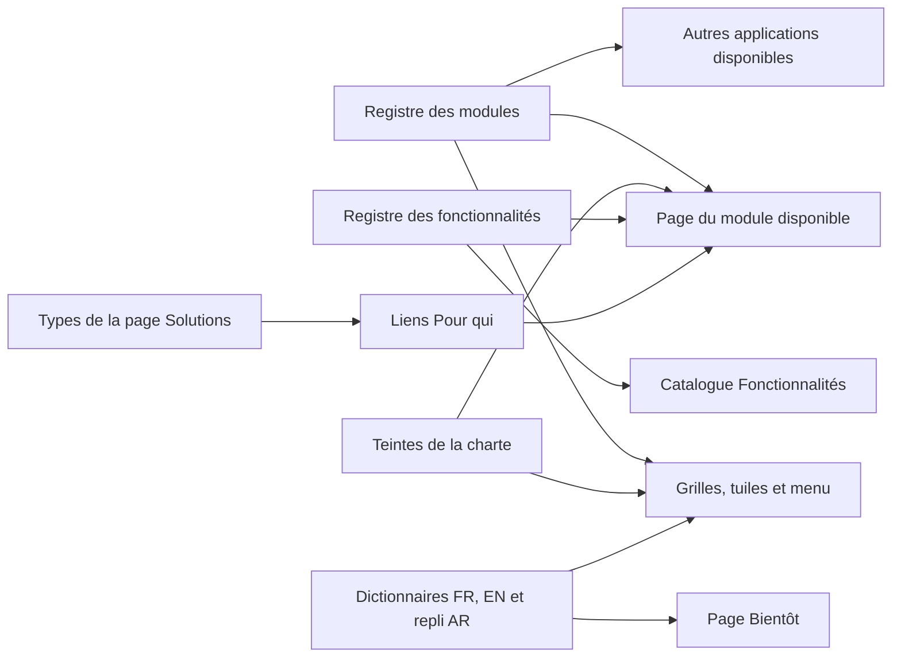

# VIT-24 · Finitions du catalogue et des pages de modules

| | |
|---|---|
| Module | [VIT](../../plan/modules/VIT-site-vitrine.md) · suite de VIT-20 hors chantier, accord du chef du 27 novembre |
| Branche | `feat/vit-24-finitions-modules` |
| Base examinée | `3daf2771` · #284 et #286 fusionnées |
| Rédigé par | Codex, le 28 novembre 2026 |
| **Validé** | Chef de projet, le 28 novembre 2026 (« Pour le site vitrine, je valide »), puis demande de poursuivre les travaux. |

## 1. Objet et critère de « terminé »

La direction et la scolarité peuvent repérer les 17 applications, distinguer les cinq disponibles des douze en préparation, comprendre ce que fait chaque application et passer à une autre application disponible. Les pages de modules reprennent leur couleur et décrivent au moins trois fonctions existantes chacune. La gestion des notes est identifiable dès le catalogue. Les textes FR et EN sont visés et testés, les pages touchées passent axe-core à 390 et 1 440 px, le site tient son budget EP-19 et les grilles tiennent à 390 px.

## 2. Ce qui existe

- [`modules.js`](../../../vitrine/src/donnees/modules.js#L13) porte les 17 identifiants, l'ordre, l'état et le logo. [`GrilleModules.astro`](../../../vitrine/src/components/applications/GrilleModules.astro#L20) les affiche par catégorie au catalogue et place les disponibles d'abord sur l'accueil.
- [`TuileModule.astro`](../../../vitrine/src/components/applications/TuileModule.astro#L19) rend un lien pour une application disponible et un élément statique pour « Bientôt ». Le SVG officiel est posé dans un carré blanc à filet et grisé par filtre. Le [méga-menu](../../../vitrine/src/components/navigation/MenuApplications.astro#L29) partage le composant dans sa variante texte.
- [`EnTeteModule.astro`](../../../vitrine/src/components/applications/EnTeteModule.astro#L20) réutilise l'ouverture VIT-23. [`PageModule.astro`](../../../vitrine/src/components/applications/PageModule.astro#L32) assemble le contenu propre à la page, le registre, le bloc équipement, les publics et les autres applications. [`Section.astro`](../../../vitrine/src/components/socle/Section.astro#L19) applique par défaut des marges de 80 à 160 px.
- [`FonctionnalitesModule.astro`](../../../vitrine/src/components/applications/FonctionnalitesModule.astro#L13) lit le registre commun. Celui-ci fournit 4 cartes pour Emploi du temps, 3 pour Quiz et jeux, 2 pour Espace de cours, 1 pour Présences et 1 pour Annonces et messages.
- [`AutresModules.astro`](../../../vitrine/src/components/applications/AutresModules.astro#L16) filtre par catégorie. [`pourQui.js`](../../../vitrine/src/components/applications/pourQui.js#L8) sait déjà lier les types aux ancres de [Solutions](../../../vitrine/src/components/solutions/types.js#L8), et les rôles à leurs pages.
- [`bientot.astro`](../../../vitrine/src/pages/%5Blang%5D/bientot.astro#L28) lit le nom dans `modules.json` et le texte sous ce nom dans `bientot.json`. Le menu et les grilles lisent directement le nom commun.

## 3. Questions soumises au chef

| N° | Question | Proposition | Réponse | Bloque |
|---|---|---|---|---|
| 1 | Quels nom et sous-titre anglais retenir, et sur quelles surfaces afficher le sous-titre ? | Viser les lignes N1 à N3 du § 4.5. Nom commun partout. Sous-titre sur « Bientôt » et dans la variante texte du méga-menu si le sous-titre tient sous le titre, sans débordement ni texte rogné en FR et EN aux deux largeurs. Si ce contrôle échoue, garder le nom et le badge dans le menu. | Proposition visée : N1 à N3, sous-titre du menu soumis à la recette | Textes et tests |
| 2 | Quel contraste visuel entre les applications disponibles et « Bientôt », et quel gabarit pour les pages ? | Choisir B, 50 % de la teinte de base sur blanc pour le fond interne du logo. Retenir aussi le gabarit proposé au § 4.1. Les essais A (35 %) et C (65 %) figurent sur la planche. | Proposition visée : B (50 %) et gabarit du § 4.1 | Rendu |
| 3 | Quelles phrases pour les nouvelles cartes ? | Viser les lignes P1 à P3, C1 et A1 à A2 du § 4.5. Pour la troisième carte de Présences, retenir la correction d'un statut après clôture. Si M-1 est intégrée avant le code et qu'on préfère la présenter, soumettre le texte de remplacement au chef. | Proposition visée : P1 à P3, C1 et A1 à A2 | Registre |
| 4 | Quels liens proposer dans « Pour qui » et dans « Un besoin, une application » ? | Afficher les types déjà associés à l'application et pointer vers leurs sections locales dans Solutions. Masquer « Pour qui » en l'absence de type attesté. Afficher les quatre autres applications disponibles dans l'ordre du registre. | Proposition visée : types de Solutions et quatre autres applications disponibles | Liens et rendu |
| 5 | Que signifie « arabe construit et non indexé » pour cette mission ? | Conserver le repli des clés existantes. Construire les routes AR pour la recette dans une copie hors dépôt, en gardant `LANGUES_PUBLIEES` limitée à FR/EN, puis contrôler `lang="ar"`, `dir="rtl"` et `noindex`. Si ces routes doivent aussi figurer dans l'artefact normal, autoriser une modification de `vitrine/src/i18n/langues.js` et vérifier les règles de l'image Nginx avant de coder. | Recette AR hors dépôt, retenue par le coordinateur le 28 novembre | Recette AR et périmètre |

## 4. Solution proposée

### 4.1 Planche de comparaison

Ouvrir `..\travaux-planner\captures-vit-24\index.html` depuis le dépôt principal. La planche rapproche chaque paire à largeur égale et donne accès aux PNG originaux. « Avant » est le site construit sur `3daf2771`. « Après » est une maquette temporaire dans Chromium, destinée au visa. Les captures d'accueil et de « Bientôt » de la planche cadrent les sections touchées.

| Surface | Largeurs | À regarder |
|---|---|---|
| Catalogue | 390 et 1 440 px | Deux et six colonnes, noms sur deux lignes, badges alignés, logos pâles identifiables |
| Accueil | 390 et 1 440 px | Même gabarit et même statut, ordre disponible puis « Bientôt » |
| Présences | 390 et 1 440 px | Ouverture et aperçu teintés, grand logo, trois cartes, deux liens d'établissements et quatre autres applications en couleur |
| Bientôt | 390 et 1 440 px | Nom et sous-titre de Notes et évaluations dans la section « Enseigner » |
| Essais A, B et C | 390 et 1 440 px | Fonds des logos à 35 %, 50 % et 65 % de la teinte de base |

### 4.2 Tuiles et teintes

- Conserver les deux densités déjà posées au catalogue et sur l'accueil. Donner au nom une zone de deux lignes à la taille courante (1,35 d'interligne) et laisser la zone grandir si un zoom ou un libellé plus long l'exige. Aligner le badge après cette zone dans chaque rangée. Garder le texte entier et un focus visible autour de la surface interactive.
- Proposer un SVG de 58 px sur téléphone et de 72 px à partir de 48 rem (48 et 60 actuellement), en laissant le carré intégré au dessin former le seul cadre. Sur « Bientôt », atténuer le fond du SVG rendu et garder ses détails reconnaissables. Le texte reste en encre. Le badge utilise le ton foncé sur un fond à 14 % de la teinte de base. Les tuiles à venir restent des éléments statiques, hors tabulation, sans survol de lien.
- Lire `app-<logo>` et `app-<logo>-fonce` depuis [la source de la charte](../../../shared/charte/jetons.json) au build et les exposer dans le périmètre des composants Applications. Les valeurs sont documentées [dans la charte](../../../shared/charte/README.md#L46). Le CSS global est un fichier généré soumis à `generer.mjs --verifier`. La lecture à la source évite de le modifier ou de demander un changement au générateur.
- Exemple Présences, fond `#2F7548` et encre `#1F4D2F`. Le choix du logo commande la teinte. Les blancs et les couleurs de texte existants restent ceux de la charte en vigueur.

### 4.3 Pages de modules

- Placer une portée de styles locale dans `PageModule.astro` autour de l'ouverture et du contenu du module. Employer le ton foncé pour le titre, l'onglet actif, les titres des cartes et les pastilles. Mettre la teinte de base à 7 % sur le fond de l'ouverture et de l'aperçu, et à 12 % sur les pastilles (20 % au survol). Garder la composition VIT-23 et l'illustration actuelle. Proposer 88 et 112 px pour le SVG du grand logo, aux deux gabarits.
- Resserrement proposé, `clamp(2rem, 1.5rem + 3vw, 4rem)` pour la marge verticale des sections du module. Garder la fin de page commune hors de la portée. Le groupe de cartes utilise des colonnes qui se replient à faible largeur.
- Pour Présences, remplacer la carte générale `appel` par les trois cartes P1 à P3 en réutilisant son identifiant pour P1. Garder pour P2 son contexte d'usage avec réseau et téléphone, expliqué dans le bloc équipement existant. P3 décrit la rectification d'une présence sur un appel clôturé. La feuille d'appel et le marquage après coup du lot M-1 sont absents de `3daf2771`.
- Pour Espace de cours et Annonces et messages, compléter par C1 et A1–A2. Garder les quatre cartes d'Emploi du temps et les trois de Quiz et jeux. Les nouveaux titres et descriptions proviennent du registre, de façon à être identiques sur la page module et dans « Fonctionnalités ».

VIT-25 (plan `0a5ce400`) intervient après VIT-24. VIT-24 ajoute dans `PageModule.astro` les emplacements nommés
`actions`, `guide` et `faq`, dans cet ordre après l’ouverture. Le bloc `actions` s’insère à la place du
contenu par défaut quand il est fourni, et `guide` vient juste après. La FAQ suit les autres applications
avant la fin de page. Les pages actuelles gardent leur contenu et leurs espacements avec les emplacements
vides. `EnTeteModule.astro` reçoit `guide?: string`, le libellé traduit que VIT-25 lui fournira. Il affiche
alors le second bouton « Voir le guide » vers `#guide`. Le lot VIT-24 prévoit une quinzaine de lignes de
composants et un cas de rendu des emplacements vides. Le test vérifie l’ordre et le contenu actuels, sans
bloc vide ni bouton `#guide`. VIT-25 remplit ces emplacements depuis ses pages, hors de
`vitrine/src/components/applications/`, et fournit ses libellés au moment de son visa.

### 4.4 Liens de fin de page et nom du module à venir

Le bloc « Un besoin, une application » filtre `MODULES` par disponibilité, puis retire l'application courante. Les quatre liens sont rendus dans le même gabarit compact en couleur, sur deux colonnes à 390 px et quatre à 1 440 px. Le lien « Toutes les applications » mène au catalogue.

Les pastilles reprennent les types issus de `pourQui`, avec les ancres localisées dans Solutions. Par exemple, Présences mène à `/fr/solutions/#superieur` et `/fr/solutions/#college-lycee`. Les associations restent celles de `TYPES`. Avec cette source, Espace de cours et Annonces et messages n'ont aucune pastille si le chef retient Q4.

Le nom et le sous-titre de Notes et évaluations suivent Q1. La description actuelle de la carte « Bientôt » prend le sous-titre visé. La description de page emploie aussi le nouveau nom si N3 est visée. Le module garde sa clé `evaluations`, son logo, son badge et sa place. VSC-08 relève de l'étape 3 et VSC-04 de l'étape 6.

### 4.5 Textes complets soumis au visa

Les clés et les sources ci-dessous fixent la proposition de texte. Une fois le visa donné, un test compare mot pour mot les libellés produits en FR et EN aux chaînes visées, avec les accents et la ponctuation.

| ID | Cible | Français | English | Source |
|---|---|---|---|---|
| N1 | Nom, toutes surfaces | Notes et évaluations | Grades and assessments | [VSC-08 et VSC-04](../../plan/modules/VSC-vie-scolaire.md), état « Bientôt » dans [modules.js](../../../vitrine/src/donnees/modules.js#L22) |
| N2 | Sous-titre « Bientôt » et menu sous condition | Bulletins, crédits et jurys | Report cards, credits and exam boards | [VSC-08 et VSC-04](../../plan/modules/VSC-vie-scolaire.md) |
| N3 | Description de la page « Bientôt » | Les modules de Planner en préparation : notes et évaluations, vie scolaire et familles, inscriptions, frais et caisse, et plus encore. Aucun n'est encore disponible. | Planner modules in preparation: grades and assessments, school life and families, admissions, fees and cash desk, and more. None is available yet. | [Description existante FR](../../../vitrine/src/i18n/fr/bientot.json#L4) et [EN](../../../vitrine/src/i18n/en/bientot.json#L4) |
| P1 | Présences, `appel` | **Faire l’appel à la main** L’enseignant indique qui est présent, en retard ou absent. | **Take attendance manually** The teacher marks students as present, late or absent. | [LigneAppel.jsx](../../../frontend/src/components/appel/LigneAppel.jsx#L37), [Appel.jsx](../../../frontend/src/pages/Appel.jsx#L126) |
| P2 | Présences, `appel-qr` | **Faire l’appel par QR code** L’enseignant projette le code et les étudiants le scannent depuis leur téléphone. | **Take attendance with a QR code** The teacher projects the code and students scan it with their phones. | [AppelProjection.jsx](../../../frontend/src/pages/AppelProjection.jsx), [appel.spec.cjs](../../../frontend/tests/parcours/appel.spec.cjs#L38) |
| P3 | Présences, `corriger-presence` | **Corriger une présence** Après la clôture de l’appel, l’enseignant peut rectifier un statut et la correction est journalisée. | **Correct an attendance record** After closing attendance, the teacher can correct a status. The change is logged. | [statuts.js](../../../backend/services/presences/statuts.js#L14), [appelClasse.test.js](../../../backend/tests/integration/appelClasse.test.js#L73) |
| C1 | Espace de cours, `ouverture-supports` | **Programmer la visibilité d’un support** L’enseignant choisit les dates auxquelles un support devient visible ou cesse de l’être. | **Schedule access to a course resource** The teacher chooses when a resource becomes visible and when access ends. | [LigneSupport.jsx](../../../frontend/src/components/espaceCours/LigneSupport.jsx#L68), [ouverture.js](../../../backend/services/cours/ouverture.js#L6), [supports.js](../../../backend/services/cours/supports.js#L98) |
| A1 | Annonces et messages, `lectures-annonces` | **Suivre la lecture d’une annonce** L’auteur voit quels destinataires ont lu l’annonce. | **See who read an announcement** The sender can see which recipients have read the announcement. | [annonceRoutes.js](../../../backend/routes/annonceRoutes.js#L29), [Annonces.jsx](../../../frontend/src/pages/Annonces.jsx#L290) |
| A2 | Annonces et messages, `relancer-annonces` | **Relancer les destinataires** L’auteur peut envoyer un rappel aux personnes qui n’ont pas encore lu son annonce. | **Remind recipients** The sender can remind people who have not read the announcement yet. | [Annonces.jsx](../../../frontend/src/pages/Annonces.jsx#L145), [annonces.js](../../../backend/services/annonces/annonces.js#L380) |

## 5. Fichiers prévus après validation

| Fichiers | Intervention | Taille visée |
|---|---|---|
| `vitrine/src/components/applications/` | Tuiles et teintes, portée de page, en-tête, cartes, liens et autres applications | ≤ 200 lignes par composant |
| `vitrine/src/donnees/fonctionnalites.json` | Entrées visées du registre | Diff limité aux six entrées P1–P3, C1 et A1–A2 |
| `vitrine/src/i18n/{fr,en,ar}/{modules,bientot}.json` | Nom, sous-titre, description et repli existant selon le visa | Clés N1–N3 |
| `vitrine/tests/` | Contrastes, fidélité des textes, disponibilité, ancres, rendu et parcours | Réutiliser les suites actuelles |
| `docs/plan/modules/VIT-site-vitrine.md` et `docs/sessions/` | État livré, preuves et reprise | Une entrée de module et une fiche de session |

## 6. Données et migration

Le registre et les dictionnaires sont lus au build. Les états et segments des modules, les permissions et les données enregistrées par Planner gardent leur fonctionnement actuel.

## 7. Sécurité, isolation et exigences produit

La vitrine présente des données statiques. Les liens mènent à des pages ou ancres locales et les exemples utilisent les visuels neutres déjà disponibles. EP-11 couvre contraste, clavier et sémantique. EP-18 couvre la justesse des parcours décrits. EP-19 couvre les octets transférés. Les assets restent locaux et aucun îlot client supplémentaire n'est prévu.

## 7 bis. Ce que disent les études

Le public prioritaire est la direction et la scolarité du supérieur, à l'étape 3, puis les enseignants qui examinent les possibilités d'appel et de cours. Les noms et les textes publics restent utilisables par les autres types d'établissements déjà décrits.

| Ligne | Étude | Appliquée ou écartée | Comment |
|---|---|---|---|
| R4 | [Étude 14](../../etude-marche/14-reprendre-et-depasser.md) | Appliquée | Fiches reliées entre elles, types cliquables, bloc équipement conservé |
| C2, C10 | [Expertise de la vitrine](../../etude-marche/12-expertise-site-vitrine.md) | Appliquées | Composition VIT-23 conservée, sections plus rapprochées, trois fonctions réelles au minimum |
| C5, R9, N2 | [Expertise](../../etude-marche/12-expertise-site-vitrine.md), [étude 14](../../etude-marche/14-reprendre-et-depasser.md) | Appliquée pour l'équipement, hors-ligne reporté | Appel manuel et QR distingués. Le futur appel hors ligne relève de MOB-08 |
| M12, M14, M15, N1, N4 | [Étude 14](../../etude-marche/14-reprendre-et-depasser.md) | Appliquées | Budget, axe-core, phrases vérifiables et test des formulations |
| Registre et progression | [Étude 15](../../etude-marche/15-modules-et-packs.md) | Appliqués | 17 modules, ordre et disponibilités existants |

## 7 ter. EP-18, tous les contextes

| Contexte | Ce que fait la fonction | Preuve ou test |
|---|---|---|
| A. Étudiant sans téléphone ni ordinateur | L'enseignant peut le marquer depuis son appareil connecté. La vitrine présente l'appel manuel à côté du QR. | P1, contrôle du rendu et du bloc équipement |
| B. Réseau lent ou coupé | La page statique doit tenir dans 200 Ko. Un premier chargement sans réseau attend le retour de la connexion. Si le réseau coupe pendant l'appel, l'enseignant peut noter les présences sur papier et saisir les statuts lorsque l'accès revient, sous réserve que la séance soit encore saisissable. | EP-19, recette Slow 3G à 390 px, textes et bloc équipement |
| C1. Ordinateur et projecteur | Le QR d'appel peut être projeté quand le réseau est disponible. | P2 et parcours de projection existant |
| C2. Pas d'écran en salle | L'enseignant peut faire l'appel sur une feuille de sa préparation. La feuille intégrée et la clôture de séance après coup dépendent de M-1. | P1 et P3 distinctes, contrôle des libellés contre le registre |

## 8. Vérifications de l'implémentation

1. Unitaires et rendu statique : textes visés présents à chaque emplacement, replis AR contrôlés, registre majoré à 4/3/3/3/3 cartes selon les pages, sources valides, 17 modules dont 5 liens et 12 éléments statiques dans les grilles principales. Vérifier les anciens identifiants, le statut « Bientôt », les ancres de Solutions et les quatre liens hors module courant.
2. Clavier et contraste : axe-core sans violation sur accueil, catalogue, les cinq modules, « Bientôt » et « Fonctionnalités », en FR et EN à 390 et 1 440 px, menu fermé puis ouvert. Vérifier les couleurs effectives sur les tuiles et leurs badges, les pastilles et leurs états interactifs (4,5:1 pour le texte courant). Vérifier le focus visible et l'absence de tuiles « Bientôt » dans la tabulation.
3. Mise en page : contrôler dimensions et alignements des badges, noms entièrement visibles à 390 et 1 440 px, aucun débordement horizontal, repli à 320 px, zoom à 200 % et aperçu RTL. Vérifier la condition du sous-titre de menu de Q1.
4. Construire, lancer les tests unitaires et de rendu, `verifier-neutre`, le contrôle du générateur de charte, puis `test:poids`. Refaire les quatre paires de captures sur le site livré et comparer aux rendus visés.

## 9. Étapes de livraison

1. Soumettre ce plan et ses maquettes au chef. Consigner le visa et les réponses dans un commit de plan.
2. Appliquer le gabarit aux tuiles et aux pages et mettre à jour les liens.
3. Intégrer les libellés et les entrées visés. Exécuter la recette et actualiser la fiche de session et le module VIT.

## 10. Risques et retour arrière

Un logo trop pâle ou un libellé rogné gêne le repérage, surtout dans le menu. Les variantes illustrent le premier risque et les tests de rendu et de zoom couvrent le second. Les changements de styles, de composants, de traductions et de registre sont réversibles par retrait des commits d'implémentation.

## 11. Hors périmètre

VIT-09b, VIT-23, refonte de la navigation, nouveaux logos, séparation Quiz et jeux (QJE-17), livraison des notes et bulletins, serveur, dépendances, publication et indexation.
