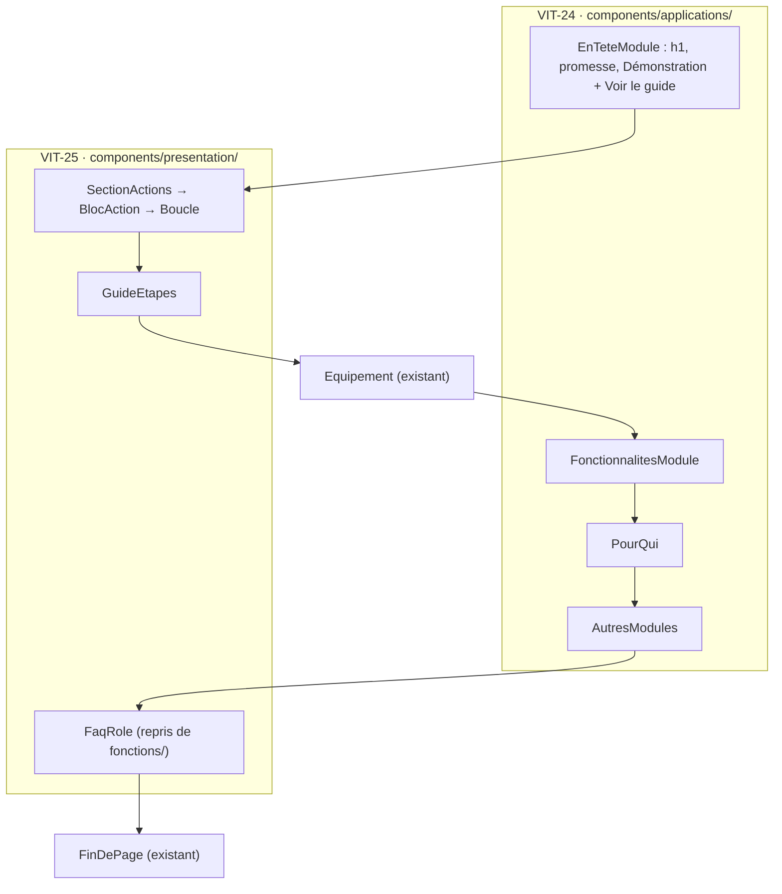

# VIT-25 · Une page de présentation par module, avec des boucles animées et un guide — conception

| | |
|---|---|
| Module | [VIT](../../plan/modules/VIT-site-vitrine.md) · hors chantier, sur la demande du chef (27 nov., élargie le 28 nov.) ; active la ligne « plus tard » du [plan du site](vit-vitrine.md), § 3 bis |
| Mission | `docs/plan/missions/vit-25-videos-site.md` (branche `doc/coordination-2026-11-27-suite`, commit `8e44e4c6`), avec « Ce que le chef a ajouté (28 nov.) » ; reprend VIT-09b (plan validé, PR #227, branche `feat/vit-09-illustrations`) |
| Branche | `feat/vit-25-videos-site` (le plan), depuis `origin/main` (`3daf2771`) ; puis une branche par lot (§ 9) |
| Rédigé par | Claude Code (Opus 5.5), sous-agent du coordinateur, le 2026-11-28 |
| **Validé** | en attente du chef (rendu, durées, phrases, questions du § 3) |

## 1. Objet et critère de « terminé »

Chaque module **disponible** a une page de présentation complète, sur la **structure** du site d'une plateforme de quiz connue que le chef apprécie (structure seulement : ni son apparence, ni ses textes, ni son nom dans le dépôt) :

1. un titre court, une promesse d'une ligne et **deux appels à l'action** (démonstration ; voir le guide) ;
2. des blocs **« une action, une boucle »** : une boucle muette de 4 à 6 s montre le geste réel dans Planner, à côté d'un titre et d'une ou deux phrases ;
3. un **guide d'utilisation** pas à pas (« Comment faire »), aux étapes numérotées, chacune avec sa capture ;
4. une **FAQ courte**, puis un **appel à l'action final**.

Modules concernés : Emploi du temps, Présences, Espace de cours, Annonces et messages. Quiz et Jeux pédagogiques viennent après l'étape du site de QJE-17 (deux pages au lieu d'une). Un module « Bientôt » n'a pas de page animée.

**Terminé, pour chaque lot (un module)** :
- chaque bloc montre une fonction qui existe, sur des données fictives ; chaque phrase a sa preuve dans le code (fichier et ligne, § 4) et un test la compare au texte visé ;
- chaque scène est visée par le chef **avant** le rendu commité (aperçu hors dépôt) ; chaque capture est vue par le chef avant son commit ;
- image d'attente, mouvement réduit respecté, sans son, bouton de pause, rien chargé d'ailleurs ;
- axe-core sans violation à 390 et 1440 px, en français et en anglais ; aucun défilement horizontal ;
- EP-19 tenu et mesuré dans la PR (§ 7) ; `verifier-neutre` vert ;
- les sources Remotion, les scripts de capture et la commande de rendu sont dans le dépôt : une boucle se refait en trois commandes quand l'écran change (§ 4.8).

## 2. Ce qui existe

**Les pages de modules** (`vitrine/src/pages/[lang]/applications/`, état de `3daf2771`) :
- `PageModule.astro` (44 lignes) assemble : `EnTeteModule` (onglets, logo, catégorie, `h1` = nom du module, accroche, **un seul** bouton « Demander une démonstration », l'illustration de VIT-23), puis le contenu propre à la page (`<slot />`), `FonctionnalitesModule`, `Equipement`, `PourQui`, `AutresModules`, `FinDePage`.
- `presences.astro` ne pose qu'une section, `Presentation` « L'appel en un geste. », avec le dessin `IllustrationAppel` (`en-classe.json`, clé `appel`). Les trois autres pages posent une ou deux sections (`Presentation`, `GrilleCartes`).
- Poids mesurés sur `dist/` (script EP-19, gzip niveau 1) : Présences **80,5 Ko** (dont la police Inter 47 Ko et l'illustration 14 Ko), Emploi du temps 83,3, Espace de cours 78,7, Annonces et messages 78,5 ; l'accueil 134,4.

**VIT-24** (Codex, plan en attente du chef) refait `components/applications/` : teintes par module, en-tête, trois cartes au moins par module (P1 à P3, C1, A1, A2), liens de fin de page. Il ne touche ni `pages/`, ni les composants hors `applications/`.

**Ce que le site sait déjà faire et que VIT-25 reprend** :
- `components/accueil/Video.astro` et `video.js` (VIT-08, VIT-17) : image fixe ``, `<video muted playsinline preload="none">` sans `src` tant que la section n'est pas visible, `IntersectionObserver`, pause hors de l'écran ;
- `components/accueil/videoAutoplay.js` (règle C9) : rien ne part seul sous `prefers-reduced-motion`, avec `saveData`, sur un écran de moins de 48rem, ou sur une connexion `slow-2g`, `2g`, `3g` ;
- `components/fonctions/FaqRole.astro` : un accordéon `<details>` lisible sans JavaScript, et le même texte en JSON-LD `FAQPage` ;
- `scripts/verifier-poids-ep19.mjs`, l. 32 à 39 : les `.mp4` et `.webm` sous `videos/` sont exclus du poids (« média lancé à la demande »), les images y comptent ;
- la politique de sécurité (`vitrine/nginx/generer-csp.py`, l. 56 et 63) : `default-src 'none'`, `media-src 'self'`.

**Remotion** : le projet `docs/presentation/video/` (Remotion 4.0.533, React 19) rend déjà la vidéo de l'accueil (`src/accueil/`, `scripts/rendre-accueil.mjs` : MP4 H.264, WebM VP9, image fixe WebP, poids vérifiés, empreinte). Sa charte (`src/accueil/charte.ts`) lit `shared/charte/jetons.json`. Ses écrans sont **dessinés**, jamais capturés.

**Captures** : aucun script n'existe. VIT-09b a prévu `vitrine/scripts/captures/preparer.mjs` (une base locale jetable, « École de démonstration », adresses `@exemple.test`) et `prendre.mjs` (Playwright, 1440 × 900, et le mobile par Expo web en 390 × 844). Les parcours (`frontend/tests/parcours/outils.cjs`) savent se connecter et **simuler le scan de l'application** (`scannerCommeMobile`, l. 32) ; leurs adresses portent encore le nom de l'école pilote : elles ne servent pas telles quelles.

**Ce qui gêne** :
- `appel.bilan` (`frontend/src/i18n/fr.js`, l. 437) n'a pas de pluriel : avec un absent, l'écran affiche « 1 absents ». Les données de démonstration en ont donc deux ; le défaut est signalé au coordinateur (hors périmètre).
- Deux fonctions de l'espace de cours existent dans le code mais sont « Bientôt » sur le site : le dépôt de documents (`ZoneDepot.jsx`) et l'épinglage d'un document de la Bibliothèque (`BibliothequeDialog.jsx`, module Bibliothèque « Bientôt » dans `donnees/modules.js`, l. 19). Les boucles ne les montrent pas (question 14).
- `ANNONCES_ENSEIGNANTS_ACTIVES = false` (`shared/fonctions.js`, l. 43) : seule l'administration écrit une annonce aujourd'hui (question 15).

## 3. Questions et réponses

| N° | Question | Proposition | Réponse du chef | Bloque |
|---|---|---|---|---|
| 1 | **GIF ou vidéo ?** | **Vidéo MP4 (H.264) muette, en boucle**, jamais de GIF sur le site. Essai mesuré (§ 4.9) : la même boucle de 5 s pèse **42 Ko en MP4**, 75 Ko en WebM VP9, **273 Ko en GIF** (à 15 images/s, 6,5 fois le MP4, couleurs réduites). Le WebM n'est rendu que s'il est plus léger que le MP4 à la mesure ; sinon MP4 seul. Un GIF seulement hors du site (README, message), si un jour on en a besoin | | lot 0 |
| 2 | **Une ou deux boucles par bloc ?** | **Une boucle par bloc** : une action, un geste, 4 à 6 s. Le guide n'a **pas de boucle** : des images fixes, dont l'image d'attente du bloc quand l'écran est le même (aucun octet de plus) | | lot 0 |
| 3 | **FAQ par module ou commune ?** | **Par module**, cinq questions au plus, sur le composant `FaqRole` (JSON-LD compris). La FAQ commune (`/faq/`) garde ses questions générales ; un test refuse une question en double entre les deux | | lot 1 |
| 4 | **Captures réelles ou écrans dessinés ?** | **Captures réelles** de la démonstration neutre (décision du 18 nov., § 3 bis), prises par Playwright, puis composées dans Remotion : curseur dessiné, appui, zoom, fondu. **Dessin seulement pour ce qui ne se capture pas** : le téléphone qui vise le QR code (l'appareil photo ne tourne pas dans Expo web). La boucle d'essai est dessinée d'après l'écran réel, faute de démonstration lancée en local | | lot 0 |
| 5 | **Lecture automatique et pause** | La règle C9 telle qu'elle est : la boucle part seule quand la moitié est visible, **sur grand écran seulement** ; sur téléphone, en mouvement réduit, avec `saveData` ou une connexion lente, l'image d'attente reste et un bouton « Lire l'animation » la lance. **Un bouton de pause** sur chaque boucle (WCAG 2.2.2 : un mouvement automatique de plus de 5 s doit pouvoir s'arrêter). Pause hors de l'écran ; une pause voulue n'est jamais reprise d'office | | lot 0 |
| 6 | **Ce que compte EP-19** | Les **images d'attente et les captures du guide comptent** dans les 200 Ko de la page. Les boucles sont comptées comme la vidéo de l'accueil, « média lancé à la demande », donc **exclues**, avec deux plafonds vérifiés par test : **300 Ko par boucle** et **1 Mo de boucles par page**. Si le chef juge qu'une boucle qui part seule sur grand écran n'est pas « à la demande », la page passe à trois blocs et la boucle ne part qu'au clic | | lot 0 |
| 7 | **Où vivent les fichiers servis** | **`vitrine/public/videos/boucles/<module>/`** (boucles et images d'attente) plutôt que `public/medias/` : l'exclusion EP-19 existe déjà sous `videos/`, le script ne change pas. Les captures du guide dans `vitrine/public/captures/<module>/`. Noms : `<bloc>-<langue>.mp4`, `<bloc>-<langue>.webp`, `<etape>-<langue>.webp` | | lot 0 |
| 8 | **Où vivent les sources** | Les compositions dans le projet Remotion existant, **`docs/presentation/video/src/boucles/`**, et `scripts/rendre-boucles.mjs` à côté de `rendre-accueil.mjs` : aucune dépendance nouvelle, `vitrine/package.json` inchangé. Les captures acceptées (sources) dans `docs/presentation/video/public/captures-site/<module>/<langue>/`, en WebP de qualité 90. Les scripts de capture dans `vitrine/scripts/captures/` (repris de VIT-09b) | | lot 0 |
| 9 | **Ordre avec VIT-24** | **VIT-24 d'abord.** Option A, préférée : VIT-24 pose dans son lot les **points d'accroche** du § 4.1 (trois emplacements nommés dans `PageModule.astro`, un second bouton facultatif dans `EnTeteModule.astro`, une quinzaine de lignes, aucun texte) ; VIT-25 ne touche jamais `components/applications/`. Option B : après la fusion de VIT-24, le lot 0 de VIT-25 les pose lui-même, et la fiche de mission lève l'interdit sur ces deux fichiers | | lot 0 |
| 10 | **L'ouverture** | Le `h1` reste le nom du module (VIT-24), la promesse est l'accroche déjà visée (« L'appel en un geste. » pour Présences), l'illustration de VIT-23 reste. Second bouton : **« Voir le guide » / “See the guide”**, lien vers `#guide`. Aucune boucle dans l'ouverture : elle retarderait le premier affichage et pèserait sur EP-19 | | lot 0 |
| 11 | **Textes de Présences** | Viser tels quels les textes des § 4.3 à 4.5 (blocs, textes de remplacement, guide, FAQ, titres de sections) ; une phrase refusée est réécrite et remontrée | | lot 1 |
| 12 | **Langues** | Captures et boucles **en français et en anglais** (deux rendus par boucle, même scène). L'arabe : textes en repli français et boucles françaises, comme le reste du site jusqu'à UIX-04 | | lot 1 |
| 13 | **L'accueil** | Deux ou trois boucles reprises des pages de modules (aucun rendu de plus), **après le lot 4**, par un plan court : l'accueil a déjà la vidéo de VIT-08 et ses illustrations | | lot 6 |
| 14 | **Espace de cours : ce qui est « Bientôt »** | Ne montrer ni le dépôt de documents ni l'épinglage d'un document de la Bibliothèque tant que le site les dit « Bientôt » ; la démonstration n'ajoute que des liens | | lot 3 |
| 15 | **Annonces : qui écrit** | Écrire le guide pour l'administration (seule à écrire aujourd'hui) ; une phrase sur les enseignants viendra avec l'interrupteur | | lot 4 |
| 16 | **Données de démonstration** | Celles de la question 1 de VIT-09b, déjà validées : « École de démonstration », noms fictifs mêlés sans pays reconnaissable, adresses `@exemple.test`, base locale jetable. Les compteurs évitent 1 là où l'écran n'a pas de pluriel (§ 2) | | lot 0 |

## 4. Solution

### 4.1 Le gabarit de la page de présentation

L'ordre des sections, pour les quatre modules :

| # | Section | Composant | Propriétaire |
|---|---|---|---|
| 1 | **Ouverture** : onglets, logo, catégorie, `h1` (nom du module), promesse (accroche), **deux boutons** (« Demander une démonstration », « Voir le guide »), illustration | `EnTeteModule` | VIT-24 (le second bouton : point d'accroche) |
| 2 | **« <module> en action »** : trois ou quatre blocs, texte et boucle en alternance gauche, droite | `presentation/SectionActions`, `BlocAction`, `Boucle` | VIT-25 |
| 3 | **Guide « Comment … »** (`id="guide"`) : étapes numérotées (`<ol>`), chacune un titre, une phrase et une image | `presentation/GuideEtapes` | VIT-25 |
| 4 | **Selon votre équipement** (EP-18) | `Equipement` | existant |
| 5 | **Toutes les fonctionnalités de <module>** | `FonctionnalitesModule` | VIT-24 |
| 6 | **Pour qui** | `PourQui` | VIT-24 |
| 7 | **Un besoin, une application** | `AutresModules` | VIT-24 |
| 8 | **Questions fréquentes** (FAQ du module) | `fonctions/FaqRole` (repris) | VIT-25 |
| 9 | **Appel à l'action final** | `FinDePage` | existant |

Le guide passe avant l'équipement : on montre d'abord comment faire, puis ce qui change sans écran ni réseau. La FAQ passe juste avant l'appel final, comme l'a demandé le chef.

**Les points d'accroche** (question 9) : `PageModule.astro` reçoit trois emplacements nommés, rendus seulement s'ils sont remplis : `actions` (après l'ouverture, à la place de l'emplacement par défaut), `guide` (après `actions`), `faq` (entre `AutresModules` et `FinDePage`) ; l'emplacement par défaut reste pour les pages qui n'ont pas encore de présentation (Quiz et jeux). `EnTeteModule.astro` reçoit `guide?: string` : s'il est donné, un second `BoutonPrincipal variante="lien" href="#guide"`.



### 4.2 Le composant d'une boucle

- `Boucle.astro` : une `<figure>` ; dedans, l'image d'attente `` et une `<video muted loop playsinline preload="none" aria-hidden="true" tabindex="-1">` **sans `src`** ; l'adresse du MP4 (et du WebM s'il existe) dans un attribut `data-`. Un bouton « Mettre en pause » / « Lire l'animation » (icône vivante de VIT-09a, `shared/icones/vivantes/`), visible au clavier.
- `boucle.js` (moins de 90 lignes, un `<script>` d'Astro, **aucun îlot React**) : il réutilise `videoPeutPartirSeule` (`accueil/videoAutoplay.js`) ; il pose le `src` quand la figure approche de l'écran, lance la lecture à la moitié visible, met en pause hors de l'écran ; la pause voulue reste. Sans JavaScript, ou si rien ne part seul, l'image d'attente reste, et le bouton (sauf sans JavaScript) lance la boucle.
- **L'image d'attente se suffit** (EP-18) : c'est l'état final du geste (le statut posé, l'appel terminé), et son texte de remplacement le dit en une phrase.
- **Impression** : la vidéo est masquée, l'image d'attente s'imprime.

### 4.3 Présences, page pilote : les blocs et leurs boucles

Titre de la section : **« Présences en action »** / **“Attendance in action”** (modèle commun « {module} en action » / “{module} in action”, nom tiré de `modules.json`).

Boucles en 960 × 600 (16:10, pour le cadre d'ordinateur du site), 30 images/s, captures en 1440 × 900 ramenées à l'échelle. Les repères sont en secondes ; la dernière demi-seconde revient en fondu à l'image du début, pour que la boucle n'ait pas de saut.

#### Bloc P-A1 · Le QR code projeté (6 s)

| | Français | English |
|---|---|---|
| Titre | Projetez le QR code, la classe pointe. | Project the QR code and the class checks in. |
| Texte | Les étudiants scannent le code avec l'application Planner, et leur nom apparaît à l'écran. Le code change toutes les 30 secondes. | Students scan the code with the Planner app and their name appears on screen. The code changes every 30 seconds. |
| Texte de remplacement | Écran projeté de l'appel : le QR code, le nombre de présents et les noms des étudiants qui viennent de scanner. | Projected roll call screen: the QR code, the number of students present and the names of those who have just scanned. |

Preuves : bouton « Projeter le QR code », `frontend/src/pages/Appel.jsx`, l. 211 à 227 (libellé `fr.js` et `en.js`, l. 423) ; écran projeté qui n'affiche que les présents, `AppelProjection.jsx`, l. 19 à 25, QR et consigne l. 198-199, compteur l. 209, nouveaux mis en avant l. 216 ; code renouvelé toutes les 30 s, `backend/services/presences/appel.js`, l. 11-12 et l. 28 (`FENETRE_MS`) ; scan par l'application, `mobile/src/app/scanner.jsx`, l. 101-103.

| Temps | Ce qu'on voit |
|---|---|
| 0,0 – 0,8 s | L'écran d'appel de l'enseignant (capture) : le QR code, « Nouveau code dans 24 s », « 23 / 28 présents ». Le curseur va vers « Projeter le QR code » |
| 0,8 s | Appui sur le bouton (léger enfoncement, onde) |
| 1,0 – 1,6 s | Fondu et zoom vers la fenêtre projetée (capture) : le QR code en grand, la consigne, « 23 / 28 présents », la liste des présents à droite |
| 1,6 – 4,4 s | Un téléphone dessiné entre par le bas, vise le code, affiche « C'est noté : vous êtes présent. » (capture Expo web si elle rend bien, sinon dessin) ; à chaque scan, un nom de plus apparaît en tête de la liste, mis en avant (captures successives, après trois scans simulés), et le compteur passe à 24, 25, 26 |
| 4,4 – 5,5 s | Tout reste en place (temps de lecture) |
| 5,5 – 6,0 s | Fondu vers l'image du début |

Image d'attente : l'image de 4,6 s (QR, 26 / 28, trois noms neufs, le téléphone et sa confirmation).

#### Bloc P-A2 · Noter à la main (5 s) · la boucle d'essai

| | Français | English |
|---|---|---|
| Titre | Pas de téléphone ? Notez-le à la main. | No phone? Mark it by hand. |
| Texte | Chaque étudiant a trois boutons, toujours visibles : présent, en retard ou absent. Un étudiant sans téléphone est noté présent d'un seul geste. | Each student has three buttons, always visible: present, late or absent. A student without a phone is marked present with a single click. |
| Texte de remplacement | Liste d'appel : un étudiant sans téléphone est noté présent à la main, un autre est mis en retard. | Roll call list: a student without a phone is marked present by hand, another is marked late. |

Preuves : trois boutons toujours visibles, un seul geste, `frontend/src/components/appel/LigneAppel.jsx`, l. 5 à 14 et 36 à 48 ; aide de la liste, `fr.js` et `en.js`, l. 443 ; une présence créée par l'enseignant porte la source « manuel » et une présence scannée la garde quand le statut change, `backend/services/presences/statuts.js`, l. 33 à 35 ; un retard est une présence (le compteur ne baisse pas), même fichier, en-tête.

| Temps | Ce qu'on voit |
|---|---|
| 0,0 – 0,5 s | La liste d'appel : cinq étudiants ; quatre « Présent » avec « QR scanné », le deuxième sans statut ni détail (il n'a pas de téléphone) ; compteur « 4 / 5 présents » |
| 0,5 – 1,4 s | Le curseur va vers « Présent » sur la deuxième ligne |
| 1,5 s | Appui : « Présent » passe au vert, le détail « noté à la main » apparaît, la ligne s'éclaire un instant ; compteur « 5 / 5 présents » |
| 1,75 – 2,6 s | Le curseur descend vers « En retard » sur la quatrième ligne |
| 2,7 s | Appui : « En retard » passe à l'orange ; le détail reste « QR scanné » ; le compteur reste à 5 / 5 |
| 3,6 – 4,3 s | Le curseur sort ; tout reste en place |
| 4,4 – 5,0 s | Retour à l'image du début |

Image d'attente : l'image de 3,3 s (les deux changements faits). La boucle d'essai suit exactement cette scène ; la première version disait « noté à la main » sous l'étudiant mis en retard, ce que le code dément (`statuts.js`, l. 34) : elle a été corrigée avant d'être montrée.

#### Bloc P-A3 · Terminer l'appel (6 s)

| | Français | English |
|---|---|---|
| Titre | Terminez l'appel : la séance est marquée faite. | End the roll call and the session is marked as held. |
| Texte | Le QR code n'est plus accepté, et la liste montre les absents en premier. Un statut corrigé ensuite est journalisé. | The QR code is no longer accepted and the list shows absent students first. A status corrected afterwards is logged. |
| Texte de remplacement | Appel terminé : le bilan des présents et des absents, et la liste des absents en tête. | Roll call ended: the count of present and absent students, with absent students listed first. |

Preuves : confirmation et fermeture, `Appel.jsx`, l. 135 à 147 et 259 à 267 ; message de confirmation, `fr.js` et `en.js`, l. 451 ; bilan, l. 187 à 196 ; absents d'abord, l. 161 à 168 ; séance marquée réalisée et codes refusés, `appel.js`, l. 17 et 206 ; correction journalisée, `statuts.js`, l. 15-16 et 39 à 41.

| Temps | Ce qu'on voit |
|---|---|
| 0,0 – 0,8 s | L'écran d'appel, « 26 / 28 présents » ; le curseur va vers « Terminer l'appel » |
| 0,8 s | Appui |
| 1,0 – 2,3 s | La fenêtre « Terminer l'appel ? » : « Présents : 26 sur 28. Le QR code ne sera plus accepté et la séance sera marquée comme faite. » ; le curseur va vers le bouton de confirmation |
| 2,4 s | Appui |
| 2,6 – 3,4 s | Le panneau passe à « APPEL TERMINÉ » et « 26 présents dont 1 en retard · 2 absents » ; la liste se regroupe : « Absents (2) » en tête, puis « Présents (26) » |
| 3,4 – 5,5 s | Tout reste en place |
| 5,5 – 6,0 s | Fondu vers l'image du début |

Image d'attente : l'image de 4,0 s.

#### Bloc P-A4 · Suivre l'assiduité (5 s)

| | Français | English |
|---|---|---|
| Titre | Suivez l'assiduité de chaque étudiant. | Follow each student's attendance. |
| Texte | Pour chaque classe : les présences, retards et absences de chaque étudiant, les plus absents d'abord, et l'export CSV pour la scolarité. | For each class: each student's attendance, late arrivals and absences, most absent first, with a CSV export for the registrar. |
| Texte de remplacement | Onglet Élèves d'une classe : le taux de présence de chaque étudiant, les plus absents en tête, et le bouton Exporter (CSV). | A class's Students tab: each student's attendance rate, most absent first, and the Export (CSV) button. |

Preuves : `frontend/src/components/espaceCours/OngletEleves.jsx`, l. 11 à 14 (présences, retards, absences sur les appels fermés, les plus absents d'abord, export CSV) et l. 25 ; seuls les appels fermés comptent, pour l'enseignant de la classe et l'administration, `backend/services/presences/historique.js`, en-tête ; onglets « Élèves » / “Students”, `fr.js` et `en.js`, l. 627.

| Temps | Ce qu'on voit |
|---|---|
| 0,0 – 1,0 s | L'onglet « Élèves » d'une classe (capture) : le tableau, les plus absents en tête |
| 1,0 – 2,2 s | Un halo léger parcourt les deux premières lignes, signalées sous le seuil (couleur de l'écran réel) |
| 2,2 – 3,0 s | Le curseur va vers « Exporter (CSV) » |
| 3,1 s | Appui |
| 3,2 – 4,5 s | Tout reste en place |
| 4,5 – 5,0 s | Fondu vers l'image du début |

Image d'attente : l'image de 2,0 s. Aucun nom de fichier inventé n'est montré.

### 4.4 Présences : le guide « Comment faire l'appel »

Titre : **« Comment faire l'appel »** / **“How to take attendance”** ; aucune phrase d'introduction. Images : 640 × 400 au plus, recadrées sur la zone utile.

| N° | Français | English | Image | Preuve |
|---|---|---|---|---|
| 1 | **Ouvrez Mes classes.** La séance en cours est en tête. Choisissez « Faire l'appel ». | **Open My classes.** The session in progress comes first. Choose “Take attendance”. | capture recadrée de la carte de la séance en cours | `SeanceEnCours.jsx`, l. 6 à 8 et 32 à 37 ; `MesClasses.jsx`, l. 55 ; `fr.js` et `en.js`, l. 527 |
| 2 | **Projetez le QR code.** Avec un écran dans la salle, choisissez « Projeter le QR code » : une fenêtre à part affiche le code et les noms des étudiants qui ont scanné, jamais les absents. Sans écran, passez à l'étape 4. | **Project the QR code.** If the room has a screen, choose “Project the QR code”: a separate window shows the code and the names of students who have scanned, never those who are absent. Without a screen, go to step 4. | image d'attente de P-A1 | `Appel.jsx`, l. 149 à 154 et 211 à 227 ; `AppelProjection.jsx`, l. 19 à 25 |
| 3 | **Les étudiants scannent.** Dans l'application Planner, l'onglet Scanner lit le code ; l'étudiant voit « C'est noté : vous êtes présent. ». | **Students scan.** In the Planner app, the Scan tab reads the code and the student sees “Attendance recorded”. | capture de la confirmation sur le téléphone (Expo web), sinon dessin | `mobile/src/i18n.js`, l. 16, 199, 423 et 606 ; `scanner.jsx`, l. 101 à 103 |
| 4 | **Complétez à la main.** Pour un étudiant sans téléphone, en retard ou absent, choisissez son statut dans la liste d'appel. | **Complete it by hand.** For a student without a phone, late or absent, choose their status in the roll. | image d'attente de P-A2 | `LigneAppel.jsx`, l. 5 à 14 ; `fr.js` et `en.js`, l. 443 |
| 5 | **Terminez l'appel.** Choisissez « Terminer l'appel », puis confirmez : le code n'est plus accepté et la séance est marquée comme faite. | **End the roll call.** Choose “End roll call”, then confirm: the code is no longer accepted and the session is marked as held. | image d'attente de P-A3 | `Appel.jsx`, l. 237 à 241 et 259 à 267 ; `fr.js` et `en.js`, l. 451 |
| 6 | **Revoyez ou corrigez.** L'onglet Appel de la classe garde chaque séance et son bilan. Un statut changé après la clôture est journalisé. | **Review or correct.** The class's Attendance tab keeps each session and its summary. A status changed after closing is logged. | capture recadrée de l'onglet Appel | `OngletAppel.jsx`, l. 13 à 17 ; `statuts.js`, l. 15-16 et 39 à 41 ; `fr.js` et `en.js`, l. 627 |

Trois images nouvelles (étapes 1, 3 et 6) ; les étapes 2, 4 et 5 reprennent les images d'attente des blocs, déjà comptées.

### 4.5 Présences : la FAQ

Titre : celui de `faq.json`, « Questions fréquentes » / “Frequently asked questions” (aucune phrase nouvelle).

| N° | Français | English | Preuve |
|---|---|---|---|
| 1 | **Chaque étudiant doit-il avoir un téléphone ?** Non. L'enseignant peut noter chaque étudiant à la main : présent, en retard ou absent. Le QR code est une option pour les étudiants qui ont l'application Planner. | **Does every student need a phone?** No. The teacher can mark each student by hand: present, late or absent. The QR code is an option for students who have the Planner app. | `LigneAppel.jsx`, l. 5 à 14 ; `equipement.json`, `presences.s3` |
| 2 | **Un étudiant peut-il pointer pour un autre ?** Un compte est lié à un seul téléphone, et un téléphone ne pointe qu'un étudiant par séance : sinon le scan est refusé et signalé. L'enseignant peut aussi faire une vérification surprise : quelques présents tirés au hasard, appelés à voix haute. | **Can a student check in for someone else?** An account is linked to a single phone, and a phone can check in only one student per session: otherwise the scan is refused and reported. The teacher can also run a spot check: a few students marked present, drawn at random and called out loud. | `appel.js`, l. 19 à 25 ; `VerificationSurprise.jsx`, l. 7 à 11 |
| 3 | **L'appel marche-t-il sans connexion ?** Non : l'appel se fait en ligne. Sans réseau, notez les présences sur papier et saisissez-les quand la connexion revient ; l'appel s'ouvre le jour de la séance. | **Does attendance work offline?** No: attendance is taken online. Without a network, note attendance on paper and enter it when the connection is back; attendance opens on the day of the session. | `appel.js`, l. 106 à 110 ; `equipement.json`, `presences.s1` |
| 4 | **Peut-on corriger un appel terminé ?** Oui. L'enseignant de la séance ou l'administration change le statut dans la liste complète ; la correction est journalisée : qui, quand, avant, après. | **Can a finished roll call be corrected?** Yes. The session's teacher or the administration changes the status in the full list; the correction is logged: who, when, before and after. | `statuts.js`, l. 13 à 17 et 39 à 41 ; `fr.js` et `en.js`, l. 441 |
| 5 | **L'enseignant est-il prévenu s'il oublie l'appel ?** Oui : quelques minutes avant la fin de la séance, une notification lui rappelle de faire ou de terminer l'appel. | **Is the teacher reminded if they forget?** Yes: a few minutes before the session ends, a notification reminds them to take or end the roll call. | `rappelAppel.js`, l. 9 à 11 et 19 ; `MesClasses.jsx`, l. 16 à 23 |

### 4.6 Les autres phrases nouvelles du gabarit

| Clé (`commun.json`) | Français | English |
|---|---|---|
| `presentation.voirGuide` | Voir le guide | See the guide |
| `presentation.enAction` | {module} en action | {module} in action |
| `presentation.boucle.pause` | Mettre en pause | Pause |
| `presentation.boucle.lire` | Lire l'animation | Play the animation |

Les textes propres à un module vivent dans `vitrine/src/i18n/{fr,en,ar}/presentation-<module>.json` (`ar` : les mêmes clés, en français).

### 4.7 Les trois autres modules : actions et étapes du guide

Les textes seront écrits, sourcés et visés dans le lot de chaque module, comme Présences. Les lignes de code seront relevées à ce moment-là.

**Emploi du temps** (lot 2)
- Blocs : (E-A1) calculer l'emploi du temps : la période et les filières, puis l'attente (`components/generation/LancementGeneration.jsx`) ; (E-A2) lire le bilan de chaque règle après le calcul (`RapportGeneration.jsx`, `backend/services/moteur/contraintes/bilan.js`) ; (E-A3) publier les changements d'un mois (`pages/EdtMensuel.jsx`, parcours `publication.spec.cjs`) ; (E-A4) demander un report : l'enseignant choisit parmi les créneaux libres, l'administration valide (`components/reports/DemandeReportDialog.jsx`, `TableDemandesAdmin.jsx`).
- Guide « Comment calculer et publier un emploi du temps » : 1. ouvrir « Générer », choisir la période et les filières ; 2. lancer et attendre ; 3. lire le rapport et le bilan des règles ; 4. explorer les emplois du temps par classe (`ExplorerEmplois.jsx`) ; 5. publier les changements du mois ; 6. partager : PDF, Excel, abonnement à l'agenda (`TimetableExportMenu.jsx`, `agenda/AbonnementAgenda.jsx`).

**Espace de cours** (lot 3)
- Blocs : (C-A1) ajouter un lien dans une section (`SectionCours.jsx`, `SaisieDialog.jsx`) ; (C-A2) programmer l'ouverture d'un support (`LigneSupport.jsx`, `PastilleOuverture.jsx`, `backend/services/cours/ouverture.js`) ; (C-A3) sonder la classe, réponses anonymes, quand l'école active les sondages (`NouveauSondageDialog.jsx`, `OngletSondages.jsx`, `shared/sondages.js`).
- Guide « Comment préparer l'espace d'une classe » : 1. « Mes classes », puis « Supports de cours » ; 2. créer une section ; 3. ajouter un lien ; 4. programmer son ouverture ; 5. masquer, déplacer ou renommer un support (menu « ⋮ » de `LigneSupport.jsx`) ; 6. publier un sondage et lire les totaux.

**Annonces et messages** (lot 4)
- Blocs : (A-A1) écrire une annonce et choisir ses destinataires : l'établissement, un campus, une filière, un niveau ou un groupe (`pages/Annonces.jsx`, l. 34 et 337 à 380) ; (A-A2) joindre un fichier et envoyer aussi par e-mail (même fichier, l. 34, 209 et 276) ; (A-A3) voir qui a lu, puis relancer les non-lus (l. 145 à 150 et 234 ; `backend/services/annonces/annonces.js`).
- Guide « Comment envoyer une annonce » : 1. ouvrir Annonces, « Nouvelle annonce » ; 2. le titre et le texte ; 3. les destinataires ; 4. la pièce jointe et l'e-mail, au choix ; 5. envoyer ; 6. suivre les lectures et relancer. Côté étudiant, une image : l'annonce reçue dans l'application (`mobile/src/app/annonce/`).

### 4.8 La technique : de la démonstration au site

```mermaid
sequenceDiagram
    participant Prep as preparer.mjs (base locale jetable)
    participant PW as prendre.mjs (Playwright)
    participant Chef
    participant R as Remotion (src/boucles/)
    participant Site as vitrine/public/

    Prep->>Prep: École de démonstration, noms fictifs, @exemple.test ; refuse toute base non locale
    PW->>PW: scénario du module : états successifs, scans simulés, captures FR et EN + positions des boutons (JSON)
    PW-->>Chef: captures brutes hors dépôt (..\travaux-planner\captures-vit-25\brut\)
    Chef-->>R: captures acceptées → docs/presentation/video/public/captures-site/
    R-->>Chef: aperçu des boucles hors dépôt (rendre-boucles.mjs)
    Chef-->>Site: scène visée → rendre-boucles.mjs --site : MP4, WebP, captures du guide, empreinte
```

- **Les données** : `vitrine/scripts/captures/preparer.mjs` remplit une base MySQL locale (hôte `127.0.0.1` ou `localhost`, nom de base fixé, sinon refus) avec les outils des tests du serveur (`backend/tests/integration/helpers/testApp.js`, en lecture seule). Pour Présences : une classe de 28 étudiants dont deux sans téléphone, une séance en cours aujourd'hui, une dizaine de séances passées aux appels fermés.
- **Les captures** : `vitrine/scripts/captures/prendre.mjs` lance un scénario par module (`scenarios/presences.mjs`…). Il clique par les noms accessibles (`getByRole`), comme les parcours ; il simule les scans comme `scannerCommeMobile` ; il écrit pour chaque état une capture PNG en 1440 × 900 et la position des boutons cliqués, que Remotion relit pour placer le curseur.
- **Les boucles** : une composition par bloc dans `docs/presentation/video/src/boucles/<module>/` ; des éléments communs dans `src/boucles/elements/` (curseur, appui, fondu, zoom, cadre de téléphone), qui reprennent `src/accueil/charte.ts`. **Aucun texte n'est écrit dans une boucle** : les mots à l'écran sont ceux des captures.
- **Le rendu** : `scripts/rendre-boucles.mjs --module=presences` rend dans `out/boucles/` (hors dépôt) ; avec `--site`, dans `vitrine/public/videos/boucles/presences/` et `vitrine/public/captures/presences/`. Réglages de l'essai : H.264, CRF 30, `yuv420p`, 960 × 600 ; image d'attente WebP 800 × 500, qualité 70 ; captures du guide WebP 640 × 400 au plus. Il vérifie les poids et écrit `empreinte.json`.
- **L'empreinte** couvre les captures sources, les fichiers de la composition et les textes de l'application que la boucle montre (les clés `appel.*` de `frontend/src/i18n/fr.js` et `en.js`, liste tenue dans la composition). Un test du site la recalcule : si un libellé de l'application change, il échoue et dit quelle boucle refaire.
- **Refaire une boucle quand l'écran change** : `node vitrine/scripts/captures/preparer.mjs`, puis `node vitrine/scripts/captures/prendre.mjs --module=presences` ; une planche « avant, après » hors dépôt ; le chef accepte ; `node docs/presentation/video/scripts/rendre-boucles.mjs --module=presences --site` ; commit. Un scénario qui ne trouve plus un bouton échoue par son nom : c'est le signal.
- **Poids visés par page** (question 6) : boucle de 30 à 80 Ko, 300 Ko au plus ; image d'attente 20 Ko au plus ; capture du guide 10 Ko au plus. Présences : 80,5 Ko aujourd'hui, environ 5 Ko de VIT-24, 6 Ko de HTML, CSS et script de VIT-25, 4 images d'attente (80 Ko) et 3 captures (30 Ko) : **environ 200 Ko, à la limite**. Si la mesure dépasse : P-A4 garde son texte et perd sa boucle, ou l'étape 6 du guide reprend une image déjà comptée.

### 4.9 La boucle d'essai (hors dépôt)

Rendue le 28 nov. dans `..\travaux-planner\captures-vit-25\` : bloc P-A2, scène du § 4.3, **dessinée d'après l'écran réel** (`Appel.jsx`, `LigneAppel.jsx`), libellés de l'application, noms fictifs, couleurs de `shared/charte/jetons.json`, police Inter du site. Planche : `index.html` ; sources : `boucle-essai/src/` (Remotion du dépôt, par une jonction vers ses `node_modules`).

| Fichier | Poids |
|---|---|
| `rendu/presences-main-fr.mp4` (H.264, CRF 30, 960 × 600, 5 s, 30 i/s) | 42 Ko |
| `rendu/presences-main-fr.webm` (VP9, CRF 42) | 75 Ko |
| `rendu/presences-main-fr.gif` (15 i/s) | 273 Ko |
| `rendu/presences-main-fr.webp` (image d'attente, 960 × 600, qualité 80) | 28 Ko |

La démonstration n'a pas été lancée en local (base, serveur et solveur à monter dans le temps donné) : la vraie boucle du lot 1 sera faite sur captures.

### 4.10 VIT-09b : ce que VIT-25 reprend

- **Les captures neutres** : la question 1 (données) et la question 6 (poids des captures) de VIT-09b ; ses quatre captures (bilan des contraintes, liste d'appel à la main, Studio quiz, semaine du mobile) sortent du même script, `prendre.mjs`. La liste d'appel à la main est l'image d'attente de P-A2 ; le bilan des contraintes sert au bloc E-A2.
- **Les icônes vivantes** (VIT-09a, `shared/icones/vivantes/`) : le bouton de pause et de lecture des boucles. Le composant `socle/IconeVivante.astro` de VIT-09b est créé au lot 0 s'il n'existe pas encore, avec le même contrat.
- **La page Application (C10)** : elle reste à VIT-09b, mais sa capture de la semaine du mobile vient du même script (Expo web, 390 × 844), et chaque onglet pourra prendre plus tard une boucle du même gabarit.
- Ce que VIT-25 ne reprend pas : les dessins nouveaux et la grille des apps de VIT-09b, qui restent dans son lot.

## 5. Fichiers créés ou modifiés

| Fichier | Créé / modifié | Rôle | Taille visée |
|---|---|---|---|
| `vitrine/src/components/presentation/SectionActions.astro`, `BlocAction.astro`, `Boucle.astro`, `GuideEtapes.astro` | créés (lot 0) | le gabarit des sections 2 et 3 | moins de 120 lignes chacun |
| `vitrine/src/components/presentation/boucle.js` | créé (lot 0) | chargement à la vue, lecture, pause | moins de 90 lignes |
| `vitrine/src/components/presentation/boucles.js` | créé (lot 0) | registre : par module, les blocs, leurs fichiers, les étapes, les images | moins de 120 lignes |
| `vitrine/src/components/socle/IconeVivante.astro` | créé si absent (lot 0) | contrat de VIT-09b | moins de 40 lignes |
| `vitrine/src/components/applications/PageModule.astro`, `EnTeteModule.astro` | modifiés **par VIT-24** (option A) ou par le lot 0 après sa fusion (option B) | points d'accroche du § 4.1 | une quinzaine de lignes |
| `vitrine/src/pages/[lang]/applications/<module>.astro` | modifié (un par lot) | pose des sections | moins de 60 lignes |
| `vitrine/src/i18n/{fr,en,ar}/commun.json` | modifiés (lot 0) | § 4.6 | quatre clés |
| `vitrine/src/i18n/{fr,en,ar}/presentation-<module>.json` | créés (un par lot) | textes visés du module | — |
| `vitrine/public/videos/boucles/<module>/`, `vitrine/public/captures/<module>/` | créés (un par lot) | boucles, images d'attente, captures du guide | § 4.8 |
| `vitrine/scripts/captures/preparer.mjs`, `prendre.mjs`, `scenarios/<module>.mjs` | créés (lot 0, puis un scénario par lot) | données et captures | moins de 200 lignes chacun |
| `docs/presentation/video/src/boucles/` (éléments et compositions), `src/Root.tsx`, `scripts/rendre-boucles.mjs`, `public/captures-site/` | créés, modifié (`Root.tsx`) | boucles et rendu | moins de 150 lignes par composition |
| `vitrine/tests/presentation.test.js`, `presentation.rendu.cjs` ; `axe.parcours.cjs` | créés, modifié | § 8 | — |
| `docs/plan/modules/VIT-site-vitrine.md`, fiches de session | modifié, créées | état | — |

Rien dans `frontend/`, `backend/`, `mobile/` ni `shared/` ; `vitrine/package.json` inchangé (Playwright vient des outils de test déjà installés, Remotion de `docs/presentation/video/`). `docs/plan/suivi.md` reste au coordinateur.

## 6. Données et migration

Aucune table, aucune migration. La base des captures est locale, jetable, remplie de données fictives ; le script refuse toute autre base. Rien n'est lu de la base de l'école pilote ni de `seed.js`.

## 7. Sécurité, isolation et exigences produit

- **Rien chargé d'ailleurs** : boucles, images et police servies par le site (`media-src 'self'`) ; aucun lecteur extérieur.
- **Rien de réel** : données fictives, aucun nom d'école ni de personne réelle, aucune adresse de serveur ; `verifier-neutre` ne lit pas les images : le chef relit chaque capture, la fiche de session le consigne.
- **EP-11** : contrastes AA, `alt` obligatoire sur chaque image d'attente et capture (test), vidéo `aria-hidden` puisque le texte du bloc et le texte de remplacement disent tout, bouton de pause au clavier, mouvement réduit respecté.
- **EP-16** : aucun texte en dur ; les boucles n'écrivent rien (les mots sont ceux des captures, dans la langue de la page).
- **EP-19** : § 4.8 et question 6 ; mesure par `npm run test:poids` et tableau dans chaque PR.

## 7 bis. Ce que disent les études

Public servi d'abord : la direction, la scolarité et les enseignants du **supérieur** (étape 3), qui comparent les outils avant une démonstration. Les pages restent neutres pour les autres types d'établissements : aucun pays, aucun outil d'État, aucun type d'école dans les captures.

| Ligne | Étude | Appliquée ou écartée | Comment, ou pourquoi |
|---|---|---|---|
| R2 | [14](../../etude-marche/14-reprendre-et-depasser.md), § 2 | appliquée | le produit montré en vrai, sur ordinateur et sur téléphone, avec des données neutres et crédibles (une classe complète, des historiques) |
| R4 | 14, § 2 | appliquée | une page par module avec FAQ et modules liés ; la FAQ par module (question 3) |
| R9, N2 | 14, § 2 et § 4 | écartée pour l'image, dite dans la FAQ | l'appel hors ligne n'existe pas : aucune boucle ne le montre, la FAQ (question 3 du § 4.5) dit ce qu'on fait à la place |
| M12, N1 | 14, § 3 et § 4 | appliquées | EP-19 mesuré par page ; boucles chargées à la vue, jamais sur téléphone sans clic |
| M13 | 14, § 3 | appliquée | aucun lecteur, aucune source extérieure |
| M14 | 14, § 3 | appliquée | axe-core et contrastes AA sur chaque page touchée |
| M15, N4 | 14, § 3 et § 4 | appliquées | chaque phrase a sa preuve (§ 4.3 à 4.5) et un test des phrases ; le garde des superlatifs de `contenu.test.js` lit les fichiers nouveaux |
| C3 | [12](../../etude-marche/12-expertise-site-vitrine.md), § C3 | appliquée | la liste d'appel à la main a son bloc (P-A2) et deux étapes du guide ; le QR code est projeté sur un écran de classe, jamais montré comme le seul chemin |
| C5 | 12, § C5 | appliquée | la FAQ et le guide disent ce qui marche sans téléphone et sans réseau ; le bloc « selon votre équipement » reste |
| C9 | 12, § C9 | appliquée | même règle de lecture automatique que la vidéo de l'accueil (`videoAutoplay.js`) |

## 7 ter. EP-18 : tous les contextes

| Contexte | Ce que fait la fonction | Preuve ou test |
|---|---|---|
| **A. Au moins un élève sans téléphone ni ordinateur** | Le site ne s'adresse pas à l'élève ; il montre le chemin sans téléphone en premier rang : P-A2, étapes 2 et 4 du guide, FAQ n° 1. Aucune image ne montre le téléphone comme le seul chemin | test des phrases ; relecture des scènes par le chef |
| **B. Connexion lente (Slow 3G : 400 kbit/s, 400 ms) ou coupée** | La page tient 200 Ko (images d'attente et captures comprises) ; l'image d'attente suffit à comprendre le geste ; aucune boucle ne se charge sur téléphone, avec `saveData` ou une connexion lente, sauf au clic ; une boucle pèse moins de 300 Ko (essai : 42 Ko). Rien ne se télécharge en arrière-plan | `test:poids` ; rendu Playwright à 390 px : aucune requête vers `/videos/boucles/` avant un clic ; recette Slow 3G à 390 px dans la PR |
| **C. Ce qu'a l'école : ordinateur et projecteur (C1), ou rien dans la salle (C2)** | Les pages montrent les deux : le QR projeté (P-A1) et la liste à la main (P-A2). La page s'imprime avec ses images d'attente | rendu d'impression (`emulateMedia print`) dans `presentation.rendu.cjs` |

## 8. Tests

- **Unitaires** (`vitrine/tests/presentation.test.js`, `node --test`) :
  - chaque bloc du registre a ses fichiers (MP4, image d'attente), aux poids du § 4.8 ; chaque image a un `alt` en français et en anglais ;
  - **test des phrases contre le plan** : les textes visés des § 4.3 à 4.6 sont recopiés mot pour mot dans le test, qui les compare aux JSON (accents et ponctuation compris) ;
  - aucune question de la FAQ du module n'est aussi dans `faq.json` ;
  - l'empreinte des boucles est à jour (§ 4.8).
- **Rendu** (`vitrine/tests/presentation.rendu.cjs`, Playwright) : l'ordre des sections du § 4.1 et les niveaux de titres ; le bouton « Voir le guide » mène à `#guide` ; à 1440 px, la boucle charge et part quand elle est visible, la pause tient ; à 390 px et en mouvement réduit, aucun `src`, l'image d'attente visible, le bouton la lance ; `saveData` simulé par un script d'initialisation ; aucun défilement horizontal à 390, 768 et 1440 px ; l'impression montre les images.
- **axe-core** : `axe.parcours.cjs` sur les pages touchées, en FR et en EN, à 390 et 1440 px.
- **EP-19** : `npm run build`, puis `npm run test:poids` ; le poids de chaque page touchée dans la PR.
- **Neutralité** : `node scripts/verifier-neutre.mjs` ; relecture de chaque capture par le chef, consignée dans la fiche de session.
- **La suite existante** : `npm run test:unit` du site.

## 9. Étapes de livraison

1. **Ce plan**, validé par le chef, commité seul ; `suivi.md` mis à jour par le coordinateur.
2. **VIT-24** fusionnée, avec les points d'accroche (option A) ; sinon ils passent au lot 0.
3. **Lot 0 · le gabarit et l'outillage** (branche `feat/vit-25a-gabarit`, S à M) : `components/presentation/`, `boucle.js`, les clés du § 4.6, `preparer.mjs` et `prendre.mjs`, les éléments Remotion et `rendre-boucles.mjs`, les tests. Sans fichiers rendus, les sections ne s'affichent pas : le lot ne change pas les pages en ligne.
4. **Lot 1 · Présences** (`feat/vit-25b-presences`, M) : le scénario, les captures (montrées au chef), les quatre boucles (aperçu hors dépôt, puis visa), le guide, la FAQ, la page.
5. **Lot 2 · Emploi du temps**, **lot 3 · Espace de cours**, **lot 4 · Annonces et messages** : chacun ses textes visés, ses captures, ses boucles et sa page.
6. **Lot 5 · Quiz et Jeux pédagogiques**, après l'étape du site de QJE-17.
7. **Lot 6 · l'accueil** (question 13), par un plan court.
8. À chaque lot : le fichier du module VIT, la fiche de session, les commandes pour le chef.

## 10. Risques et retour arrière

- **Un écran change après le rendu** : l'empreinte fait échouer le test du site, la boucle se refait en trois commandes (§ 4.8). Le style de l'application (UIX-10b, fait) est celui des captures.
- **Une boucle dit plus que le code** : chaque scène est relue contre le code avant le visa ; l'essai l'a montré (le détail « noté à la main », corrigé, § 4.3).
- **Le poids** : Présences est à la limite (§ 4.8) ; les replis sont écrits. Un test refuse le dépassement.
- **Une capture montre du réel** : base locale et jetable, refus de toute autre base, relecture par le chef.
- **Le dépôt est public et garde l'historique** : rien n'est rendu dans le dépôt avant le visa de la scène sur l'aperçu ; une boucle pèse moins de 100 Ko, ce qui garde l'historique léger.
- **Collision avec VIT-24** : l'ordre du § 9 et les propriétaires du § 4.1 ; VIT-25 ne touche `components/applications/` qu'en option B, après la fusion.
- **Retour arrière** : retirer les sections de la page ; le gabarit ne rend rien sans fichiers.

## 11. Hors périmètre

- Les pages de Quiz et Jeux pédagogiques avant QJE-17 ; les modules « Bientôt ».
- Les textes des cartes de VIT-24, les teintes et l'en-tête des modules.
- Les dessins nouveaux, la grille des apps et la page Application de VIT-09b (sauf ce que dit le § 4.10).
- Le défaut de pluriel de `appel.bilan` dans l'application (signalé au coordinateur).
- Le son, les voix, la musique ; la vidéo de l'accueil (VIT-08).
- Le centre d'aide (VIT-03, lien « Ressources ») : le guide d'une page de module n'en tient pas lieu.
