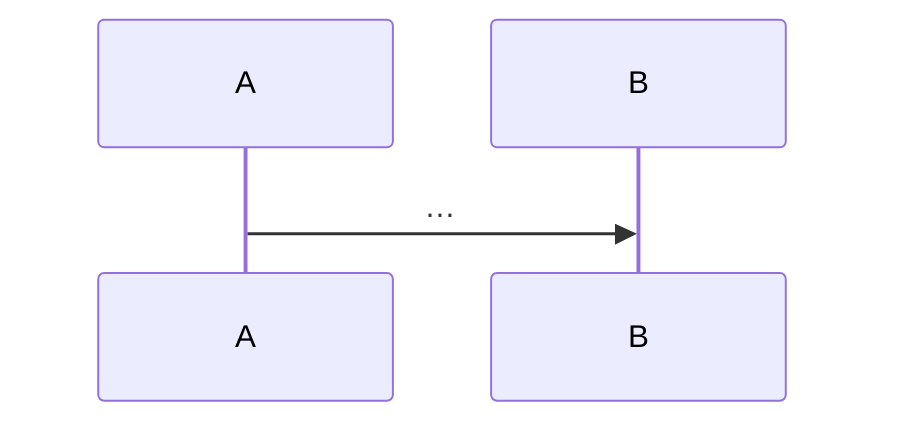

# <IDENTIFIANT> · <Nom de la fonction> — conception

<!-- Copier ce modèle dans docs/conception/<dossier du module>/<identifiant>-<mot>.md.
     Aucune ligne de code avant que la ligne « Validé » soit remplie par le chef de projet. -->

| | |
|---|---|
| Module | [<CODE>](../../plan/modules/<fichier>.md) · chantier ouvert le AAAA-MM-JJ |
| Branche | `<préfixe>/<identifiant>-<mot>` |
| Rédigé par | <agent ou personne>, le AAAA-MM-JJ |
| **Validé** | <!-- « par Claude20022002 le AAAA-MM-JJ » : rempli seulement après son accord --> en attente |

## 1. Objet et critère de « terminé »

<!-- Recopié du fichier du module, puis précisé : ce qui sera vrai à la fin, et comment on le vérifie. -->

## 2. Ce qui existe

<!-- Lu dans le code, avec les fichiers et les lignes. Ce qui est réutilisé, ce qui gêne. -->

## 3. Questions et réponses

| N° | Question | Proposition | Réponse du chef | Bloque |
|---|---|---|---|---|
| 1 | | | | |

## 4. Solution

<!-- Le principe en quelques phrases, puis au moins un diagramme Mermaid
     (séquence, composants, ou modèle de données). -->

## 5. Fichiers créés ou modifiés

| Fichier | Créé / modifié | Rôle | Taille visée |
|---|---|---|---|

## 6. Données et migration

<!-- Tables touchées et module propriétaire ; numéro de migration réservé dans docs/plan/suivi.md ;
     « étendre puis contracter » ; ce qui se passe sur une base qui a déjà des données. -->

## 7. Sécurité, isolation et exigences produit

<!-- Canaux d'isolation (I-1 à I-16) touchés ; droits par rôle ; EP-1 à EP-19 concernées. EP-18 : sans téléphone de l'élève, avec peu ou pas de réseau,
     avec un écran projeté ou du papier ; EP-19 : poids mesuré. Une fonction qui fait télécharger affiche le poids avant et reprend après coupure (N3). -->

## 7 bis. Ce que disent les études

<!-- Obligatoire depuis le 21 nov. : un plan sans cette section n'est pas validé.
     Le registre des études est docs/etude-marche/14-reprendre-et-depasser.md (§ 2 à § 5, et § 7 pour les reports).
     Citer chaque ligne qui touche la fonction (ex. M18, R9, N3, C5 de l'expertise du site), dire si le plan l'applique ou l'écarte, et pourquoi.
     Dire aussi à quel public la fonction sert d'abord : le supérieur (étape 3), ou un autre, et ce qui reste neutre pour la suite. -->

| Ligne | Étude | Appliquée ou écartée | Comment, ou pourquoi |
|---|---|---|---|

## 7 ter. EP-18 : tous les contextes

<!-- Ajoutée le 22 nov. (décision du chef, étude EP-18, § 9.2). Une ligne par contexte (étude EP-18, § 2).
     « Sans objet » se justifie en une phrase. Une fonction qui ne marche pas dans un contexte dit ce que
     fait l'utilisateur à la place. -->

| Contexte | Ce que fait la fonction | Preuve ou test |
|---|---|---|
| **A. Au moins un élève sans téléphone ni ordinateur** | il est servi sans appareil (l'enseignant saisit pour lui, ou c'est imprimé, projeté) ; sinon, ce qu'il fait à la place | |
| **B. Connexion lente (Slow 3G : 400 kbit/s, 400 ms) ou coupée** | le poids de l'écran, mesuré et écrit dans la PR (EP-19) ; ce qui se lit et ce qui s'écrit sans réseau, et ce qui arrive au retour du réseau ; pour un téléchargement : le poids affiché avant, et la reprise après coupure (N3) | |
| **C. Ce qu'a l'école : ordinateur et projecteur (C1), ou rien dans la salle (C2)** | ce qui se projette ; ce qui s'imprime ; ce qui se saisit après coup | |

Aucun pays supposé : aucune devise, aucun fuseau, aucun férié, aucun format de téléphone ni aucun outil de l'État écrit en dur. Ils viennent de la configuration de l'école.

## 8. Tests

<!-- Tests unitaires, d'intégration, parcours ; le test de régression de chaque correctif. -->

## 9. Étapes de livraison

1. Conception (ce document) et `suivi.md` à « en cours ».
2. …

## 10. Risques et retour arrière

## 11. Hors périmètre
